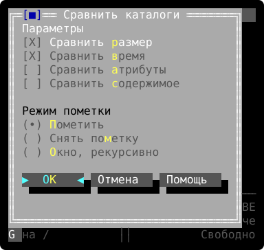
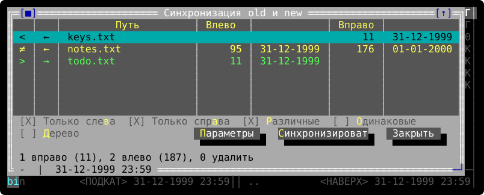
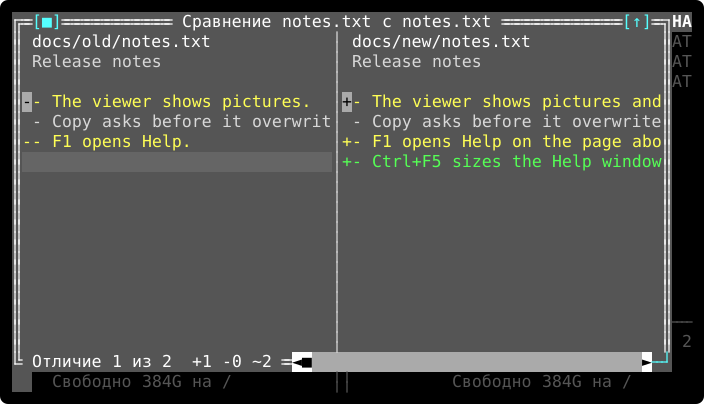

# Сравнение

## Сравнение каталогов

*Панель > Сравнить каталоги* сравнивает файлы двух панелей по имени.

- *Сравнить размер*, *Сравнить время*, *Сравнить атрибуты* и *Сравнить содержимое* выбирают, при чём два файла с
  одинаковым именем считаются одинаковыми. Только *Сравнить содержимое* читает файлы, и это занимает больше
  времени.
- *Пометить* помечает в каждой панели файлы, у которых нет пары в другой. Скопировав помеченные файлы на другую
  сторону, вы приведёте другой каталог в актуальное состояние.
- *Снять пометку* вместо этого снимает пометку с этих файлов.
- *Окно, рекурсивно* сравнивает каталоги со всем их содержимым и открывает окно синхронизации.

## Синхронизация

Окно синхронизации перечисляет все файлы, которые есть только на одной стороне или различаются; каталог левой
панели — слева. У каждой строки есть действие: копировать вправо, копировать влево, удалить или пропустить. Окно
предлагает одно из них, а меню *Синхронизация* меняет его для строки под курсором или сразу для всех строк.

- *Синхронизировать*, `F5`, выполняет действия, предварительно спросив.
- *Сравнить файлы*, `Enter` или `F3`, показывает два файла строки рядом.
- *Сравнить снова*, `Ctrl+R`, перечитывает оба каталога.
- *Показать только слева*, *Показать только справа*, *Показать различные* и *Показать одинаковые* выбирают, какие
  строки показывать.
- *Дерево*, `Ctrl+T`, показывает строки деревом каталогов.
- *Параметры* задают, как сравниваются файлы, и [маску файлов](panels.md#маски-файлов), отбирающую рассматриваемые
  файлы.

### Параметры

*Параметры* в окне синхронизации задают, что и как сравнивается. *OK* снова сравнивает оба каталога.

- *Маска файлов* выбирает рассматриваемые файлы; пустая сравнивает всё. Шаблоны разделяются `;`. `-` перед
  шаблоном исключает его файлы, а `/` после шаблона обозначает каталоги: `*.py;-.git/`.
- *Время совпадает* задаёт, насколько близки должны быть два значения времени: *Точно, до секунды*, *В пределах 2
  секунд (FAT)* или *В пределах минуты (FTP)*.
- *Или разница ровно в час* считает одинаковыми и значения времени, отличающиеся на час, — так переход на летнее
  время сказывается на диске FAT.
- *Асимметрично: правая сторона — копия левой* предлагает удалить то, что есть только справа, и скопировать вправо
  каждый различающийся файл, какой бы из них ни был новее.

## Сравнение файлов

*Файл > Сравнить файлы* показывает два файла рядом с отмеченными различиями. Берутся два помеченных файла
активной панели. Если ничего не помечено, берутся файл под курсором и файл с тем же именем в другой панели, а если
такого нет — файл под курсором другой панели.

