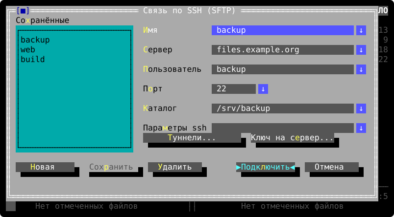
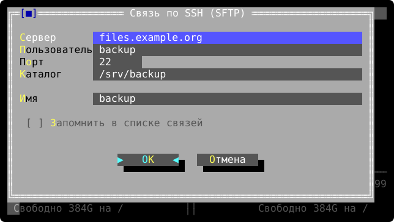
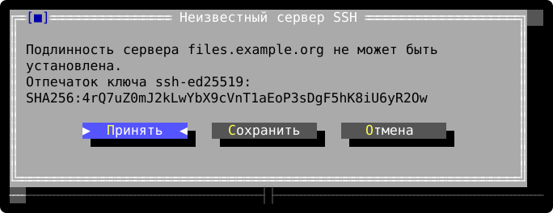
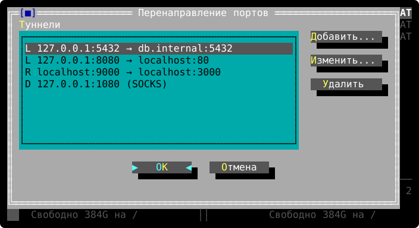
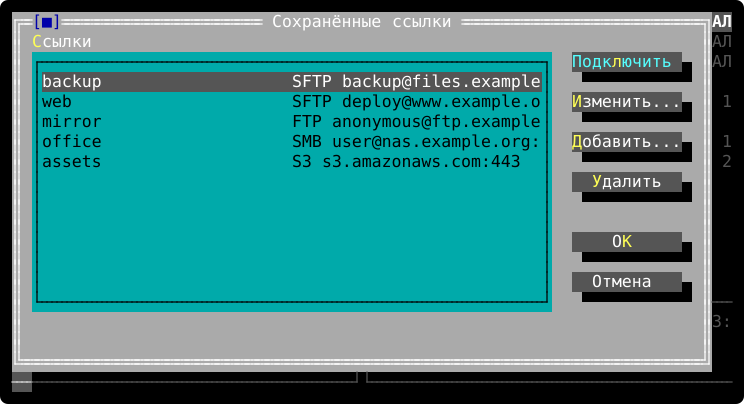

# Соединения

Как поставить панель на сервер и как хранятся соединения, которыми вы пользуетесь. Что представляет собой каждый
вид мест и какие ещё есть способы до них добраться, описано в разделе [Места помимо диска](drives.md).

## Менеджер связей

Каждый пункт *Утилиты > Связи*, например *SSH (SFTP)* (`Alt+F11`), открывает окно, где слева — соединения,
сохранённые для этого протокола, а справа — строки одного соединения.

- Окно открывается с пустыми строками. Заполните их и нажмите *Подключить* для соединения, которое не
  сохраняется.
- Выберите соединение в списке *Сохранённые*, чтобы перенести его в строки. Двойной щелчок подключается к нему.
- *Новая* создаёт сохраняемое соединение под именем, которое можно переписать. *Сохранить* сохраняет изменения;
  изменённое соединение помечено `*`, и при уходе с него вас спросят, сохранить ли его. *Удалить* удаляет
  соединение.
- *Подключить* направляет туда активную панель. Из *Утилиты > Удалённая оболочка* вместо этого открывается
  оболочка в окне.

Строки — это строки [соединения](#соединение). Каждая помнит, что в ней было раньше; `Down` в строке открывает
её историю.

У менеджера SSH есть ещё три:

- *Параметры ssh* передаются `ssh` при открытии удалённой оболочки.
- *Туннели* задаёт [перенаправления портов](#перенаправление-портов) соединения.
- *Ключ на сервер* кладёт один из ваших открытых ключей на сервер, чтобы последующим соединениям не нужен был
  пароль.

*Конфигурация* в менеджере rclone запускает `rclone config` для настройки хранилищ.

## Соединение

| Строка | Что это |
|---|---|
| *Сервер* | Имя или адрес сервера. Для SSH подходит имя `Host` из `~/.ssh/config`, и то, что сказано в этом файле, заполняет оставленные пустыми пользователя и порт |
| *Пользователь* | Пользователь, от имени которого подключаться |
| *Порт* | Порт, если он не обычный для протокола |
| *Каталог* | Где панель начинает на сервере |
| *Имя* | Имя, под которым сохраняется соединение |

Строки немного различаются между протоколами: у соединения FTP есть *Шифровать (TLS)*, что делает его FTPS, а у
места GVfs/KIO — только *Имя* и *Адрес (URI)*.

*Запомнить в списке связей* сохраняет соединение под его именем, чтобы снова подключаться в один шаг.

## Пароли и парольные фразы

Пароль сервера или парольная фраза закрытого ключа запрашиваются, когда они нужны соединению. *Сохранить в связке
ключей* запоминает их в связке ключей рабочего стола, чтобы больше не спрашивать. Этот флажок показан только там,
где есть связка ключей, в которой их можно хранить.

## Неизвестный ключ сервера

При первом подключении к серверу SSH его ключа ещё нет в `~/.ssh/known_hosts`, и вас спрашивают, продолжать ли,
как спрашивает `ssh`.

- *Принять* доверяет ключу только для этого соединения.
- *Сохранить* также записывает его в `~/.ssh/known_hosts`, чтобы больше не спрашивать.
- *Отмена* не подключается.

Прежде чем принять ключ, сравните показанный отпечаток с тем, что вы получили от администратора сервера.

## Перенаправление портов

*Туннели* в менеджере SSH перечисляет перенаправления портов соединения. *Добавить*, *Изменить* и *Удалить*
меняют список, который сохраняется вместе с соединением, когда вы его сохраняете.

| Тип | Что делает |
|---|---|
| *Локальное (-L)* | Порт на этой машине ведёт к назначению, доступному с сервера |
| *Удалённое (-R)* | Порт на сервере ведёт к назначению, доступному с этой машины |
| *Динамическое, SOCKS (-D)* | Порт на этой машине — прокси SOCKS через сервер |

*Адрес прослушивания* и *Порт прослушивания* — сторона, которая ждёт подключений, а *Сервер назначения* и *Порт
назначения* — куда они направляются. У динамического перенаправления назначения нет.

## Сохранённые связи

*Утилиты > Сохранённые ссылки* перечисляет в одном окне сохранённые соединения всех протоколов. *Подключить*
открывает соединение под курсором, *Изменить* меняет его, *Добавить* создаёт новое, а *Удалить* удаляет. Изменения
сохраняются, когда вы выходите по *OK*.

*Утилиты > Разорвать связь*, `Alt+H`, закрывает соединение; панель, которая его показывала, возвращается на диск.
