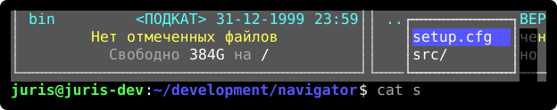
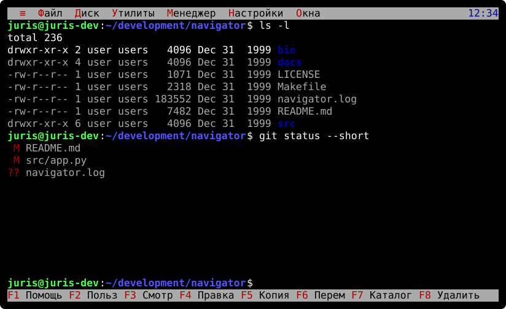
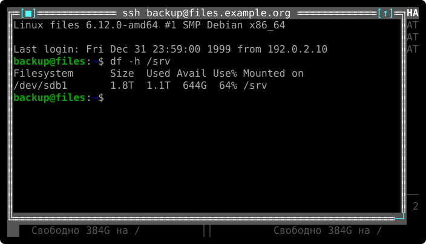
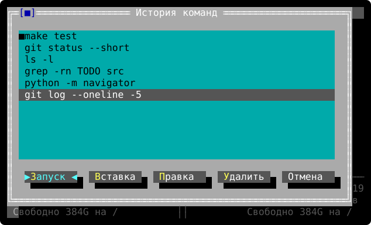

# Командная строка и консоль

Под панелями находится командная строка, а за окнами — консоль: терминал, в котором работает ваша оболочка.

## Командная строка

Всё, что вы набираете, пока клавиатура у панели, попадает в командную строку. `Enter` выполняет её в оболочке, в
каталоге активной панели, а вывод появляется в консоли.

| Клавиша | Что делает |
|---|---|
| `Enter` | Выполняет команду |
| `Ctrl+Enter` | Вставляет в строку имя файла под курсором |
| `Ctrl+E`, `Ctrl+X` | Вызывают предыдущую и следующую команду |
| `Tab` | Дополняет набираемое слово, когда в строке есть текст |
| `Esc` | Очищает строку |

Пока в строке есть текст, `Left`, `Right`, `Home` и `End` редактируют её. `Enter` на программе в панели запускает
её.

После команды панели перечитывают свои каталоги, а активная панель следует за оболочкой, если команда сменила
каталог.

## Консоль

`Ctrl+O` прячет окна и показывает консоль; повторное `Ctrl+O` возвращает их. Пока окна спрятаны, клавиши идут
оболочке или запущенной в ней программе.

`Shift+PgUp` и `Shift+PgDn` прокручивают назад то, что показывала консоль, а `Shift+Up` и `Shift+Down`
прокручивают на строку.

Пока в консоли работает программа, она получает все клавиши, включая `F1` и `F10`; сначала выйдите из программы
её собственным способом.

## Команда в окне

Команду можно выполнить не в консоли, а в отдельном окне рядом с панелями. Начните командную строку с `&` или
нажмите `Shift+Enter` вместо `Enter`.

Программа в окне получает все клавиши, кроме тех, что выводят вперёд другое окно. Когда она завершается, окно
сохраняет её вывод, а его заголовок сообщает, как она завершилась; `Esc` или `Enter` закрывает окно. Если закрыть
окно, пока программа работает, программа завершится.

*Утилиты > Удалённая оболочка* открывает в таком окне оболочку на сервере, в контейнере или на устройстве.

## Выполнение команды

*Файл > Выполнить команду ОС* спрашивает команду в строке, у которой общая история с командной строкой.

- *В окне* выполняет её в отдельном окне, а не в консоли.
- *Развёрнуто* открывает это окно на весь рабочий стол.
- *Модальное* держит клавиатуру в этом окне, пока оно не закроется.

## История команд

`Alt+F8`, или *Утилиты > История команд*, перечисляет набранные вами команды, самые новые в конце.

- *Запуск*, или `Enter`, выполняет команду под курсором.
- *Вставка* помещает её в командную строку, не выполняя.
- *Правка* меняет её в отдельном окне; изменённая команда становится самой новой.
- *Удалить*, или `Del`, убирает её из истории.

*Утилиты > Нечёткий поиск в истории*, `Alt+Shift+F8`, ищет с помощью `fzf` команды, набранные здесь и в оболочке.

## Истории файлов

`Alt+PgDn` перечисляет ранее просмотренные файлы, а `Alt+PgUp` — ранее редактированные; в меню *Утилиты* это
*История просмотра* и *История редактирования*. *Открыть* снова открывает файл под курсором, а *Удалить запись*
убирает его из списка.
