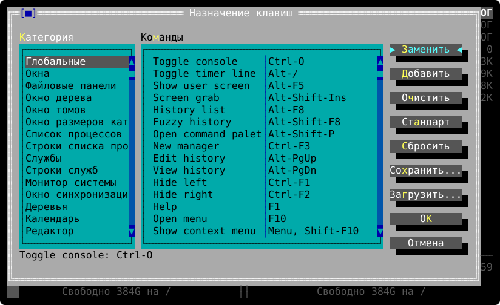
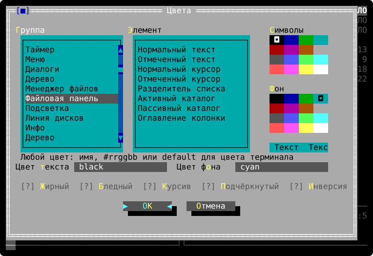

# Клавиши и цвета

## Назначение клавиш

*Настройки > Конфигурация > Назначение клавиш* меняет, какая клавиша что делает. Клавиши перечислены по разделам,
по одному на каждое место, где они работают: везде, файловый менеджер, редактор, просмотрщик, диалоги и так далее.

Выберите команду и нажмите клавишу, которую хотите для неё назначить.

*Сохранить* записывает весь набор в файл, а *Загрузить* читает его из файла. С Navigator поставляются четыре
набора: его собственный по умолчанию и наборы по образцу WordStar, DOS Navigator 1.51 и Emacs.

Назначения хранятся в `keybindings.ini` в каталоге настроек. Клавиши, перемещающие курсор в списках и в тексте,
изменить нельзя.

## Цвета

*Настройки > Цвета* меняет цвета используемой темы.

- *Группа* и *Элемент* выбирают, что раскрашивать.
- *Символы* и *Фон* выбирают из шестнадцати цветов; строки рядом с ними принимают любой цвет — названием или в
  виде `#rrggbb`.
- Пять флажков задают жирный, бледный, курсив, подчёркнутый и инверсию. Флажок, в котором стоит `?`, оставляет
  атрибут таким, каким элемент его наследует.

Экран меняется по мере того, как вы что-то меняете. *OK* сохраняет изменения для этой темы; *Отмена* возвращает
всё как было.

*Сохранить палитру* сохраняет цвета как собственную тему, которую потом находят `--theme` и *Загрузить палитру*.
*Загрузить палитру* берёт цвета другой темы.

Чтобы использовать другую тему, запустите Navigator с `--theme NAME`; `--list-themes` перечисляет их.
