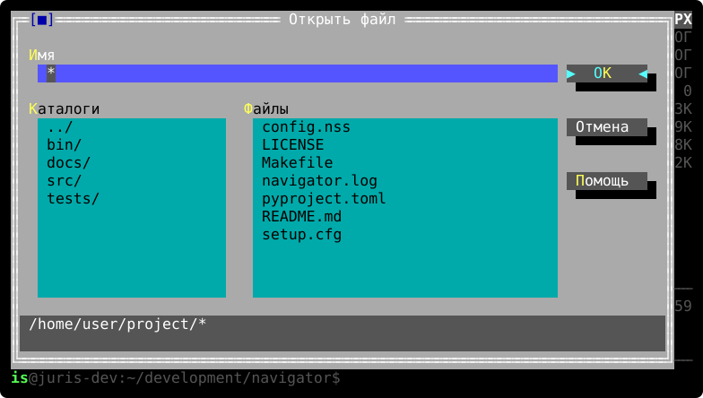

# Диалоговые окна

Диалоговое окно удерживает клавиатуру, пока вы его не закроете.

## Клавиши в диалоговом окне

| Клавиша | Что она делает |
|---|---|
| `Tab`, `Shift+Tab` | Перейти к следующему или предыдущему элементу |
| `Alt` и выделенная буква | Перейти к элементу с этой буквой |
| `Enter` | Нажать кнопку по умолчанию, отмеченную стрелками |
| `Esc` | Закрыть окно, ничего не делая |
| `Space` | Отметить флажок или выбрать переключатель |
| `Down` на строке со значком `↓` рядом | Открыть историю строки |
| `F1` | Показать справку по этому окну |

В списке истории `Enter` берёт запись, а `Del` забывает её.

## Выбор файла

Несколько команд запрашивают файл в одном и том же окне: имя в строке, а под ней файлы и каталоги просматриваемого
места.

- *Имя* — имя файла. Можно ввести полный путь. Имя с `*` или `?` или имя каталога показывает эти файлы вместо того,
  чтобы выбрать один.
- *Файлы* перечисляет подходящие файлы. Если набирать там буквы, находится имя, которое с них начинается.
- *Каталоги* перечисляет каталоги; `Enter` на одном из них входит в него.
- Область внизу показывает путь, а также размер и дату файла под курсором.
- *OK* или `Enter` на файле выбирает его.

`Left` и `Right` перемещают между списками и кнопками.
