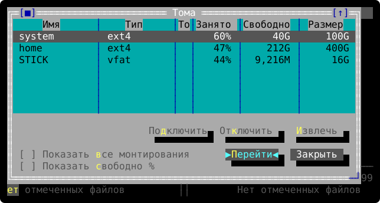
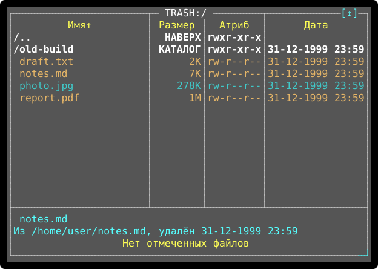

# Места помимо диска

Панель может показывать не только каталоги вашего диска. Где бы она ни была, файлы просматриваются,
редактируются, копируются и удаляются одинаково.

## Архивы

`Enter` на архиве, например на файле zip или tar, входит в него, как в каталог. Копируйте файлы из него или в
него по `F5`. О создании и извлечении рассказано в разделе [Архивы](archives.md).

## Серверы, контейнеры и устройства

*Утилиты > Связи* открывает панель на другой машине или в другой службе. Каждый пункт хранит список сделанных вами
соединений, чтобы подключаться снова; его окно описано в разделе [Соединения](connections.md).

| Пункт | Куда ведёт |
|---|---|
| *SSH (SFTP)*, `Alt+F11` | На сервер по SSH |
| *FTP* | На сервер FTP или FTPS |
| *SMB* | В общую папку Windows |
| *S3* | В корзину S3 или совместимой службы |
| *Контейнер Docker*, *Контейнер Podman* | К файлам внутри работающего контейнера |
| *Устройство Android* | На телефон или планшет через `adb` |
| *Хранилище rclone* | В любое хранилище, настроенное в `rclone`, например Google Drive или Dropbox |
| *Связь по GVfs/KIO* | Куда может дотянуться рабочий стол, например на телефон по MTP или на сервер WebDAV |

Пункт показан серым, если нужная ему программа не установлена; его подсказка называет программу.

Можно также набрать адрес там, где спрашивается каталог, например `sftp://user@host/dir` или
`smb://host/share`.

*Утилиты > Удалённая оболочка* открывает оболочку на сервере, в контейнере или на устройстве. *Утилиты > Разорвать
связь*, `Alt+H`, закрывает соединение; панель, которая его показывала, возвращается на диск.

## Тома

*Диск > Тома* перечисляет диски и съёмные носители, а также подключает, отключает и извлекает их.

### Образы дисков

`Enter` на образе диска — файле `.iso` или `.img`, — или *Диск > Подключить образ* с курсором на нём подключает
его только для чтения и открывает в панели. *Диск > Отключить образ* в образе или на нём снова отключает его и
возвращает панели, которые были внутри, к файлу образа. Для этого нужен udisks2, который работает на большинстве
рабочих столов; *ENTER подключает образы дисков* на странице [Файловые панели](settings.md#файловые-панели) настроек
отключает участие `Enter`.

## Корзина

`F8` перемещает файлы на диске в корзину вместо удаления, когда на странице [Файловые
панели](settings.md#файловые-панели) настроек отмечено *F8 перемещает в корзину*. Тогда в окне
[удаления](file-operations.md#удаление) отмечено *Переместить в корзину*; снимите отметку, чтобы удалить файлы
насовсем. [Отмена](file-operations.md#отмена), `Ctrl+Z`, возвращает последнее перемещение в корзину.

*Диск > Корзина*, или двойной щелчок по значку корзины, показывает файлы в корзине в активной панели. Строка под
панелью сообщает, откуда взят файл под курсором и когда он удалён.

- *Файл > Восстановить из корзины* возвращает выбранные файлы туда, откуда они взяты.
- `F8` там удаляет их насовсем.
- `F5` копирует их наружу, как из любого каталога.

*Диск > Очистить корзину* насовсем удаляет всё, что в корзине, предварительно спросив.

## Закладки

`Alt+F1` и `Alt+F2` открывают список каталогов-закладок для левой и правой панели, а `Alt+C` — для активной.
Клавиши списка описаны в разделе [Закладки](bookmarks.md).
