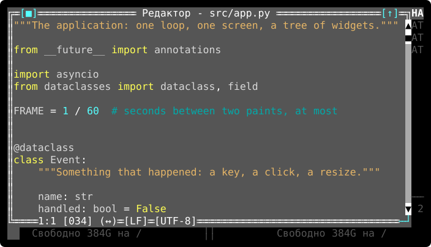
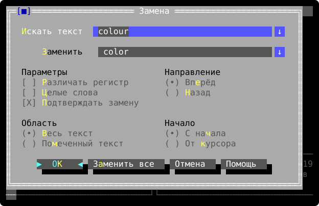
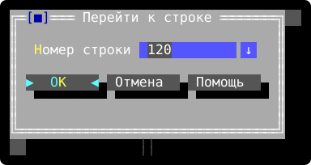
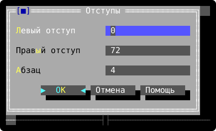

# Редактор

`F4` открывает файл под курсором в редакторе. Все команды есть и в меню *Редактор*, которое появляется в строке
меню, пока открыт редактор.



## Клавиши

| Клавиша | Что делает |
|---|---|
| `F2` | Сохраняет |
| `Shift+F2` | Сохраняет под другим именем |
| `Ctrl+F4` | Закрывает редактор; если текст изменён, сначала спрашивает |
| `Alt+Backspace` | Отменяет |
| `Alt+Shift+Backspace` | Возвращает отменённое |
| `Ctrl+Y` | Удаляет строку |
| `Ctrl+Backspace` | Удаляет слово слева |
| `Ctrl+N` | Вставляет строку |
| `F7`, `Ctrl+F7` | [Поиск и замена](#поиск-и-замена) |
| `Alt+G` | [Переход к строке](#переход-к-строке) |
| `Alt+PgUp` | Показывает список ранее редактированных файлов |

## Открытие файла

| Клавиша или пункт | Что открывает |
|---|---|
| `F4` | Файл под курсором |
| `Alt+F4`, `Ctrl+K`, *Файл > Правка > Встроенный редактор* | Файл под курсором в другом редакторе: см. ниже |
| `Shift+F4`, *Файл > Правка > Новый файл* | Файл, который вы назовёте в [окне выбора файла](dialogs.md#выбор-файла). Файл с ещё не существующим именем создаётся при сохранении |
| *Файл > Правка > Открыть...* | Файл, выбранный в окне выбора файла, без файлового менеджера. Файл с ещё не существующим именем создаётся при сохранении |
| `Alt+PgUp` | Файл из списка ранее редактированных |

`F4` использует редактор Navigator, а *Встроенный редактор* (пункт альтернативного редактора) — другую программу:
ту, что для этого файла указана в `editors.ini` ([связи файлов](user-menu.md#связи-файлов)), а если такой нет —
список установленных терминальных редакторов, таких как `vim` или `nano`; выбранный запускается в отдельном окне.
Если на странице [Система](settings.md#система) настроек снят флажок *Встроенный редактор*, клавиши меняются
ролями: `F4` запускает программу из `editors.ini`, а при её отсутствии — `$EDITOR`, а альтернативный пункт
использует редактор Navigator. `Ctrl+K` нужна потому, что многие оконные менеджеры закрывают терминал по
`Alt+F4`.

`F4` на каталоге открывает его [атрибуты](file-operations.md#атрибуты-файлов).

Ранее редактированный файл открывается там, где вы его оставили.

## Блоки и буфер обмена

Чтобы выделить блок, двигайте курсор с нажатой `Shift` или протащите мышью.

| Клавиша | Что делает |
|---|---|
| `Ctrl+Ins`, `Ctrl+C` | Копирует блок |
| `Shift+Del`, `Ctrl+X` | Вырезает блок |
| `Shift+Ins`, `Ctrl+V` | Вставляет |
| `Ctrl+Del` | Удаляет блок |
| `Alt+Shift+I`, `Alt+Shift+O` | Сдвигает блок вправо и влево |
| `Alt+Shift+U`, `Alt+Shift+L` | Переводит блок в прописные, в строчные буквы |
| `Alt+T` | Сортирует строки блока |
| `Alt+H` | Скрывает или показывает блок |

В разделе [Копирование и вставка](clipboard.md) объясняется, какие клавиши копирования и вставки работают в каком
терминале.

Подменю *Настройки* переключает поведение этого окна, например автоотступ, номера строк и подсветку синтаксиса. С
чем начинает новый редактор, задаётся на странице [Ред/Пр](settings.md#редакторпросмотр) настроек.

## Поиск и замена

`F7` ищет текст, а `Ctrl+F7` заменяет его. `Shift+F7` повторяет последний поиск, вместе с заменой.

Окно открывается с догадкой о том, что вы ищете: с выделенным текстом, если он в одной строке, иначе со словом под
курсором.



- *Искать текст* — что искать. `Down` в этой строке открывает историю прежних поисков.
- *Заменить* при замене — что подставить вместо найденного.

### Параметры

- *Различать регистр* отличает заглавные буквы от строчных.
- *Целые слова* пропускает совпадение, которое является частью более длинного слова.
- *Подтверждать замену* спрашивает перед каждой заменой: *Да*, *Нет*, *Все* — эту и все последующие, или *Отмена*.

### Где искать

- *Направление*: *Вперёд* — к концу текста, *Назад* — к его началу.
- *Область*: *Весь текст* ищет по всему тексту, *Помеченный текст* — только в выделенном блоке.
- *Начало*: *С начала* начинает с начала области, *От курсора* — от курсора.

### Замена

*OK* заменяет первое совпадение. *Заменить все* заменяет все и сообщает, сколько замен сделано. Каждую замену
можно отменить отдельно.

### Панель поиска

`Ctrl+F` и `Ctrl+R` открывают вместо окна панель внутри окна редактора. Она ищет по мере набора, подсвечивает все
совпадения на экране и умеет искать по регулярному выражению.

## Переход к строке



`Alt+G` спрашивает номер строки и ставит курсор на эту строку. Строки считаются с 1. Окно открывается с номером,
набранным в прошлый раз.

## Отступы



*Редактор > Абзац > Отступы* задаёт три числа, между которыми форматируются абзацы. Они действуют только в этом
окне редактора; начальные значения берутся из установок редактора.

- *Левый отступ* — колонка, с которой начинается каждая строка.
- *Правый отступ* — последняя колонка, до которой может доходить строка.
- *Абзац* — колонка, с которой начинается первая строка абзаца.

Чтобы отформатировать абзац, выделите его как блок и нажмите `Alt+J`, чтобы выровнять по ширине, `Alt+L` — по
левому краю, `Alt+R` — по правому или `Alt+C` — по центру. Весь блок считается одним абзацем.

## Подсветка синтаксиса

Редактор и программа просмотра раскрашивают текст программы, веб-страницы, файла конфигурации и многих других
по тому, чем является каждая часть. Какую раскраску получит файл, решает его имя в `highlight.ini`, а для
сценария без известного расширения — первая строка, например `#!/bin/sh`: *Настройки > Файл раскраски
редактора* открывает этот файл в редакторе.

```ini
[*.conf]
lexer = ini

[*.txt]
lexer = none
autowrap = on
right_margin = 72
```

- Каждая секция — это [маска файлов](panels.md#маски-файлов). Язык выбирает первая секция, которая подходит к файлу
  и указывает `lexer`; файл, не подошедший ни к одной секции, Pygments угадывает сам.
- `lexer` называет язык так, как его называет Pygments (`python3 -m pygments -L lexers` перечисляет их). `none`
  ничего не раскрашивает; `auto` даёт Pygments угадать язык по имени и содержимому.
- Секция может задать и параметры редактора для этих файлов, под теми же именами, что в секции `[editor]` файла
  `navigator.ini`: `auto_indent`, `insert_tabs`, `line_numbers`, `soft_wrap`, `autowrap`, `right_margin`,
  `line_ending` и другие. Каждый берётся из первой подходящей секции, которая его задаёт. Все они перечислены в
  комментариях самого файла. Ранее редактированный файл сохраняет параметры, с которыми его оставили.

Для одного окна *Редактор > Тип файла* (`Ctrl+Shift+H`) выбирает другой язык, а *Редактор > Настройки >
Подсветка синтаксиса* выключает и включает раскраску. Цвета берутся из темы.
