# Операции с файлами

Копирование, перемещение, ссылки, разбиение и кодирование работают с выбранным: с отмеченными файлами активной
панели или, если ничего не отмечено, с файлом под курсором. Большинство этих команд предлагают в качестве места для
результата каталог другой панели.

## Копирование и перемещение

`F5` копирует выбранное, а `F6` переименовывает или перемещает его. Обе клавиши открывают одно и то же окно: строку
с местом назначения, режимы копирования и четыре параметра.

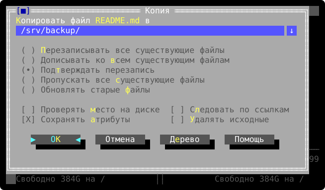

### Куда

То, что вы вводите в строке, определяет, что произойдёт:

| Вы вводите | Что это значит |
|---|---|
| Существующий каталог или имя, оканчивающееся на `/` | Файлы попадут в этот каталог |
| Имя с `*` или `?` | Каждый файл на новом месте переименовывается по этой маске |
| Любое другое имя, когда выбран один файл | Новое имя файла |
| Любое другое имя, когда выбрано несколько файлов | Каталог, который будет создан и в который будут скопированы файлы |

Маска применяется к имени и к расширению по отдельности: `*.bak` даёт каждому файлу расширение `bak`. Маска без
точки охватывает имя целиком, поэтому `*` оставляет каждое имя как есть.

`F10` или кнопка *Дерево* позволяет выбрать каталог в дереве. `Down` в строке открывает историю мест, куда вы
копировали раньше.

### Что делать с уже существующими файлами

| Режим | Что он делает |
|---|---|
| *Перезаписывать все существующие файлы* | Заменяет их, ничего не спрашивая |
| *Дописывать ко всем существующим файлам* | Добавляет каждый файл в конец уже существующего |
| *Подтверждать перезапись* | Спрашивает о каждом. Ответ можно применить ко всем остальным |
| *Пропускать все существующие файлы* | Не трогает их и копирует остальные |
| *Обновлять старые файлы* | Заменяет файл, только если копируемый новее |

Когда Navigator спрашивает, кнопка *Имя* позволяет вместо этого дать копии другое имя.

### Параметры

- *Проверять место на диске* — остановиться перед копированием, если в месте назначения слишком мало места.
- *Сохранять атрибуты* — сохранять у копий права, владельца и время. О том, что сохранить не удалось, сообщается;
  само копирование при этом всё равно выполняется.
- *Следовать по ссылкам* — копировать то, на что указывает ссылка, а не саму ссылку.
- *Удалять исходные* — удалять оригиналы после копирования, что превращает копирование в перемещение.

Режим и параметры запоминаются до выхода из Navigator.

### Во время работы

Окно хода операции показывает скорость и оставшееся время. *В фоне* отправляет копирование в фон, чтобы вы могли
продолжать работу: в строке меню появляется процент выполнения, а щелчок по нему возвращает окно. Если у
копирования в фоне возникает вопрос, рядом с процентом появляется `?`, и операция ждёт вас. *Стоп* спрашивает,
прежде чем прервать копирование.

Со скопированных файлов отметка снимается; пропущенные файлы остаются отмеченными.

`Ctrl+Z` отменяет копирование; см. [Отмена](#отмена).

## Создание каталога

`F7` создаёт каталог в активной панели. Введите путь вроде `a/b/c`, чтобы создать все каталоги на пути, или
несколько имён через `;`, чтобы создать несколько каталогов.

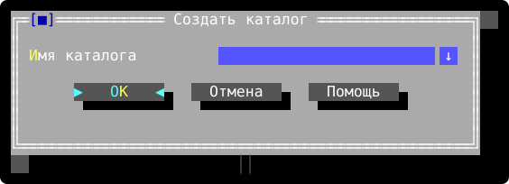

## Быстрое переименование

`Shift+F6` или *Файл > Инструменты переименования > Быстро переименовать* запрашивает в небольшом окне новое имя
файла под курсором. Файл переименовывается на месте; чтобы переместить файл или переименовать несколько файлов по
маске, используйте `F6`.

## Групповое переименование

`Alt+A` или *Файл > Инструменты переименования > Групповое переименование* переименовывает отмеченные файлы по
одному шаблону. Список в нижней половине окна показывает каждое новое имя до того, как что-либо будет сделано, а
строка под ним сообщает, что не так, если имя использовать нельзя: пустое имя, имя с `/`, одно имя для двух файлов
или уже занятое имя.

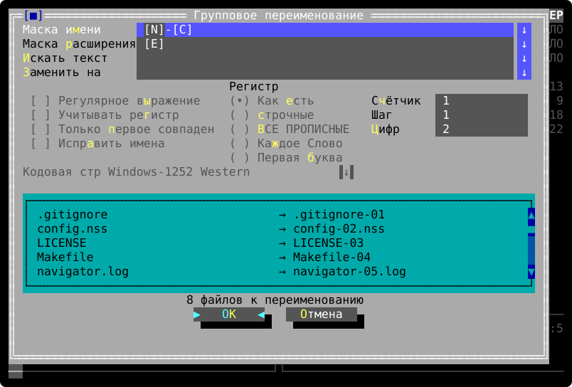

Новое имя строится в три шага.

**Маски.** *Маска имени* строит имя, а *Маска расширения* — расширение. Текст берётся как есть, а метка в
квадратных скобках заменяется:

| Метка | Что означает |
|---|---|
| `[N]` | Старое имя без расширения |
| `[N3]` | Его третий символ |
| `[N2-5]` | Его символы со второго по пятый |
| `[N2-]` | Начиная со второго символа |
| `[N2,4]` | Четыре символа начиная со второго |
| `[N-3-]` | Последние три символа |
| `[E]` | Старое расширение, вырезаемое теми же способами |
| `[P]` | Имя каталога, в котором лежит файл, вырезаемое теми же способами |
| `[C]` | Счётчик по полям *Счётчик*, *Шаг* и *Цифр* |
| `[C10+5:3]` | Счётчик, который начинается с 10, растёт с шагом 5 и имеет три цифры: 010, 015, 020 |
| `[Y]` `[M]` `[D]` `[h]` `[m]` `[s]` | Дата и время изменения файла |
| `[[]` `[]]` | Символы `[` и `]` |

Пустая маска расширения оставляет имя без точки.

**Поиск и замена.** *Искать текст* и *Заменить на* работают со всем именем, построенным масками.

- *Регулярное выражение* — искомое понимается как регулярное выражение; тогда в замене можно использовать `\1` для
  группы.
- *Учитывать регистр* — отличать прописные буквы от строчных.
- *Только первое совпадение* — заменять в каждом имени одно совпадение, а не все.

**Регистр.** *Как есть*, *строчные*, *ВСЕ ПРОПИСНЫЕ*, *Каждое Слово* или *Первая буква*.

*Исправить имена* исправляет имена до трёх шагов: байты, не являющиеся UTF-8, читаются в кодировке, выбранной в поле
*Кодовая страница*, управляющие символы становятся `_`, а имена в одном каталоге, различающиеся только регистром,
нумеруются.

Файл, имя которого получается прежним, не трогается. Имена, которые файлы меняют между собой, `a` на `b` и `b` на
`a`, переименовываются правильно.

### Имена, которые нужно исправить

*Файл > Инструменты переименования > Пометить плохие имена* отмечает в панели каждый файл, имя которого изменил бы
режим *Исправить имена*: имя, не являющееся корректным UTF-8, имя в разложенной форме Unicode, имя с управляющим
символом и имена, отличающиеся от другого только регистром. Затем `Alt+A` с включённым *Исправить имена*
переименовывает их.

## Удаление

`F8` или `Del` при пустой командной строке удаляет выбранное, предварительно спросив. `Shift+F8`, `Shift+Del` или
*Файл > Удалить один файл* удаляет файл под курсором, что бы ни было отмечено.

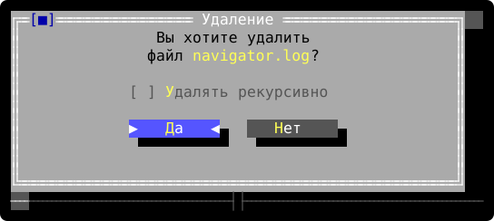

- *Удалять рекурсивно* удаляет каталоги со всем содержимым, не спрашивая о каждом.
- *Переместить в корзину* показывается, когда используется [корзина](drives.md#корзина). Если этот флажок снят,
  файлы удаляются насовсем.

Без *Удалять рекурсивно* Navigator спрашивает о непустом каталоге и о файлах, недоступных вам для записи; на каждый
вопрос можно ответить сразу за все остальные. Какие вопросы задаются вообще, настраивается на странице
[Подтверждения](settings.md#подтверждения) в настройках.

Долгое удаление можно отправить в фон, как и копирование.

## Отмена

`Ctrl+Z` или *Файл > Отменить операцию* отменяет последнюю операцию с файлами, а повторное нажатие — предыдущую, и
так до пятидесяти. Сначала Navigator говорит, что собирается сделать, и спрашивает.

| Операция | Что делает отмена |
|---|---|
| Копирование, `F5` или вставка | Убирает то, что создало копирование, но только файлы, которые с тех пор не менялись: в корзину на диске, насовсем в других местах |
| Перемещение, `F6` или вырезание и вставка | Перемещает файлы обратно |
| Переименование, `F6`, `Alt+F6`, `Shift+F6` или `Alt+A` | Возвращает старые имена |
| Удаление в [корзину](drives.md#корзина) | Восстанавливает файлы из корзины |
| Новый каталог от `F7` | Удаляет его, если он всё ещё пуст |

Файл, который заменило копирование или перемещение, утрачен насовсем, и в вопросе говорится, сколько таких файлов
было. Нельзя отменить удаление насовсем, изменение атрибутов и создание ссылок, а также копирование или перемещение
в архив или из архива. Список операций хранится до выхода из Navigator и общий для всех окон файлового менеджера.
Пока в командной строке есть текст, `Ctrl+Z` достаётся командной строке.

## Атрибуты файлов

`Alt+E` изменяет атрибуты выбранного. Применяется только то, что вы изменили, поэтому файлы, различающиеся в
остальном, сохраняют свои различия. *Рекурсия* применяет изменение и ко всему содержимому каталогов.

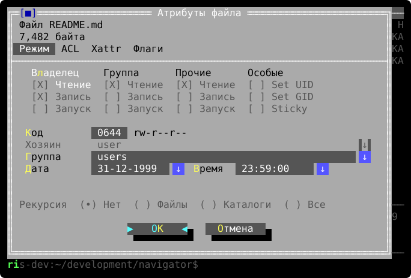

- *Режим* содержит права: сетку чтения, записи и выполнения для владельца, группы и прочих, то же самое в виде
  восьмеричного числа, владельца и группу, а также дату и время. В сетке `R`, `W` и `X` отмечают целую строку.
- *ACL* перечисляет записи управления доступом сверх режима, а также добавляет, изменяет и удаляет их.
- *Xattr* перечисляет расширенные атрибуты.
- *Флаги* содержит флаги файловой системы, например «неизменяемый» и «только для добавления».

Поле, в котором стоит `?`, означает, что файлы здесь различаются; не трогайте его, чтобы каждый файл остался как
есть.

### Записи ACL

*Добавить* и *Правка* на странице *ACL* открывают одну запись. *Тип* говорит, называет ли она пользователя или
группу, *Имя* выбирает, кого именно, а *Права* — это *Чтение*, *Запись* и *Запуск*. *По умолчанию, наследуется
новыми файлами* делает её записью каталога по умолчанию: то, что создаётся внутри каталога, наследует её.

### Расширенные атрибуты

*Добавить* и *Правка* на странице *Xattr* открывают один атрибут: его *Имя* и *Значение*. Значение — это текст,
или `0x` и шестнадцатеричные цифры, или `0s` и base64. Значение в кавычках остаётся текстом.

## Ссылки

`Shift+F5` создаёт ссылки на выбранное в указанном вами каталоге.

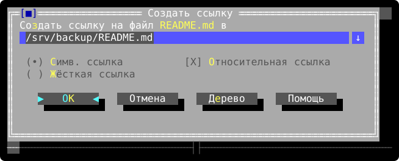

- *Симв. ссылка* создаёт маленький файл, хранящий путь к оригиналу. Она может указывать на каталог и на другой
  диск.
- *Жёсткая ссылка* даёт файлу второе имя. Она работает только для файлов и только в пределах одной файловой
  системы.
- *Относительная ссылка* записывает путь относительно ссылки, так что ссылку и оригинал можно перемещать вместе.
  Относится только к символическим ссылкам.

В *Файл > Ссылки на файлы* есть и другое: изменение цели ссылки, превращение ссылок в относительные или абсолютные,
отметка битых ссылок и показ всех имён файла с жёсткими ссылками.

### Изменение цели ссылок

*Файл > Ссылки на файлы > Изменить цель ссылки* изменяет выбранные символические ссылки.

- Если выбрана одна ссылка, строка содержит её цель для правки. *Относительная ссылка* записывает новую цель
  относительно ссылки.
- Если выбрано несколько, *Искать текст* и *Заменить на* меняют одну и ту же часть каждой цели — именно это нужно,
  когда дерево каталогов переехало.

*Сделать относительной* и *Сделать абсолютной* переписывают цель каждой выбранной ссылки другим способом, сохраняя
тот же файл. *Пометить битые ссылки* отмечает в панели каждую ссылку, которая никуда не указывает: те, что
помечены `!` в списке, когда он показывается без значков.

### Все имена файла

У файла с жёсткими ссылками несколько имён, возможно, в разных каталогах. *Файл > Ссылки на файлы > Показать
жёсткие ссылки* находит все имена файла под курсором в его файловой системе и показывает их в панели, как
[поиск файлов](panels.md#поиск-файла) показывает найденное; `Enter` на `..` возвращает назад. Каталоги, которые вам
нельзя читать, пропускаются, поэтому найдено может быть меньше имён, чем есть у файла. Колонка *Ссылки* в
подробном виде показывает, сколько имён у файла.

## Разбиение и сцепление

*Файл > Разбить/сцепить* работает с файлом под курсором, и от имени файла зависит, что из двух будет сделано.

### Разбиение

Любой обычный файл разбивается на части с именами `NAME.001`, `NAME.002` и так далее в указанном вами каталоге.

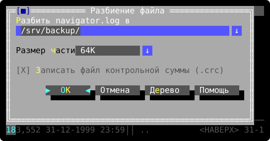

- *Размер части* — размер каждой части: число байтов или число с `K`, `M` или `G`, например `100M` или `1.44M`.
- *Записать файл контрольной суммы (.crc)* дополнительно записывает `NAME.crc` с именем, размером и контрольной
  суммой файла. С ним собранный файл можно проверить.

Файл не больше одной части не разбивается. Эти части умеют собирать Total Commander, Double Commander и 7-Zip.

### Сцепление

На части (`NAME.001`) или на `NAME.crc` набора команда собирает файл обратно в указанном вами каталоге. Она читает
части по порядку, пока не дойдёт до отсутствующей. С файлом `.crc` она ещё и проверяет результат; если контрольная сумма
не совпадает, файл сохраняется, и вам об этом сообщают.

## UU-кодирование и декодирование

UU-кодирование превращает любой файл в простой текст, который можно отправить туда, где допускается только текст.

### Кодирование

`Ctrl+F7` кодирует файл под курсором в `NAME.uue`. Большой файл записывается секциями, каждая в свой файл.

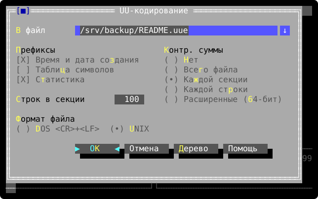

- *Префиксы* добавляют строки перед данными: дату и время файла, использованную таблицу символов и статистику.
- *Контр. суммы* добавляет контрольные суммы, чтобы при декодировании можно было найти повреждения: никаких, всего
  файла, каждой секции, каждой строки или 64-битные.
- *Строк в секции* — сколько строк данных входит в одну секцию.
- *Формат файла* выбирает, как заканчиваются строки: как в DOS или как в UNIX.

### Декодирование

`Ctrl+F8` декодирует файл под курсором в указанный вами каталог. Один файл может содержать несколько
закодированных файлов и их секции в любом порядке.

- *Проверять существующие файлы* — спрашивать, прежде чем заменить уже существующий файл.
- *Выводить сообщения об ошибках* — показывать каждую найденную в данных ошибку.
- *Сохранять повреждённые файлы* — записывать файл, даже если его данные повреждены.

## Контрольные суммы

Список контрольных сумм хранит дайджест каждого файла, чтобы потом файлы можно было проверить на повреждение или
изменение.

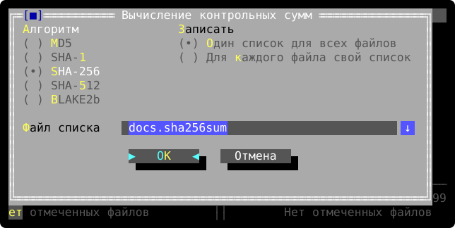

*Файл > Кодирование > Хеш-суммы > Вычислить* вычисляет хеши отмеченных файлов и всего, что лежит в отмеченном
каталоге.

- *Алгоритм* — *MD5*, *SHA-1*, *SHA-256*, *SHA-512* или *BLAKE2b*.
- *Один список для всех файлов* записывает один список с именем из строки *Файл списка*. *Для каждого файла свой
  список* записывает список рядом с каждым файлом.

*Проверить* читает отмеченные списки или список под курсором, заново вычисляет хеши названных в них файлов и
сообщает, сколько совпало. Файлы, которые не совпали или отсутствуют, перечислены под заголовком *Проблемы*.

Это те же списки, что пишут и проверяют `md5sum`, `sha256sum` и их родственники, так что каждая сторона может
проверить списки другой. Алгоритм списка определяется по его имени, например `.sha256sum`, `.sha256` или
`SHA256SUMS`, а иначе — по длине дайджестов.

## Шифрование

*Файл > Кодирование > Шифрование* шифрует и расшифровывает файлы с помощью GnuPG (`gpg`) или `age`. Программа,
которая не установлена, показывается серой.

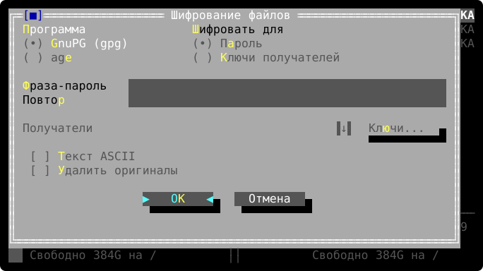

*Зашифровать* работает с отмеченными файлами и со всем, что лежит в отмеченном каталоге. Каждый файл записывается
рядом с собой как `NAME.gpg` или `NAME.age`.

- *Программа* — *GnuPG (gpg)* или *age*.
- *Шифровать для*: *Пароль*, вводимый дважды, или *Ключи получателей*. Получатели разделяются пробелами:
  идентификаторы или отпечатки ключей для gpg, ключи или файлы ключей для age. *Ключи...* выбирает из ключей gpg.
- *Текст ASCII* записывает зашифрованные файлы как текст; gpg называет их `NAME.asc`.
- *Удалить оригиналы* удаляет каждый файл, как только записана его зашифрованная копия.

*Расшифровать* работает с отмеченными зашифрованными файлами или с файлом под курсором и записывает каждый рядом с
собой под именем без окончания. Пароль запрашивается, только если он нужен файлу, и один раз для всех.

## Преобразование текста

*Файл > Кодирование > Преобразовать текст* переписывает отмеченные текстовые файлы или файл под курсором в другой
кодировке или с другими концами строк. Каждый файл меняется на месте.

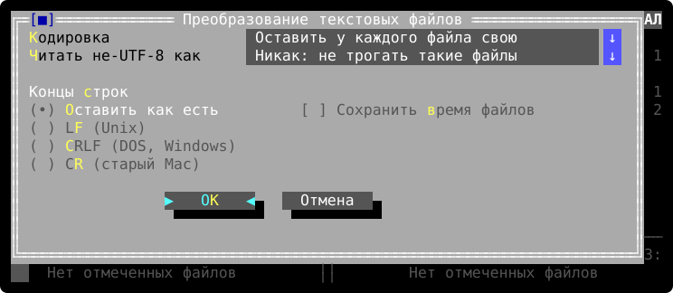

- *Кодировка* — кодировка, в которой записываются файлы.
- *Читать не-UTF-8 как* — кодировка, предполагаемая для файла, который не является UTF-8 и не имеет метки порядка
  байтов. Если ничего не выбрано, такой файл не трогается.
- *Концы строк*: *Оставить как есть*, *LF (Unix)*, *CRLF (DOS, Windows)* или *CR (старый Mac)*.
- *Сохранить время файлов* оставляет каждому переписанному файлу прежнее время.

Файл, похожий на двоичный, файл, текст которого выбранная кодировка не может записать, и очень большой файл не
трогаются, и вам сообщают почему. Файл, который вышел бы неизменным, не записывается.

## Открыть через

*Файл > Открыть через* открывает файл под курсором в одном из приложений рабочего стола, выбранном из списка тех,
что работают с его типом; обычное приложение стоит первым.

- *Другие приложения* перечисляет все прочие установленные приложения.
- *Сделать по умолчанию* выбирает приложение, в котором этот тип будет открываться впредь, и ничего не открывает.
- *Команда...* запрашивает вашу собственную командную строку. `!.!` в ней обозначает файл; без него имя файла
  ставится в конец. Команда выполняется в консоли, и для каждого расширения хранится история использованных
  команд.

Для этого нужен `gio` рабочего стола или инструменты KDE; см. *Рабочий стол* на странице
[Связь](settings.md#связь) в настройках. Файл на сервере сначала загружается. То, что изменит
приложение, обратно не отправляется; то, что изменит *Команда...*, отправляется, когда команда завершится.

`Enter` на файле, который не берёт ни одна запись в `extensions.ini`, тоже открывает его в приложении рабочего
стола, пока на странице [Файловые панели](settings.md#файловые-панели) включён флажок *Прочие файлы — в рабочий стол*.

## Печать

`Ctrl+F9` или *Файл > Напечатать* печатает выбранные файлы, предварительно спросив. Они отправляются на системный
принтер через `lp` или, если `lp` нет, через `lpr`, которые печатают на `$PRINTER` или на принтер по умолчанию.
Каталоги пропускаются, а с каждого файла снимается отметка, как только он отправлен на принтер. Редактор печатает
свой текст по `F8`.
