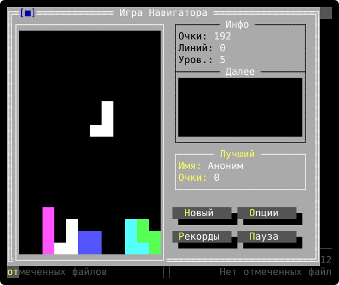

# Игра

`Alt+F9` или *Игра* в меню `≡` открывает игру: фигуры падают в стакан, а заполнившийся ряд исчезает. У неё два
вида: Тетрис с семью фигурами и Пентикс с двадцатью семью.

## Клавиши

| Клавиша | Что она делает |
|---|---|
| `Left` или `Home` | Сдвинуть фигуру влево |
| `Right` или `PgUp` | Сдвинуть фигуру вправо |
| `Up` | Повернуть фигуру |
| `Down` или `Space` | Сбросить фигуру |
| `F2` | Начать новую игру |
| `F3` | Пауза и продолжение |
| `F4` | Показать десятку лучших |
| `F5` | Настроить игру: начальный уровень, вид и показ следующей фигуры |
| `Gray +` | Повысить уровень |
| `Gray *` | Показать или скрыть следующую фигуру |
| `Esc` | Закрыть игру |

Игра сама встаёт на паузу, когда вы переключаетесь в другое окно.

## Десятка лучших

Когда игра заканчивается со счётом, достаточным для десятки лучших, у вас спрашивают имя, под которым её записать.
Без имени или по *Отмена* она записывается как *Аноним*. Для каждого вида игры свой список.

## Настройка

`F5` или кнопка *Опции* настраивает игру.

- *Уровень* — уровень, с которого начинается игра, от *1 - Малыш* до *10 - Психушка*. С каждым уровнем фигуры
  падают быстрее.
- *Вид игры* — *Тетрис* или *Пентикс*.
- *След. фигура* показывает следующую фигуру рядом со стаканом.
