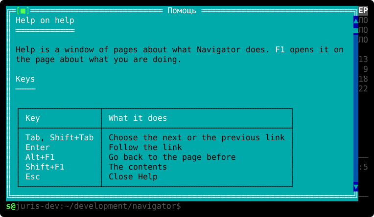

# Справка о справке

`F1` открывает это руководство на странице о том, что вы делаете. Страницы связаны друг с другом ссылками: ссылка
показана своим цветом, и одна из них всегда выбрана.

## Справка там, где вы находитесь

`F1` работает везде и открывает страницу о том, у чего сейчас клавиатура:

- в диалоговом окне — раздел об этом окне. Во многих окнах есть и кнопка *Помощь*, которая делает то же;
- в открытом меню — страницу о выделенном пункте или о его меню;
- в окне, например в программе просмотра, редакторе или калькуляторе, — страницу этого окна;
- в панелях — страницу о панелях.

Если ни одна страница не относится к тому, что вы делаете, открывается [содержание](README.md). `Esc` закрывает
справку и возвращает вас туда, где вы были, с открытым меню, если оно было открыто. Пока в консоли работает
программа, `F1` принадлежит ей.

## Клавиши

| Клавиша | Что делает |
|---|---|
| `Tab` | Выбирает следующую ссылку |
| `Shift+Tab` | Выбирает предыдущую ссылку |
| `Enter` | Переходит по выбранной ссылке |
| `Alt+F1` | Возвращает туда, откуда вы пришли |
| `Shift+F1` | Открывает [содержание](README.md) |
| `F1` | Открывает эту страницу |
| `Up`, `Down`, `PgUp`, `PgDn`, `Home`, `End` | Прокручивают страницу |
| `Left`, `Right` | Прокручивают вбок, когда строка кода шире окна |
| `Alt+Z` | Разворачивает окно на весь экран и обратно |
| `Ctrl+F5` | Двигает окно и меняет его размер: стрелки двигают, `Shift` со стрелками меняют размер, `Enter` оставляет его там, `Esc` возвращает на место |
| `Esc` | Закрывает справку |

Эти клавиши можно изменить: Настройки > Конфигурация > Назначение клавиш, в разделе *Окно помощи*.

## Мышь

Щёлкните по ссылке, чтобы перейти по ней. Колесо прокручивает страницу, как и полоса на правом краю окна, когда
страница длиннее окна. У страницы со строкой кода шире окна есть полоса и вдоль нижнего края; `Shift` с колесом
прокручивает её вбок.

## Ссылки на другие сайты

Ссылку, ведущую за пределы этого руководства, на веб-сайт, Navigator не открывает. Её может открыть ваш терминал:
в большинстве терминалов для этого нужно щёлкнуть по ней, удерживая `Ctrl`.
