# Панели

Файловый менеджер показывает две панели рядом, в каждой — файлы одного каталога. Одна из них активна: на ней
курсор, команды работают с её файлами и обычно предлагают каталог другой панели как место для результата.

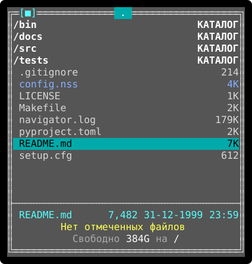

## Перемещение

| Клавиша | Что делает |
|---|---|
| `Tab` | Переходит на другую панель |
| `Up`, `Down`, `PgUp`, `PgDn`, `Home`, `End` | Двигают курсор |
| `Enter` | Входит в каталог или архив, запускает программу или открывает файл |
| `Backspace`, `Ctrl+PgUp` | Переходит в родительский каталог |
| `Ctrl+\` | Переходит в корневой каталог |
| `Ctrl+R` | Перечитывает каталог |
| `Alt+Backspace` | Показывает список каталогов, в которых вы побывали |
| `Alt+=` | Показывает тот же каталог в другой панели |
| `Ctrl+U` | Меняет панели местами |

Набранные буквы попадают в командную строку под панелями; см. [командную строку](console.md).

Панель сама перечитывает свой каталог, когда в нём что-то меняется.

## Виды

`Ctrl+Y` по очереди переключает три вида панели:

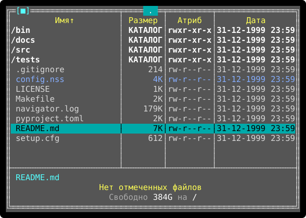

- *Краткий*: имена и размеры.
- *Подробный*: имена с размером, атрибутами, владельцем и датой в колонках. `Alt+K` выбирает колонки.
- *Список*: одни имена, в несколько колонок.

В кратком и подробном видах `Left` и `Right` прокручивают длинные имена. В подробном виде щелчок по заголовку
колонки сортирует по этой колонке, а повторный щелчок меняет порядок на обратный.

`Ctrl+H` показывает или прячет скрытые файлы, а `Alt+I` — строки под списком.

## Сортировка

`Alt+B` выбирает порядок файлов на панели: по имени, расширению, размеру, времени, атрибутам, владельцу или типу,
в прямом или обратном направлении, либо без сортировки. Каталоги идут перед файлами.

## Пометка файлов

Команды работают с помеченными файлами, а если ничего не помечено — с файлом под курсором.

| Клавиша | Что делает |
|---|---|
| `Ins` или `Space` при пустой командной строке | Помечает файл или снимает пометку и переходит вниз |
| `Gray +` | Помечает файлы, подходящие под маску |
| `Gray -` | Снимает пометку с файлов, подходящих под маску |
| `Gray *` | Инвертирует пометку |
| `Ctrl+A` | Помечает всё |

Мышью файл помечает средняя кнопка, а протаскивание с ней помечает все файлы на пути. Щелчок левой кнопкой с
`Shift` или `Ctrl` помечает файлы от курсора до того, по которому щёлкнули.

Строки под списком показывают, сколько файлов помечено и их общий размер.

## Быстрый поиск

`Ctrl+S` начинает поиск по имени: наберите первые буквы, и курсор встанет на первое имя, которое с них
начинается. Повторное `Ctrl+S` переходит к следующему. `Esc` заканчивает поиск; любая другая клавиша тоже
заканчивает его и делает то, что делает обычно, так что `Enter` сразу входит в найденный каталог.

## Копирование через буфер обмена

`Ctrl+C` копирует выделенное, а `Ctrl+X` вырезает; `Ctrl+V` в другом каталоге вставляет туда файлы, задавая те же
вопросы, что и [копирование и перенос](file-operations.md#копирование-и-перемещение). `Esc` забывает файлы. Эти клавиши
работают на панели, пока командная строка пуста.

## Другая сторона

Неактивная сторона может показывать на месте панели что-то другое:

| Клавиша | Что показывает |
|---|---|
| `Ctrl+T` | Дерево каталогов |
| `Ctrl+Q` | Быстрый просмотр файла под курсором |
| `Ctrl+L` | [Сведения](#информационная-панель) о каталоге, диске и файле под курсором |

Та же клавиша возвращает панель. `Ctrl+F1` и `Ctrl+F2` прячут левую и правую сторону, `Ctrl+P` прячет неактивную
сторону, а `Alt+Left` и `Alt+Right` двигают границу между сторонами.

`Alt+F12` переключает на колонки Миллера: ряд узких колонок, по одной на каждый каталог пути, с предпросмотром
того, что под курсором.

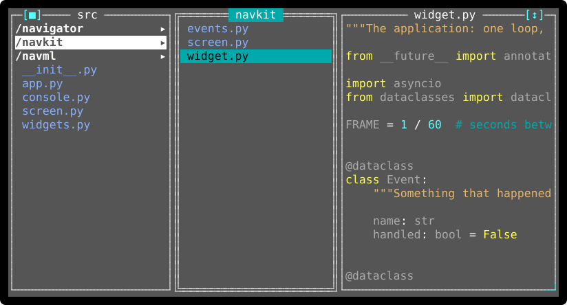

## Информационная панель

`Ctrl+L` показывает на месте другой панели сведения об активной, а повторное `Ctrl+L` возвращает панель. Сведения
следуют за активной панелью, когда вы перемещаетесь:

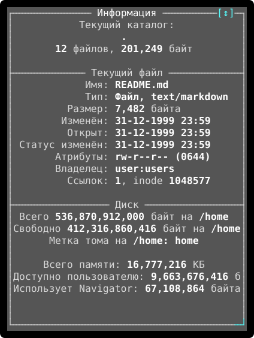

- имя каталога, сколько в нём файлов и их размер;
- файл под курсором: его тип, размер, время, атрибуты, владелец, число ссылок и inode. Картинка, звук, видео, PDF
  и программа получают больше: размер в пикселях, длительность, потоки, страницы или библиотеки, нужные
  программе. Для звука и видео нужен `ffprobe` из FFmpeg;
- файловая система, на которой лежит каталог: её размер, свободное место и устройство или метка. На сервере —
  сервер и способ подключения; в архиве — архив;
- память компьютера, сколько ещё доступно программам и сколько занимает сам Navigator;
- информационный файл каталога, `DirInfo` или `File_ID.DIZ`, если он есть.

Когда сведений больше, чем помещается, `Tab` переводит в них клавиатуру, чтобы прокручивать их стрелками, `PgUp`
и `PgDn`; прокручивает и колесо мыши. Страница [Инфопанель](settings.md#инфопанель) настроек выбирает, какие
строки показывать.

## Несколько файловых менеджеров

`Ctrl+F3` открывает ещё одно окно файлового менеджера. О переходе между окнами см. [Окна](windows.md).

## Маски файлов

Многие окна принимают маску файлов. Маска — это один или несколько шаблонов через `;`, где `*` означает любой
текст, а `?` — любой один символ. Шаблон, начинающийся с `-`, исключает то, что под него подходит, а решает
последний подошедший к имени шаблон: `*;-*.bak` — это все файлы, кроме резервных копий.

## Установки панели

`Alt+S`, или *Панель > Установки панели*, задаёт, как активная панель показывает файлы. Те же параметры для
каждой новой панели находятся на странице *Панели по умолчанию* [настроек](settings.md#панели-по-умолчанию).

- *Сортировка* выбирает порядок: по имени, расширению, размеру, времени, атрибутам, владельцу или типу, либо без
  сортировки. *Обратный порядок* переворачивает его.
- *Размер каталогов* подсчитывает и показывает размер каждого каталога.
- *Текущий файл*, *Отмеченные файлы*, *Итоги* и *Свободное место* выбирают строки под списком.
- *Подсветка файлов* раскрашивает файлы по типу.
- *Программы в начало* и *Архивы в начало* ставят эти файлы перед остальными.
- *Маска файлов* оставляет на панели только файлы, подходящие под [маску](#маски-файлов).

## Фильтр

`Alt+Del`, или *Панель > Пометка > Расширенный фильтр*, выбирает, какие файлы показывает панель, по их
расширениям. В окне перечислены `*` и по маске на каждое расширение, найденное в каталоге.

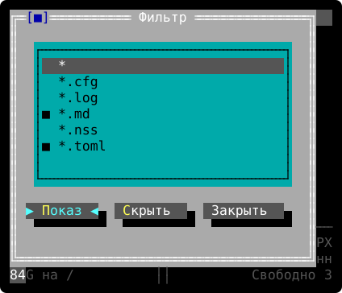

- `Space` или `Ins` отмечает маску и переходит к следующей. `+` отмечает все, `-` — ни одной, `*` инвертирует
  отметки.
- *Показ* показывает на панели отмеченные маски, а если ничего не отмечено — маску под курсором.
- *Скрыть* убирает их с панели.
- *Закрыть* закрывает окно. После *Показ* и *Скрыть* оно остаётся открытым, так что можно выбирать дальше.

Выбор `*` снова показывает всё.

## Поиск файла

`Alt+F7`, или *Файл > Искать*, ищет файлы по имени и по содержимому.

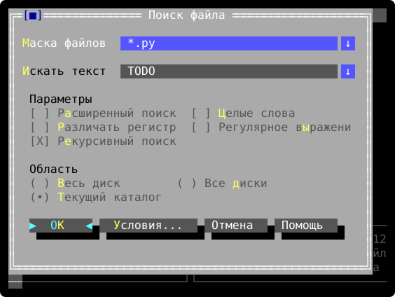

- *Маска файлов* — какие имена искать. Простое слово без `*` и без точки находит все имена, которые с него
  начинаются.
- *Искать текст* ограничивает поиск файлами, содержащими этот текст. Оставьте поле пустым, чтобы искать только по
  имени.

### Параметры

- *Расширенный поиск* применяет ещё и ограничения, заданные кнопкой *Условия*.
- *Различать регистр* отличает заглавные буквы от строчных в тексте.
- *Рекурсивный поиск* ищет и в подкаталогах.
- *Целые слова* пропускает текст, который является частью более длинного слова.
- *Регулярное выражение* читает текст как регулярное выражение, которое может охватывать несколько строк.

### Область поиска

- *Весь диск* ищет по всему диску, на котором находится панель.
- *Текущий каталог* ищет в каталоге панели.
- *Все диски* ищет на всех дисках.

### Результаты

Найденные файлы перечисляются на панели с заголовком *Поиск:* и маской. Их можно просматривать, редактировать,
копировать и удалять там, как любые другие файлы; строка под панелью показывает, в каком каталоге лежит каждый.
`Enter` на `..` возвращает в каталог, из которого шёл поиск.

### Расширенный поиск

Кнопка *Условия* задаёт ограничения, которые действуют, пока отмечен *Расширенный поиск*:

- *С датой после* и *С датой до* ограничивают файлы по времени изменения. Даты пишутся как год-месяц-день,
  например `2026-01-31`.
- *С размером больше* и *С размером меньше* ограничивают их по размеру.
- *Тип* оставляет только программы, символические ссылки, скрытые файлы, файлы только для чтения или битые
  ссылки.

*Очистить* снимает все ограничения.

### Замена в файлах

`Alt+Shift+F7` открывает то же окно с ещё одной строкой, *Заменить на*. Файлы находятся так же, и в каждом из них
текст заменяется.

## Создание списка файлов

`Alt+L`, или *Панель > Создать список файлов*, записывает имена помеченных файлов в текстовый файл.

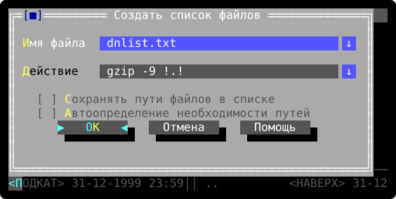

- *Имя файла* — файл, в который пишется список. Если он уже есть, вас спросят, заменить его или дописать в конец.
- *Действие*, если оно заполнено, превращает список в сценарий: по строке на файл, где имя файла подставлено в
  заданный текст. Несколько строк на файл разделяются `;`.
- *Сохранять пути файлов в списке* записывает полный путь каждого файла, а не одно имя.
- *Автоопределение необходимости путей* записывает путь только для файла, который лежит не в каталоге самого
  списка.

В действии эти сочетания обозначают части имени каждого файла:

| Вы пишете | Получается |
|---|---|
| `!` | Имя без расширения |
| `.!` | Расширение с точкой |
| `!\` | Каталог файла, оканчивающийся на `/` |
| `!/` | Каталог файла без последнего `/` |
| `!!` | Символ `!` |

Если в действии нет ни одного из них, имя файла добавляется в конец: `cp` превращается в `cp name`.

## Пометка группы

`Gray +` помечает файлы панели, подходящие под [маску файлов](#маски-файлов), а `Gray -` снимает с них пометку. В
меню *Панель* это пункты *Пометить группу* и *Снять пометку по шаблону*.

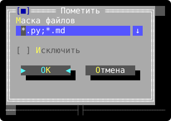

*Исключить* переворачивает маску: помечаются или теряют пометку файлы, которые под неё не подходят.

## Установки колонок

`Alt+K`, или *Панель > Установки колонок*, выбирает, что подробный вид показывает рядом с каждым именем: *Размер*,
*Атрибуты*, *Ссылки*, *Владелец* и *Дата*.

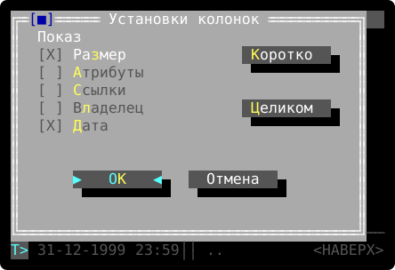

- *OK* показывает отмеченные колонки.
- *Коротко* показывает одни имена.
- *Целиком* показывает все колонки, кроме *Ссылки*.

Колонки, с которыми начинает новая панель, задаются на странице [Колонки](settings.md#колонки) настроек.

## Поиск дубликатов

*Панель > Поиск дубликатов* ищет в каталоге панели файлы с одинаковым содержимым и, как при поиске, перечисляет их
на панели.

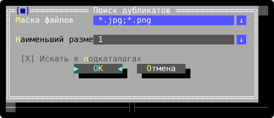

- *Маска файлов* выбирает, какие файлы сравнивать.
- *Наименьший размер* отбрасывает файлы меньшего размера.
- *Искать в подкаталогах* ищет и в каталогах ниже.

Первыми идут группы, которые занимают больше всего лишнего места, а файлы одной группы остаются вместе при любой
сортировке панели. Ничего не помечается: пометьте ненужные копии и удалите их по `F8`. Символические ссылки
пропускаются, а два жёстко связанных имени одного файла дубликатами не считаются.

## Вывод команды в панель

`Alt+Y`, или *Панель > Файлы из вывода команды*, выполняет команду оболочки в каталоге панели и показывает как
содержимое панели файлы, которые она выводит, по одному имени на строку. Это для команд, отвечающих на вопрос
«какие файлы?»:

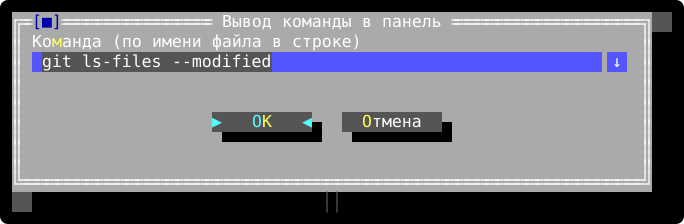

```sh
git ls-files -m
grep -l TODO *.py
```

Командная строка, начинающаяся с `|`, делает то же без окна.

## История каталогов

`Alt+BkSp`, или *Панель > История каталогов*, перечисляет каталоги, в которых побывали панели, последний первым.
*Перейти* открывает каталог под курсором в активной панели, а *Удалить запись* убирает его из списка.

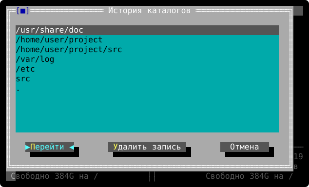

## Запоминание каталога

*Панель > Запомнить для этого каталога* сохраняет порядок сортировки, вид и маску файлов, которые сейчас на
панели, и применяет их всякий раз, когда панель оказывается в этом каталоге. *Также для его подкаталогов*
показывает так же все каталоги ниже, если только какой-то из них не запомнен отдельно.

*Список запомненных каталогов* показывает запомненные каталоги. `Enter` переходит в выбранный, а `Del` забывает
его.
