# Настройки

*Настройки > Настройки* собирает все параметры на пятнадцати страницах. `Ctrl+PgUp` и `Ctrl+PgDn` листают
страницы; пункты в *Настройки > Конфигурация* и *Настройки > Менеджер файлов* открывают окно сразу на своей
странице. Если задержать мышь на параметре, появится подсказка о том, что он делает.

*OK* сразу применяет изменения и записывает их в `navigator.ini`. *Отмена* отбрасывает их.

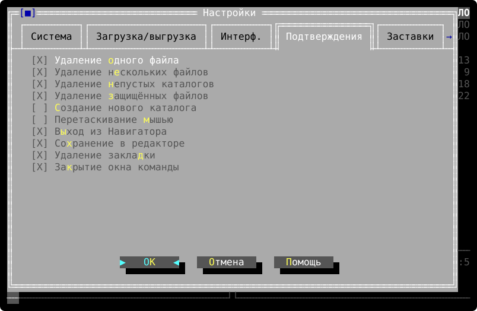

## Система

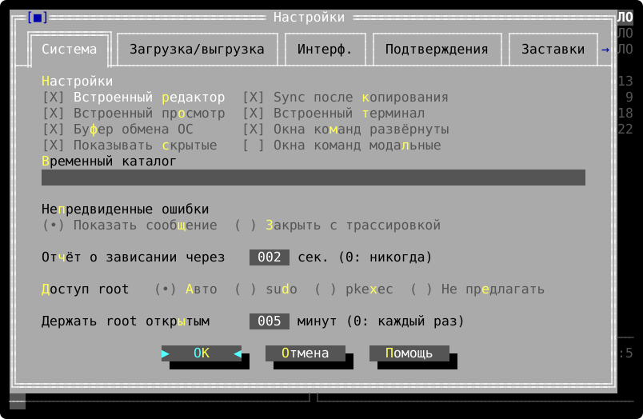

- *Встроенный редактор* и *Встроенный просмотр*: `F4` и `F3` используют собственные редактор и просмотрщик
  Navigator. Если выключено, запускается программа, названная в `$EDITOR` и `$PAGER`.
- *Буфер обмена ОС*: копировать в буфер обмена рабочего стола и вставлять из него. Если выключено, Navigator ведёт
  собственный буфер обмена.
- *Показывать скрытые*: новая панель показывает скрытые файлы. `Ctrl+H` переключает одну панель.
- *Sync после копирования*: каждый скопированный файл записывается на диск, прежде чем считаться готовым.
- *Встроенный терминал*: `Ctrl+O` показывает консоль внутри Navigator. Если выключено, весь терминал отдаётся
  оболочке.
- *Окна команд развёрнуты* и *Окна команд модальные*: как открывается команда, запущенная в собственном окне.
- *Временный каталог*: куда помещаются временные файлы. Пусто — значит `$TMPDIR`.
- *Непредвиденные ошибки*: непредвиденная ошибка либо показывает сообщение с подробностями, либо закрывает
  Navigator и выводит их.
- *Отчёт о зависании через*: сколько секунд Navigator может не отвечать, прежде чем причина будет записана в
  `errors.log`.
- *Доступ root*: как шаг, которому отказано в доступе, можно повторить от имени root: через `sudo`, через `pkexec`
  или никак.
- *Держать root открытым*: сколько минут доступ root остаётся открытым после последнего использования. См.
  [Работа от имени root](as-root.md).

## Загрузка/выгрузка

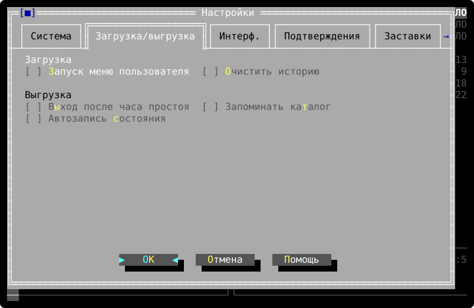

- *Запуск меню пользователя*: меню пользователя (`F2`) открывается при запуске Navigator.
- *Очистить историю*: незакреплённые записи истории удаляются при каждом запуске.
- *Выход после часа простоя*: Navigator завершается после часа без нажатий клавиш и щелчков.
- *Автозапись состояния*: окна сохраняются при выходе и восстанавливаются при следующем запуске.
- *Запоминать каталог*: активная панель сохраняет свой каталог после команды и в восстановленном состоянии.

## Интерфейс

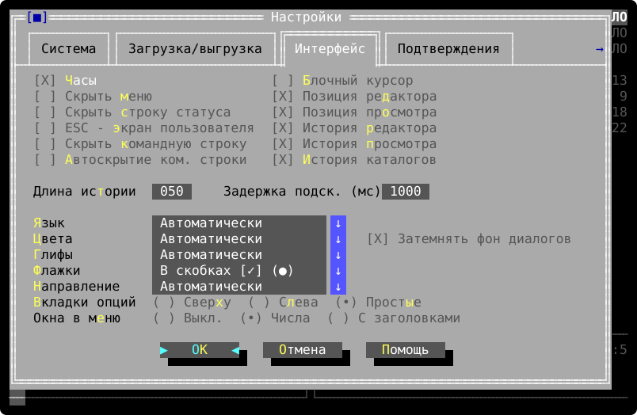

- *Часы*, *Скрыть меню*, *Скрыть строку статуса*: часы в строке меню, сама строка меню до нажатия `F10` и строка
  клавиш в нижней строке экрана.
- *ESC - экран пользователя*: `Esc` при пустой командной строке показывает консоль до следующего нажатия клавиши.
- *Скрыть командную строку* и *Автоскрытие ком. строки*: скрывать командную строку всегда или пока она пуста.
- *Блочный курсор*: блочный курсор в командной строке.
- *Позиция редактора* и *Позиция просмотра*: файл открывается снова в том окне и на том месте, где его оставили.
- *История редактора*, *История просмотра*, *История каталогов*: вести списки, которые показывают `Alt+PgUp`,
  `Alt+PgDn` и `Alt+Backspace`.
- *Длина истории*: сколько записей хранит каждый список истории.
- *Задержка подск. (мс)*: сколько мышь должна пробыть на месте, прежде чем появится подсказка; 0 — подсказок нет.
- *Язык*: язык надписей и сообщений.
- *Цвета*: сколько цветов передавать терминалу.
- *Глифы*: какие символы предположительно есть в шрифте терминала: только ASCII, Unicode или значки Nerd Font.
- *Затемнять фон диалогов*: то, что находится за диалогом, рисуется бледным.
- *Флажки*: как рисуются флажки и переключатели.
- *Направление*: слева направо, справа налево или как читается язык.
- *Вкладки опций*: где это окно показывает свои вкладки.
- *Окна в меню*: показываются ли открытые окна в строке меню — номерами или с заголовками.

## Подтверждения

Каждый флажок заставляет Navigator спрашивать перед действием: удалением одного файла, удалением нескольких,
удалением непустого каталога, удалением защищённых от записи файлов, созданием каталога, названного при
копировании, перетаскиванием мышью, выходом, сохранением в редакторе, удалением закладки и закрытием окна команды,
команда которого ещё выполняется.

## Заставки

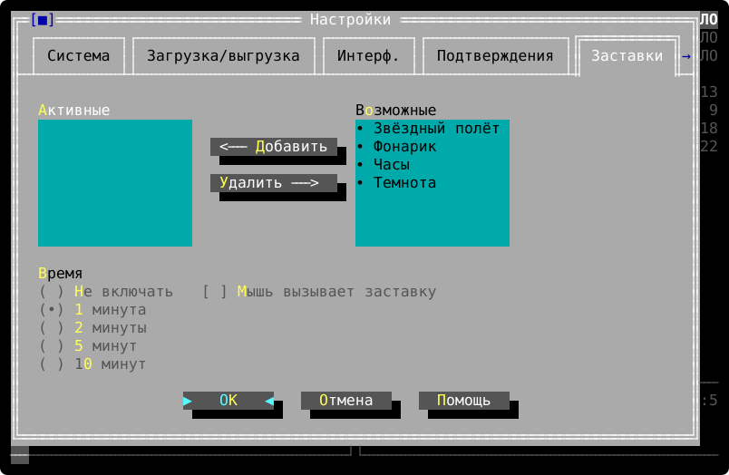

Экранная заставка занимает экран после некоторого времени без нажатий клавиш и щелчков.

- *Активные* заставки сменяют друг друга. *Добавить* переносит заставку из списка *Возможные*, а *Удалить*
  убирает её.
- *Время* — сколько ждать, или *Не включать*.
- *Мышь вызывает заставку*: если навести указатель в правый верхний угол, заставка запускается сразу; пока он в
  правом нижнем углу, ни одна не запускается.

## Страна

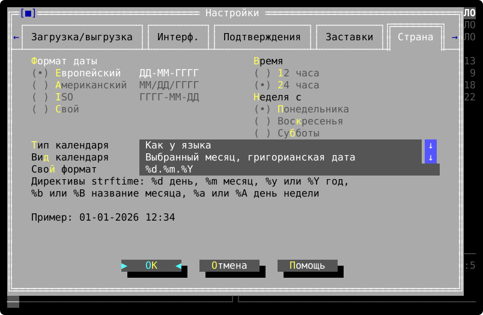

- *Формат даты*: порядок, в котором записываются даты, или *Свой* с форматом, записанным в строке *Свой формат*.
- *Время*: 12-часовой или 24-часовой формат.
- *Неделя с*: первый день недели в календарях.
- *Тип календаря* и *Вид календаря*: какой календарь показывает окно календаря и стоит ли он рядом с
  григорианским.

*Пример* показывает дату и время, записанные так, как выбрано.

## Редактор/просмотр

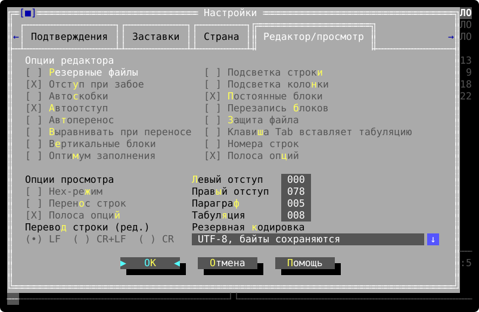

С чем начинает новое окно редактора или просмотрщика. Большинство параметров редактора можно переключить для
одного окна из его меню *Настройки*.

Опции редактора:

- *Резервные файлы*: при сохранении по `F2` старый файл остаётся как `NAME.bak`.
- *Отступ при забое*: `Backspace` в начальных пробелах возвращается к отступу одной из строк выше.
- *Автоскобки*: при вводе `(`, `{` или `[` вводится и парная скобка.
- *Автоотступ*: `Enter` делает в новой строке такой же отступ, как в строке выше.
- *Автоперенос* и *Выравнивать при переносе*: строка, набранная за правым отступом, переносится, а оставшаяся
  строка растягивается до отступа.
- *Вертикальные блоки*: блоки отмечаются колонками.
- *Оптимум заполнения*: пробелы, доходящие до позиции табуляции, записываются символом табуляции.
- *Подсветка строки* и *Подсветка колонки*: строка и колонка курсора подсвечиваются.
- *Постоянные блоки*: блок остаётся отмеченным при перемещении курсора. *Перезапись блоков*, когда это выключено:
  ввод и вставка заменяют блок.
- *Защита файла*: редактор держит на своём файле блокировку, видимую другим программам.
- *Клавиша Tab вставляет табуляцию*: `Tab` вставляет символ табуляции, а не пробелы.
- *Номера строк*: строки нумеруются слева.
- *Полоса опций*: нижняя рамка показывает параметры окна, а щелчок переключает один из них.

Опции просмотра: *Hex-режим* открывает файлы в шестнадцатеричном виде, *Перенос строк* переносит длинные строки, а
*Полоса опций* — как у редактора.

- *Левый отступ*, *Правый отступ*, *Параграф*: отступы для [форматирования абзацев](editor.md#отступы).
- *Табуляция*: ширина табуляции.
- *Перевод строки (ред.)*: какой конец строки получает новый файл.
- *Резервная кодировка*: как редактор читает файл, если он не в UTF-8.

## Типы просмотра

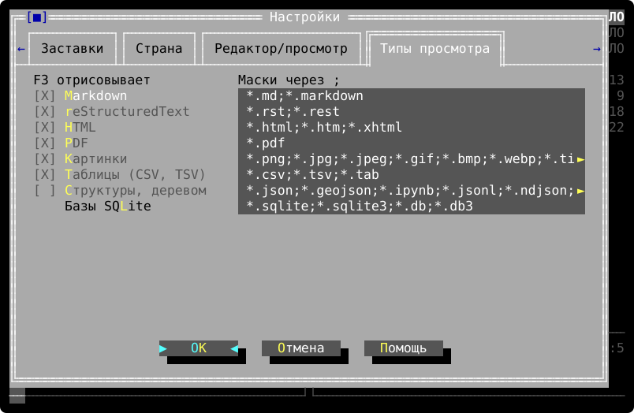

Какие файлы `F3` показывает не как текст: Markdown, reStructuredText и HTML — страницей, PDF — его текстом,
картинки — картинками, CSV и TSV — таблицей, а структурированные файлы (JSON, YAML, TOML, XML) — деревом. У каждого
вида есть флажок для включения и строка [масок файлов](panels.md#маски-файлов), указывающая, к каким файлам он
относится. *Базы SQLite* — маска файлов, открываемых как база данных.

## Файловые панели

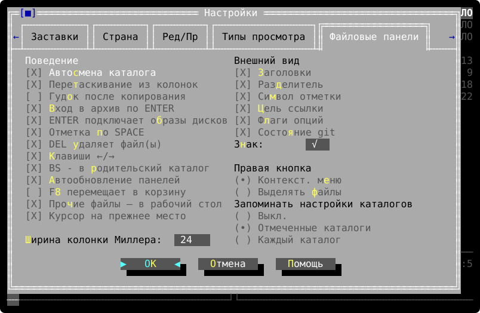

Поведение:

- *Автосмена каталога*: панель следует за курсором в дереве рядом с ней.
- *Перетаскивание из колонок*: файлы можно вытаскивать из панели мышью.
- *Гудок после копирования*: по окончании копирования звенит звонок терминала.
- *Вход в архив по ENTER*: `Enter` на архиве входит в него как в каталог.
- *ENTER подключает образы дисков*: `Enter` на файле `.iso` или `.img` подключает и открывает его.
- *Отметка по SPACE*, *DEL удаляет файл(ы)*, *BS - в родительский каталог*: эти клавиши работают в панели, пока
  командная строка пуста.
- *Клавиши ←/→*: стрелки, `Home` и `End` редактируют командную строку, в которой есть текст. Если выключено, они
  делают это вместе с `Shift`.
- *Автообновление панелей*: панель перечитывает свой каталог, когда он меняется на диске.
- *F8 перемещает в корзину*: `F8` перемещает файлы в корзину, а не удаляет их.
- *Прочие файлы — в рабочий стол*: `Enter` на файле, для которого не задана программа, открывает его в приложении
  рабочего стола.
- *Курсор на прежнее место*: при возврате в каталог курсор встаёт туда, где его оставили.
- *Ширина колонки Миллера*: ширина колонки в виде колонок Миллера.

Внешний вид:

- *Заголовки*: строка заголовков над колонками.
- *Разделитель*: линия над итогами под списком.
- *Символ отметки* и *Знак*: отмеченный файл помечается знаком, и каким именно.
- *Цель ссылки*: строка под панелью показывает, куда указывает символическая ссылка.
- *Флаги опций*: нижняя рамка показывает параметры панели, а щелчок переключает один из них.
- *Состояние git*: в рабочем дереве git — состояние каждого файла и ветка в заголовке.

*Правая кнопка* выбирает, что делает правая кнопка мыши в панели: открывает контекстное меню или отмечает файлы.
*Запоминать настройки каталогов* выбирает, какие каталоги хранят собственные порядок сортировки, вид, колонки и
маску файлов.

## Инфопанель

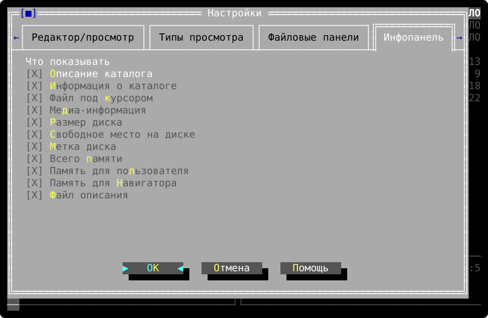

Какие строки показывает информационная панель (`Ctrl+L`): имя каталога, его итоги, файл под курсором,
медиа-информацию, размер тома, свободное место и метку, память машины и файл описания каталога.

## Панели по умолчанию

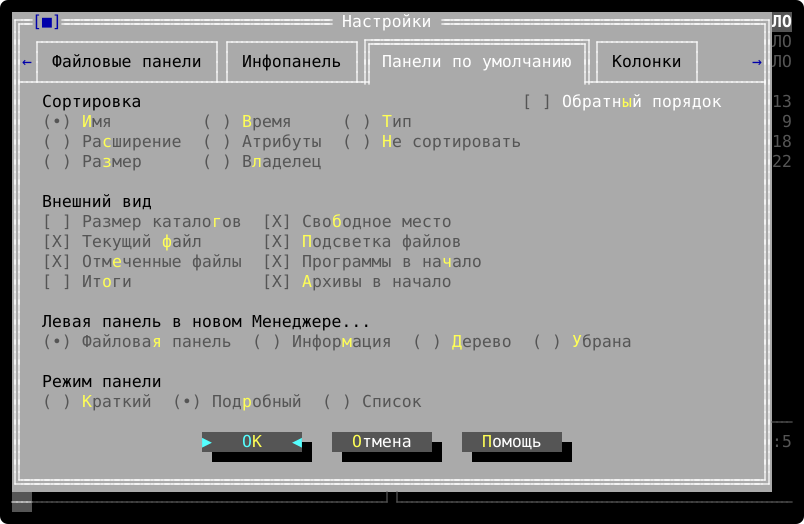

С чем начинают панели нового файлового менеджера.

- *Сортировка* и *Обратный порядок*: порядок, в котором перечисляются файлы.
- *Размер каталогов*: размер каждого каталога подсчитывается и показывается.
- *Текущий файл*, *Отмеченные файлы*, *Итоги*, *Свободное место*: строки под списком.
- *Подсветка файлов*: файлы раскрашиваются по типу.
- *Программы в начало* и *Архивы в начало*: такие файлы перечисляются раньше остальных.
- *Левая панель в новом Менеджере*: файловая панель, информационная панель, дерево или ничего.
- *Режим панели*: краткий, подробный вид или список.

## Колонки

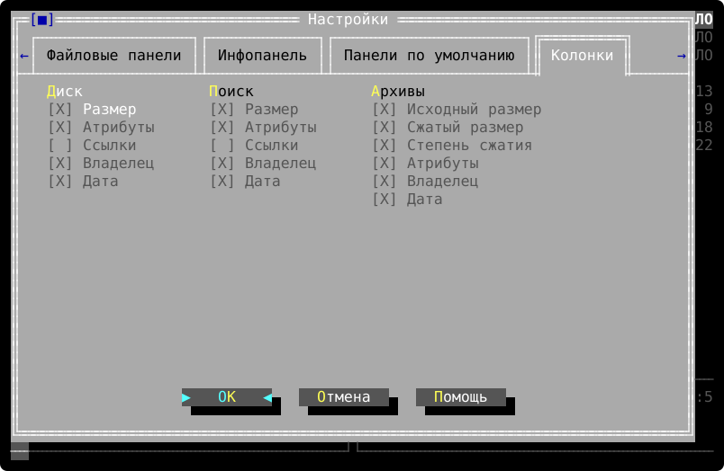

Какие колонки панель показывает в подробном виде, отдельно для трёх видов списков. `Alt+K` меняет их для одной
панели; см. [Настройка колонок](panels.md#установки-колонок).

- *Диск*: каталог на диске или на сервере. Колонки — *Размер*, *Атрибуты*, *Ссылки* (сколько имён у файла),
  *Владелец* и *Дата*.
- *Поиск*: список, которым [поиск файлов](panels.md#поиск-файла) заполняет панель. Колонки те же.
- *Архивы*: внутри архива. *Исходный размер*, *Сжатый размер*, *Степень сжатия* (насколько файл сжат),
  *Атрибуты*, *Владелец* и *Дата*.

## Подсветка

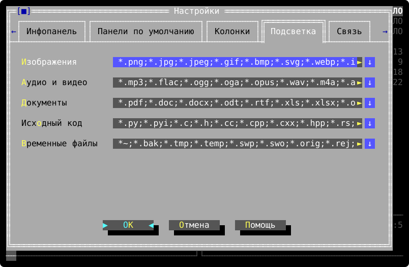

[Маски файлов](panels.md#маски-файлов) пяти групп, которые раскрашивают панели: *Изображения*, *Аудио и видео*,
*Документы*, *Исходный код* и *Временные файлы*. Файл, подходящий под маску группы, показывается цветом этой группы,
пока для панели включена *Подсветка файлов*. Сами цвета берутся из темы и меняются в *Настройки > Цвета*
([Цвета](customizing.md#цвета)).

Эти группы раскрашивают имена в панелях; какими цветами раскрашивается текст внутри файла в просмотрщике и
редакторе, задаётся в `highlight.ini` ([Подсветка синтаксиса](editor.md#подсветка-синтаксиса)).

## Связь

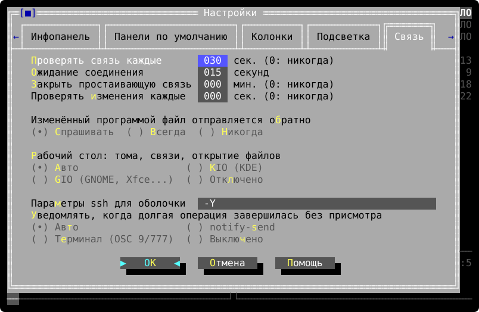

- *Проверять связь каждые*: как часто отправляется сообщение, чтобы соединение с сервером не закрывалось.
- *Ожидание соединения*: сколько ждать ответа сервера.
- *Закрыть простаивающую связь*: сколько неиспользуемое соединение остаётся открытым.
- *Проверять изменения каждые*: как часто каталог на сервере проверяется на изменения.
- *Изменённый программой файл отправляется обратно*: загружается ли такой файл обратно: после вопроса, всегда или
  никогда.
- *Рабочий стол*: службы какого рабочего стола используются для томов, связей и открытия файлов.
- *Параметры ssh для оболочки*: слова, добавляемые к команде `ssh` каждой удалённой оболочки.
- *Уведомлять, когда долгая операция завершилась без присмотра*: как сообщить рабочему столу, что долгая операция
  завершилась, пока терминал был в фоне.

## Инструменты

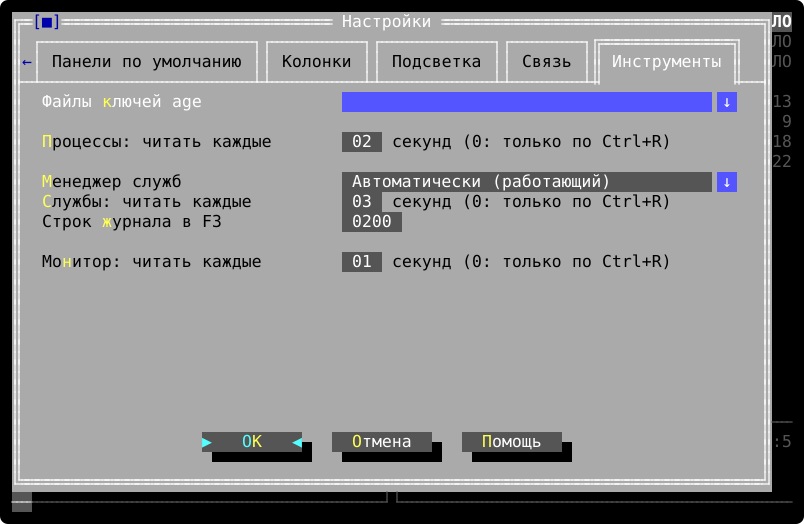

- *Файлы ключей age*: файлы ключей, которыми расшифровывает `age`.
- *Процессы: читать каждые*, *Службы: читать каждые*, *Монитор: читать каждые*: как часто обновляются эти окна.
- *Менеджер служб*: с каким менеджером служб работает окно служб.
- *Строк журнала в F3*: какую часть журнала службы открывает `F3`.
