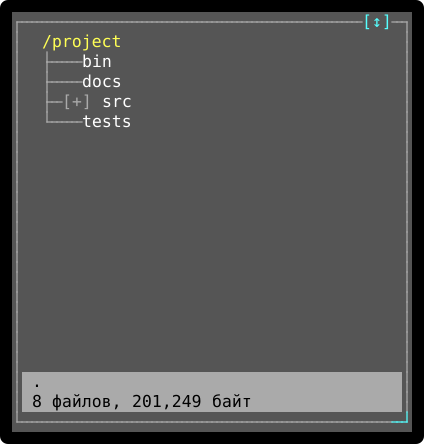
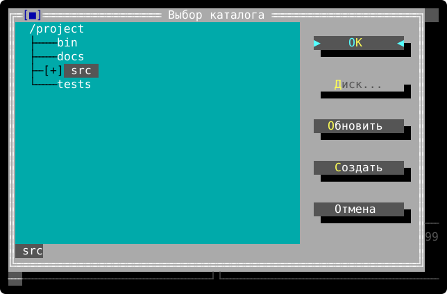
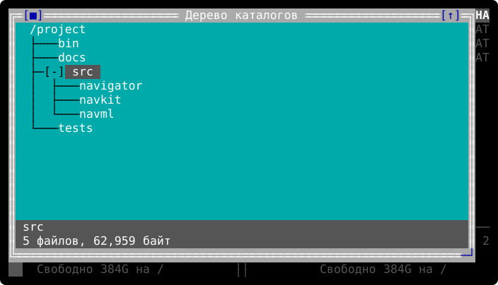
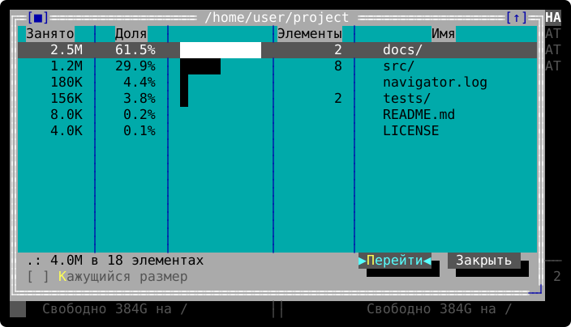

# Деревья каталогов

Дерево показывает каталоги, а вложенные в них — с отступом под ними.

| Клавиша | Что делает |
|---|---|
| `Up`, `Down` | Двигают курсор |
| `Right` | Раскрывает каталог и входит в него |
| `Left` | Переходит к каталогу, в котором он находится |
| `+`, `-` или `Space` | Раскрывают или сворачивают каталог |
| `*` | Раскрывает все каталоги |
| `Enter` | Выбирает каталог |
| `Ctrl+S` | Поиск: наберите начало имени; `/` продолжает поиск внутри найденного каталога |

Дерево показывает скрытые каталоги, когда их показывает панель (`Ctrl+H`).

## Дерево рядом с панелью

`Ctrl+T` ставит дерево на место неактивной панели. Оно следует за активной панелью, а панель — за ним: стоит
курсору задержаться на каталоге в дереве, как панель показывает этот каталог. Если на странице [Файловые
панели](settings.md#файловые-панели) настроек снят флажок *Автосмена каталога*, это делает только `Enter`.

## Смена каталога

`Alt+T` открывает дерево в окне, чтобы выбрать в нём каталог активной панели. *Создать* создаёт каталог внутри
того, что под курсором, а *Обновить* перечитывает дерево.

## Окно дерева

*Диск > Дерево каталогов* открывает дерево в отдельном окне на рабочем столе, которое остаётся открытым, пока вы
работаете в другом месте. `Enter` на каталоге отправляет туда активную панель активного файлового менеджера. У окна
есть собственное меню *Дерево* с пунктами *Обновить* (`Ctrl+R`), *Быстрый поиск* (`Ctrl+S`) и *Закрыть*; `Esc`
тоже закрывает его.

## Размеры каталогов

*Диск > Размеры каталогов* измеряет каталог активной панели и перечисляет его содержимое по размеру, чтобы было
видно, что занимает место.

| Клавиша | Что делает |
|---|---|
| `Enter`, `Right` | Входят в каталог |
| `Backspace`, `Left` | Выходят обратно |
| `Ctrl+N`, `Ctrl+S`, `Ctrl+E` | Сортируют по имени, размеру, числу элементов; повторное нажатие меняет порядок на обратный |
| `Ctrl+A` | Переключает между размером содержимого и местом, занятым на диске |
| `F8`, `Del` | Удаляют, как в панели |
| `Ctrl+R` | Измеряет заново |
