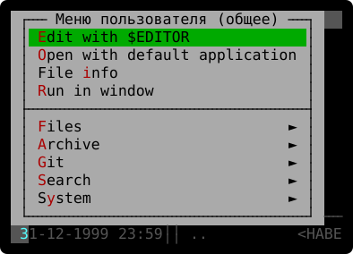

# Меню пользователя и связи файлов

## Меню пользователя

`F2` открывает меню ваших собственных команд. Navigator ищет файл с именем `.navigator-menu.ini` в каталоге панели
и в каждом каталоге выше; это *локальное* меню. Если такого нет, используется *глобальное* — `menu.ini` в каталоге
настроек Navigator.



В меню `F2` переключает между локальным и глобальным меню, а `F4` открывает показанное в редакторе. Их также
редактируют *Настройки > Глобальное меню пользователя* и *Локальное меню пользователя*.

### Как написать меню

```ini
# A comment
~S~how the file = less !.!

[Archive]
~P~ack this file = tar czf !.tar.gz !.!
-
~L~ist = tar tf !.!
```

- `Caption = command` — пункт. Строки с отступом под ним — дополнительные команды того же пункта.
- `[Name]` начинает подменю, а `[Name/Inner]` — подменю внутри него.
- Строка из одного `-` — разделитель.
- `~` перед буквой делает её горячей клавишей пункта. Пункт, название которого начинается с `F1`…`F12` и пробела,
  выбирается этой клавишей.

Эти сочетания обозначают файл под курсором в активной панели:

| Вы пишете | Получается |
|---|---|
| `!` | Имя без расширения |
| `.!` | Расширение с точкой |
| `!.!` | Полное имя |
| `!\` | Каталог, оканчивающийся на `/` |
| `!/` | Каталог без последнего `/` |
| `!!` | Символ `!` |

То же самое с `$` вместо `!` обозначает файл в другой панели, поэтому собственный символ `$` пишите как `$$`.
`%1` — файл со списком помеченных имён активной панели, а `%2` — другой панели.

`%3`…`%9` — слова, которые у вас спрашивают при запуске пункта. Строка `<Title` даёт вопросу заголовок, а
`<=text` подставляет начальный ответ.

Имена при необходимости заключаются в кавычки для оболочки, поэтому не ставьте кавычки вокруг них сами. Команды
выполняются в оболочке консоли, как если бы вы набрали их сами.

## Связи файлов

Ещё пять файлов в каталоге настроек определяют, как обрабатывается каждый вид файлов. В каждом — по секции на
маску файлов.

| Файл | Что определяет | Где редактируется |
|---|---|---|
| `extensions.ini` | Что `Enter` запускает для файла | *Настройки > Файл расширений* |
| `viewers.ini` | Что `F3` запускает вместо программы просмотра | *Настройки > Программы просмотра* |
| `editors.ini` | Что `F4` запускает вместо редактора | *Настройки > Редакторы* |
| `quickrun.ini` | Что запускают `Ctrl+Shift+F1`…`Ctrl+Shift+F10` | *Настройки > Файл быстрого запуска* |
| `highlight.ini` | Как редактор и программа просмотра раскрашивают файл, и параметры редактора для него | *Настройки > Файл раскраски редактора* |

`Alt+F3` всегда использует собственную программу просмотра Navigator. `Alt+F4` использует программу из
`editors.ini`, пока `F4` использует редактор Navigator, и наоборот; см. [редактор](editor.md#открытие-файла). При
первом запуске Navigator каждый файл записывается с примерами. `highlight.ini` описан в разделе [Подсветка
синтаксиса](editor.md#подсветка-синтаксиса).
