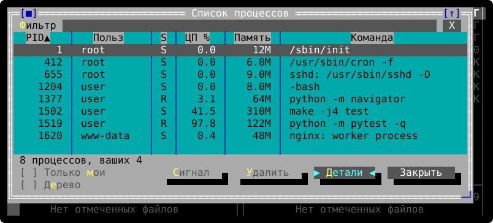
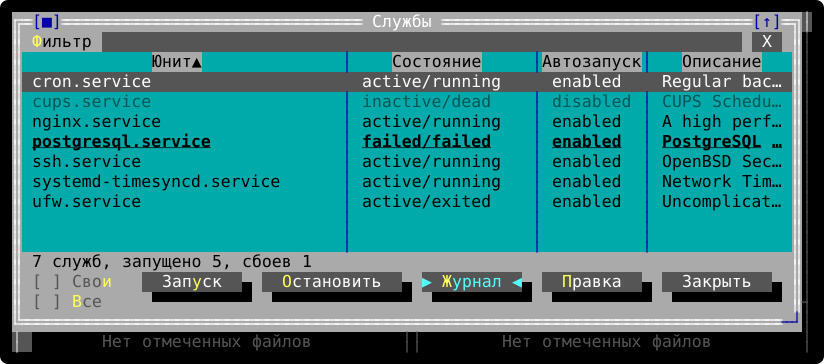
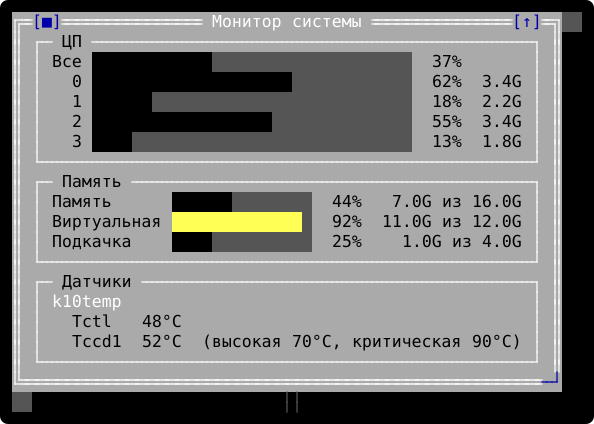
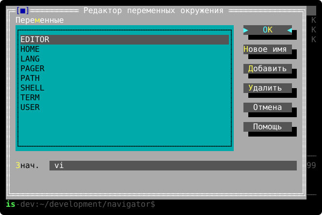
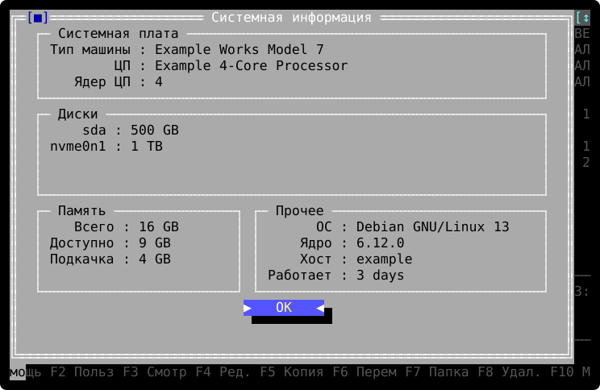
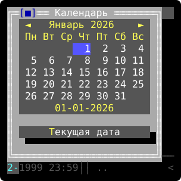
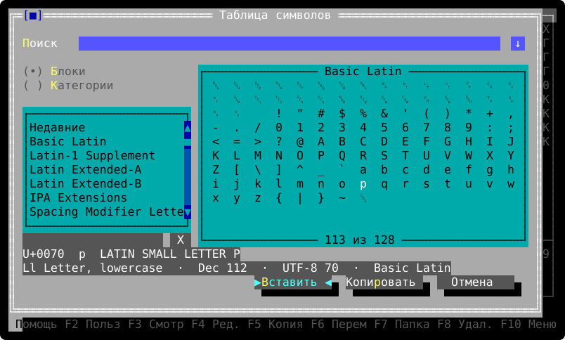

# Утилиты

## Список процессов

*Утилиты > Список процессов* показывает запущенные процессы.

| Клавиша | Что делает |
|---|---|
| Набор текста, `F4` | Оставляет в списке процессы, у которых команда, имя, пользователь или номер содержат этот текст; `Esc` сбрасывает фильтр |
| `Ctrl+T` | Показывает процессы деревом родителей и потомков |
| `Ctrl+H` | Показывает только ваши процессы |
| `Ctrl+P`, `Ctrl+U`, `Ctrl+E`, `Ctrl+L`, `Ctrl+Z`, `Ctrl+N` | Сортируют по номеру, пользователю, состоянию, загрузке процессора, памяти, команде |
| `Left`, `Right` | Прокручивают длинные команды |
| `F3` | Показывает подробности о процессе |
| `F7` | Посылает выбранный сигнал |
| `F8`, `Del` | Завершают процесс, предварительно спросив |
| `Ctrl+R` | Перечитывает список |

Щелчок по заголовку колонки сортирует по ней. Если в отправке сигнала отказано из-за нехватки прав, вам
предложат отправить его от имени root.

## Службы

*Утилиты > Службы* перечисляет службы системы и управляет ими через systemd, OpenRC, runit или SysVinit.

| Клавиша | Что делает |
|---|---|
| `Enter` | Показывает подробности о службе |
| `F3` | Показывает её журнал и следит за ним |
| `F4` | Редактирует её конфигурацию |
| `F5`, `F6`, `F7` | Запускают, перезапускают, перечитывают конфигурацию |
| `F8`, `Del` | Останавливают, предварительно спросив |
| `Ctrl+E`, `Ctrl+D` | Включают и выключают запуск при загрузке |
| `Ctrl+U` | Показывает ваши собственные службы |
| `Ctrl+A` | Показывает юниты всех типов |
| `Ctrl+S` | Фильтрует список |
| `Ctrl+R` | Перечитывает список |

Изменение системной службы обычно требует прав root, которые вам предложат получить.

## Монитор системы

*Утилиты > Монитор системы* показывает загрузку каждого процессора, занятые память и подкачку, а также температуры
и скорости вентиляторов, о которых сообщает машина.

## Переменные окружения

*Утилиты > Переменные окружения* показывает переменные окружения, которые получают программы, запущенные из
Navigator, и позволяет их менять.

- *Переменные* перечисляет имена. Значение той, что под курсором, стоит в строке *Знач.*, где его можно
  редактировать.
- *Новое имя* даёт переменной другое имя.
- *Добавить* добавляет новую переменную.
- *Удалить* удаляет переменную под курсором.
- *OK* сохраняет изменения; *Отмена* отбрасывает их все.

Изменения получают программы, которые Navigator запускает с этого момента: внешние программа просмотра и
редактор, команды меню пользователя и оболочка в консоли. Они действуют, пока вы не выйдете из Navigator.

## Системная информация

*Утилиты > Системная информация* показывает, что это за машина: *Системная плата* и процессор, *Диски*, *Память*,
а в разделе *Прочее* — система, её ядро, имя хоста и время работы с момента загрузки.

## Календарь

*Утилиты > Календарь* показывает месяц с отмеченным сегодняшним днём. Под неделями день под курсором выписан
полностью в формате даты из настроек [Страна](settings.md#страна).

| Клавиша | Что делает |
|---|---|
| Стрелки | Переходят от дня к дню |
| `PgUp`, `PgDn` | Предыдущий и следующий месяц |
| `Ctrl+PgUp`, `Ctrl+PgDn` | Предыдущий и следующий год |
| `M`, `Y` | Выбирают месяц или год из списка |
| `T` | Переходит к сегодняшнему дню; то же делает кнопка *Текущая дата* |
| `C` | Переключает между другим календарём и григорианским |
| `Esc` | Закрывает календарь |

В меню *Календарь* те же команды и ещё две. *Тип календаря* показывает месяц в другом календаре, например в
еврейском, исламском или персидском. *Вид календаря* определяет, что из него показано рядом с григорианским
месяцем: только его месяц, выписанный в нём день под григорианским месяцем, его месяц с выписанным под ним
григорианским днём или оба месяца рядом.

## Таблица символов

`Ctrl+B`, или *Утилиты > Таблица символов*, находит символ и вставляет его туда, где стоит курсор.

- *Поиск* находит символы по имени, например `arrow` или `euro`.
- Список слева выбирает группу символов, а строка под ним отбирает группы по имени.
- Сетка справа показывает группу. Символ под курсором описан внизу.
- *Вставить* вставляет символ, а *Копировать* помещает его в буфер обмена.

На терминале, настроенном на одни символы ASCII, таблица — это *Таблица ASCII* из DOS Navigator: 256 символов, с
кодом символа под курсором в десятичном и шестнадцатеричном виде.

## SmartPad

`Alt+Q`, или *Записная книжка* в меню `≡`, открывает блокнот, который сохраняется от сеанса к сеансу. При каждом
открытии он добавляет в конец строку с датой и временем и ставит курсор под ней, так что блокнот читается как
журнал. Это окно [редактора](editor.md), и при закрытии оно сохраняет себя само.

## Системное меню

Меню `≡` на левом конце строки меню содержит то, что относится к Navigator в целом.

| Пункт | Что делает |
|---|---|
| *О программе* | Показывает версию, лицензию и автора |
| *Палитра команд* | Находит любую [команду](windows.md#палитра-команд) по нескольким её буквам |
| *Перерисовать экран* | Заново рисует весь экран поверх того, что оставила на нём другая программа |
| *Экранная заставка* | Сразу запускает экранную заставку |
| *Вырезать с экрана*, `Shift+Alt+Ins` | Копирует прямоугольник экрана в буфер обмена |
| *Экран пользователя*, `Alt+F5` | Показывает [консоль](console.md#консоль) до нажатия клавиши |
| *Окно вывода*, `Ctrl+O` | Убирает окна, чтобы печатать в консоли, и возвращает их |
| *Записная книжка*, `Alt+Q` | Открывает [блокнот](#smartpad) |
| *Корзина вкл/выкл* | Показывает или прячет корзину, на которую бросают файлы, чтобы удалить их |
| *Игра*, `Alt+F9` | Открывает [игру](game.md) |

`Alt+X` выходит из Navigator. Сначала он спрашивает; *Не спрашивать* в вопросе или *Выход из Навигатора* на
странице [Подтверждения](settings.md#подтверждения) отключают вопрос.
