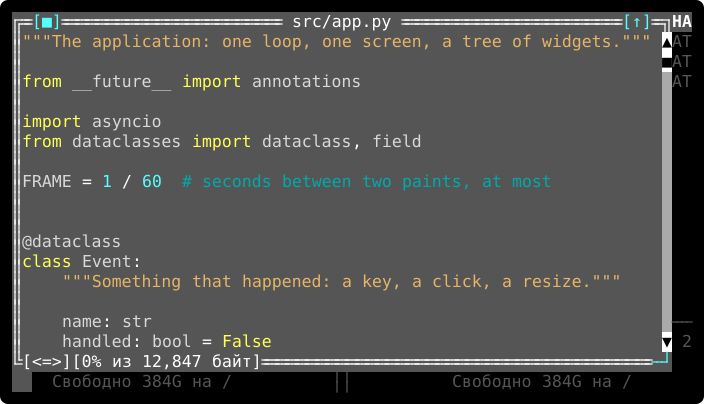
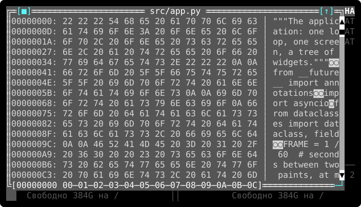
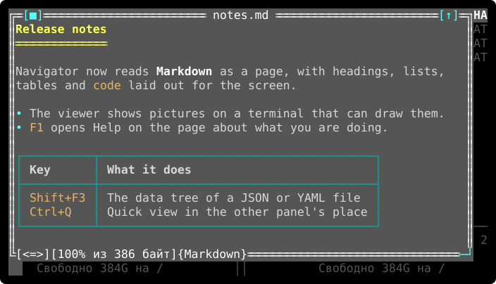
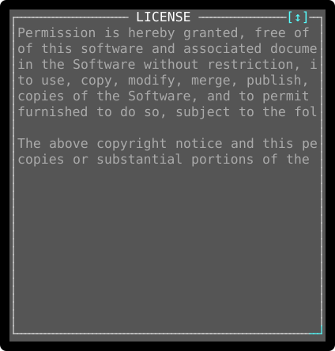
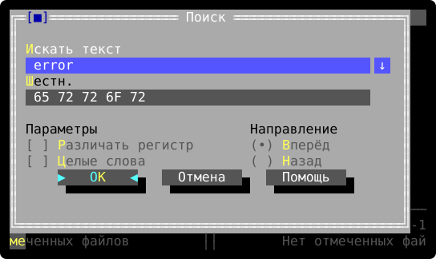
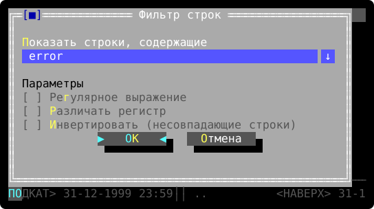
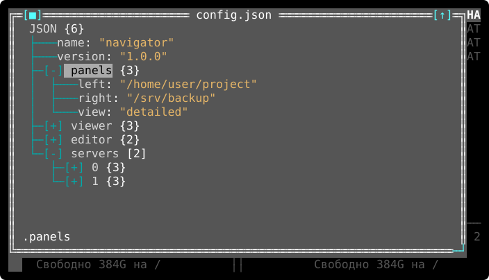
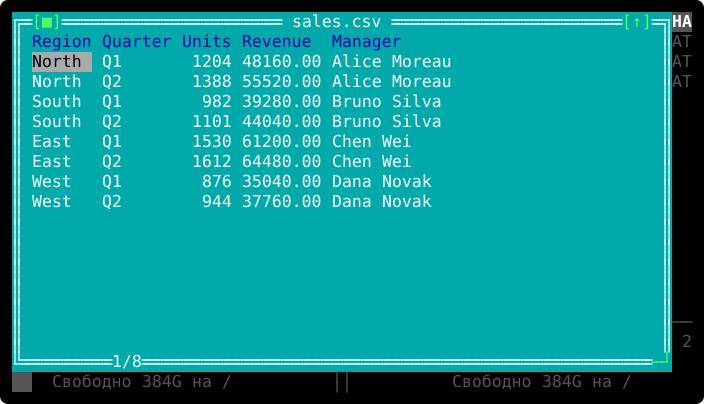

# Просмотрщик

`F3` показывает файл под курсором, не изменяя его. Он открывается сразу, каким бы большим ни был файл.

## Клавиши

| Клавиша | Что она делает |
|---|---|
| `Up`, `Down`, `PgUp`, `PgDn` | Прокрутка |
| `F2` | Переносить длинные строки или перестать переносить |
| `F4` | Переключение между текстом, шестнадцатеричным видом и дампом |
| `F5` | Переход на адрес |
| `F6` | Смена символьного фильтра |
| `F7` | Поиск; `Shift+F7` ищет снова, `Ctrl+F7` — назад |
| `Shift+F3` | Показать Markdown, HTML или похожий файл отрисованным или как исходный текст |
| `Shift+F4` | Редактировать файл |
| `Shift+F5` | Сохранить файл под другим именем |
| `Shift+F6` | Выбрать кодировку, в которой читается текст |
| `Ctrl+T` | Следить за концом растущего файла |
| `Ctrl+G` | Показывать только строки, содержащие текст |
| `Alt+PgDn` | Список файлов, просмотренных раньше |
| `Esc`, `F3` | Закрыть просмотрщик |

Те же команды есть в меню *Смотреть*, которое появляется в строке меню, пока открыт просмотрщик.

В шестнадцатеричном режиме байты можно менять: вводите поверх них шестнадцатеричные цифры или нажмите `Tab` и
вводите символы. `Shift+F2` записывает изменения в файл.

## Открытие файла

| Клавиша или пункт | Что он делает |
|---|---|
| `F3`, *Файл > Смотреть > Как есть* | Показывает файл под курсором так, как лучше всего показывать файлы его вида (см. ниже) |
| `Alt+F3`, *Файл > Смотреть > Встроенный просмотр* | Показывает его во встроенном просмотрщике Navigator — никогда не таблицей, не архивом и не программой из `viewers.ini` |
| *Файл > Смотреть > Текст*, *Двоичный файл* | Открывает просмотрщик в текстовом или шестнадцатеричном режиме |
| *Файл > Смотреть > База данных* | Открывает файл dBase или SQLite как [таблицу](#таблицы), как бы он ни назывался |
| *Файл > Смотреть > Электронная таблица* | Открывает файл CSV или TSV как таблицу |
| *Файл > Смотреть > Открыть...* | Показывает файл, выбранный в [окне выбора файла](dialogs.md#выбор-файла); файловый менеджер не нужен |
| `Alt+PgDn` | Показывает файл из списка файлов, просмотренных раньше |

`F3` открывает файл dBase, SQLite или CSV как таблицу и входит внутрь архива, как это делает `Enter`. Иначе, если
`viewers.ini` называет программу для этого файла, его показывает она ([ассоциации файлов](user-menu.md#связи-файлов));
в противном случае — просмотрщик Navigator. Если на странице [Система](settings.md#система) в настройках снят флажок
*Встроенный просмотр*, `F3` запускает программу из `viewers.ini`, а без неё — `$PAGER`.

`F3` на каталоге подсчитывает размер всего, что в нём лежит.

## Что показывается особо

Некоторые файлы показываются не как их текст. `Shift+F3` или *Смотреть > Просмотр разметки* переключает между таким
видом и собственным текстом файла; метка на нижней рамке, например `{Markdown}`, перечёркнута, пока вы видите
текст, а щелчок по ней тоже переключает вид.

- **Markdown, reStructuredText и HTML** показываются страницей: заголовки, списки, таблицы, цитаты и блоки кода
  разложены, а абзацы растянуты на ширину окна. Терминал может открыть ссылку со страницы. Поиск по `F7` ищет в
  тексте самого файла и показывает найденное место на странице.
- **PDF** показывается своим текстом, страница за страницей. Картинки в нём опускаются, а `F7` не находит текст
  PDF, который упакован внутри файла.
- **Картинка** рисуется картинкой в терминале, который это умеет, через графический протокол kitty или sixel.
  Большинству видов картинок нужен пакет Python Pillow (`pip install navigator-fm[images]`); без него рисуется
  только PNG в kitty. В остальных случаях показываются байты картинки. `--graphics` в
  [командной строке](command-line.md#цвета-и-символы) сообщает, что умеет терминал, если спросить его не
  получается.
- **JSON, YAML, TOML, XML и списки свойств** открываются как текст, а `Shift+F3` показывает их [деревом
  данных](#дерево-данных).
- **Файлы dBase, SQLite и CSV** открываются [таблицей](#таблицы) записей в отдельном окне.

Файл больше 4 МБ, а также PDF или картинка больше 64 МБ показываются как текст. Настройки
[Типы просмотра](settings.md#типы-просмотра) определяют, какие виды показываются особо и по каким маскам файлов.

## Быстрый просмотр

`Ctrl+Q` показывает файл под курсором на месте другой панели и следует за курсором при его перемещении. `Tab`
переводит клавиатуру в окно просмотра, где работают клавиши просмотрщика.

## Поиск

`F7` ищет в файле. `Shift+F7` ищет снова, а `Ctrl+F7` — назад.

- *Искать текст* — что искать. *Шестн.* — тот же поиск, записанный байтами в шестнадцатеричных цифрах; вводите в
  ту строку, которая удобнее для искомого.
- *Различать регистр* — отличать прописные буквы от строчных.
- *Целые слова* — пропускать места, где текст является частью более длинного слова.
- *Направление*: *Вперёд* к концу файла или *Назад* к его началу.

Поиск в большом файле показывает ход работы, и *Стоп*, `Esc` или `Enter` прерывают его.

## Переход на адрес

`F5` в шестнадцатеричном режиме запрашивает *Адрес* — позицию в файле, записанную шестнадцатеричным числом, — и
показывает файл с этого места.

## Фильтр строк

`Ctrl+G` или *Смотреть > Фильтр строк* показывает только строки, содержащие текст.

- *Регулярное выражение* — текст понимается как регулярное выражение.
- *Различать регистр* — отличать прописные буквы от строчных.
- *Инвертировать (несовпадающие строки)* — показывать строки, которые его не содержат.

## Дерево данных

`Shift+F3` на файле JSON, YAML, TOML, XML или списке свойств показывает его данные деревом, а повторное `Shift+F3`
возвращает к тексту. Строка внизу — путь узла под курсором.

| Клавиша | Что она делает |
|---|---|
| `F7` | Поиск по ключам и значениям; `Shift+F7` ищет снова |
| `Ctrl+S` | Найти ключ по мере ввода |
| `Ctrl+Ins` | Копировать путь узла в буфер обмена |
| `Ctrl+Shift+C` | Копировать значение узла в буфер обмена |
| `Shift+F4` | Редактировать файл |
| `Esc` | Закрыть окно |

В меню *Данные* есть те же команды, а также *Развернуть всё*.

## Поиск в таблице

`F7` в таблице ищет текст в записях. `Shift+F7` повторяет поиск.

- *Искать текст* — что искать.
- *Различать регистр* — отличать прописные буквы от строчных.
- *Область*: *В текущем поле* ищет только в колонке, где стоит курсор, *По всем полям* — во всех колонках.
- *Направление*: *Вперёд* от курсора к последней записи, *Назад* — к первой или *С начала* — с первой записи.

## Таблицы

Файл dBase, SQLite или CSV открывается таблицей записей.

- `F2` показывает структуру таблицы: её поля и их типы.
- `F3` на поле memo показывает текст memo в окне, где работают клавиши просмотрщика.
- `F6` на файле SQLite запрашивает запрос. Выполняется только читающий запрос; файл никогда не изменяется.
- `Shift+F6` на файле CSV или TSV задаёт, как он делится на ячейки: *Разделитель* (*Запятая*, *Точка с запятой*,
  *Табуляция*, *Вертикальная черта* или *Другой* с символом, введённым рядом), является ли *Первая строка —
  заголовок*, и *Кодировка*.
