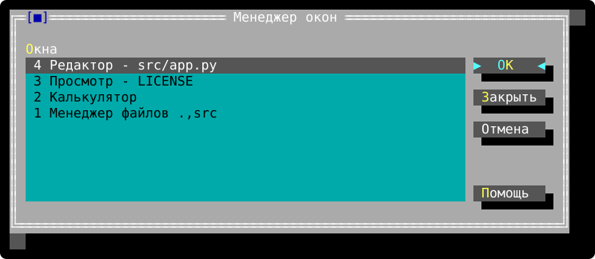
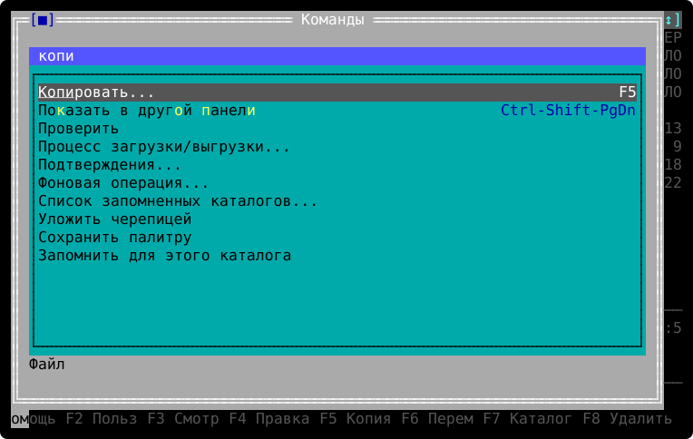

# Окна

Файловые менеджеры, программы просмотра, редакторы и инструменты открываются каждый в своём окне на рабочем
столе. Меню *Окна* упорядочивает их.

## Работа с окнами

| Клавиша | Что делает |
|---|---|
| `F9` | Переходит к следующему окну |
| `Shift+F9` | Переходит к предыдущему окну |
| `Alt+0` | Показывает список окон |
| `Alt+Z` | Разворачивает окно на весь рабочий стол и обратно |
| `Ctrl+F5` | Двигает окно стрелками или меняет его размер с `Shift` и стрелками; `Enter` оставляет его так, `Esc` возвращает на место |
| `Ctrl+F4` | Закрывает окно |

*Окна > Уложить черепицей* и *Каскад* сразу упорядочивают все окна, а *Закрыть все* закрывает их все. Мышью окно
перетаскивают за верхний край, его размер меняют за правый нижний угол, а щелчок по окну выводит его вперёд.

У каждого окна есть номер, который показан в списке окон.

## Два вида одного текста

*Окна > Новое окно текста*, или *Редактор > Файл > Новое окно текста*, открывает второе окно с текстом редактора,
стоящего впереди. Оба показывают один и тот же текст: то, что вы набираете в одном, появляется в другом, и у них
общая история отмены и общее сохранение. У каждого свой курсор, своя прокрутка и свой блок, так что можно работать
сразу в двух местах длинного файла.

## Операции в фоне

Копирование, перенос или удаление можно отправить в фон кнопкой *Фон* в окне хода операции. Тогда процент в
строке меню показывает, насколько она продвинулась, а `?` — что она ждёт ответа. *Окна > Фоновая операция*, или
щелчок по проценту, снова выводит окно хода операции; если операций несколько, сначала выводится их список, самые
старые первыми, с курсором на той, что ждёт ответа.

## Сохранение рабочего стола

*Настройки > Запомнить состояние* сохраняет открытые окна: каждый файловый менеджер с каталогами, видами и
сортировкой его панелей, каждый редактор с его файлом и местом в нём, каждую программу просмотра с её файлом и
местом, каждую таблицу с её записью, окно дерева, окно «Тома», калькулятор, календарь и положение каждого окна.
*Настройки > Восстановить состояние* закрывает открытые сейчас окна и возвращает сохранённые; активная панель
остаётся в том каталоге, где она сейчас, если только на странице [Загрузка/выгрузка](settings.md#загрузкавыгрузка)
настроек не отмечено *Запоминать каталог*. Если там отмечено *Автозапись состояния*, рабочий стол сохраняется при
выходе и восстанавливается при следующем запуске; каталоги, указанные в [командной строке](command-line.md),
главнее сохранённых.

## Список окон

`Alt+0`, или *Окна > Список*, перечисляет открытые окна, переднее первым.

- *OK*, или `Enter`, переходит к окну под курсором.
- Цифра переходит прямо к окну с этим номером.
- *Закрыть* закрывает окно под курсором. Список остаётся открытым, так что можно закрыть несколько.
- *Отмена* оставляет всё как есть.

## Палитра команд

`Alt+Shift+P`, или *Палитра команд* в меню `≡`, перечисляет все команды, применимые там, где вы находитесь:
пункты меню, в том числе собственного меню активного окна, и команды, которые запускаются только клавишей.
Каждая показана со своей клавишей, а та, что сейчас не может выполниться, показана серым.

Наберите по порядку несколько букв команды, чтобы сузить список. `Enter` выполняет команду под курсором, а `Esc`
закрывает список.
