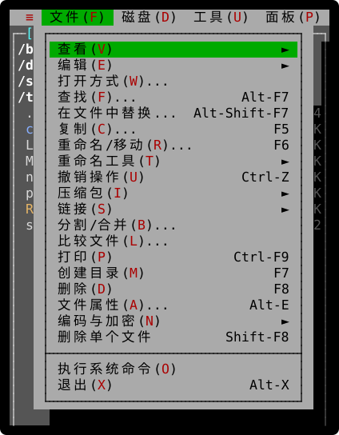

# Navigator 帮助

Navigator 是为现代终端重新打造的 DOS Navigator 双面板文件管理器。这些页面就是它的手册：在 Navigator 中按 `F1` 显示的也是这些文件。

## 入门

屏幕顶部是菜单栏，中间是两个文件[面板](panels.md)，其下是[命令行](console.md)，最底行是按键栏，标明各功能键的作用。在能报告修饰键的终端中，按住 `Alt`、`Ctrl` 或 `Shift` 会显示按住该键时各功能键的作用。

| 按键 | 作用 |
|---|---|
| `Tab` | 在两个面板之间切换 |
| `Enter` | 进入目录或打开文件 |
| `F3`、`F4` | [查看](viewer.md)或[编辑](editor.md)文件 |
| `F5`、`F6` | [复制，或重命名和移动](file-operations.md#复制和移动) |
| `F7` | 创建目录 |
| `F8` | 删除 |
| `F10` | 打开菜单 |
| `Ctrl+O` | 显示窗口后面的[控制台](console.md) |
| `Alt+X` | 退出 |
| `F1` | 关于当前操作的帮助；参见[帮助说明](help.md) |

所有命令都在菜单中，旁边标有其按键。`Alt+Shift+P` 通过输入命令名称的一部分来查找命令。

## 目录

文件和目录：

- [面板](panels.md)：移动、视图、排序、标记、信息面板、列、过滤、查找文件和重复文件、列表文件
- [文件操作](file-operations.md)：复制和移动、重命名、删除、撤消、属性、链接、分割和合并、UU、校验和、加密、文本转换、用其他应用程序打开、打印
- [压缩包](archives.md)：格式、打开、测试、创建压缩包和从中解压
- [比较](compare.md)：目录、同步窗口、两个文件
- [目录树](trees.md)：面板旁的目录树、切换目录、目录树窗口、目录大小
- [磁盘以外的位置](drives.md)：压缩包、服务器、容器、卷、磁盘映像、回收站
- [以 root 身份工作](as-root.md)：执行你没有权限的操作，以及 root 权限
- [连接](connections.md)：链接管理器、密码、主机密钥、端口转发、已保存的链接
- [书签](bookmarks.md)：列表及其按键

查看和修改文件：

- [查看器](viewer.md)：按键、打开文件、分页、PDF 和图片、搜索、过滤行、数据树、表格
- [编辑器](editor.md)：按键、打开文件、块、查找和替换、转到行、边距、语法高亮
- [宏](macros.md)：录制的按键，以及编辑器的宏

使用 Navigator：

- [命令行和控制台](console.md)：运行命令、命令窗口、历史
- [启动 Navigator](command-line.md)：`nav` 命令的选项
- [窗口](windows.md)：在窗口之间切换、同一文本的两个视图、后台操作、保存桌面、窗口列表、命令面板
- [对话框](dialogs.md)：按键，以及选择文件
- [复制和粘贴](clipboard.md)：按键、剪贴板工具，以及各种终端如何处理它们
- [设置](settings.md)：选项 > 设置 的每一页
- [按键和颜色](customizing.md)：键绑定、主题的颜色
- [用户菜单和文件关联](user-menu.md)

工具：

- [计算器](calculator.md)：四种界面、表达式和按键
- [工具](utilities.md)：进程列表、服务、系统监视器、环境变量、系统信息、日历、字符表、SmartPad、系统菜单
- [游戏](game.md)：按键、前十名、游戏设置

- [帮助说明](help.md)：当前位置的帮助，以及本窗口的按键
