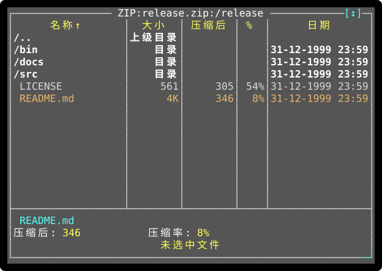
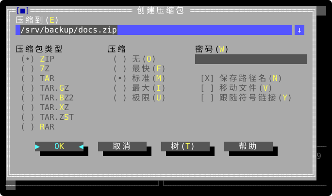
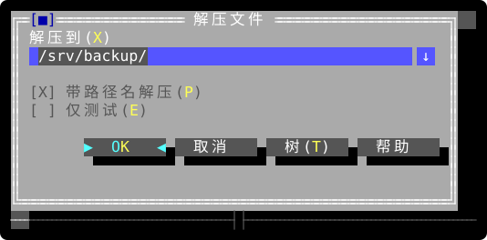

# 压缩包

Navigator 把压缩包显示为目录：在 zip 或 tar 文件上按 `Enter` 即可进入，其中的文件可以像其他文件一样查看和复制出来。本页介绍如何打开、创建和解压压缩包。

## 打开压缩包

在压缩包上按 `Enter` 或 `Ctrl+PgDn` 进入其中；在其顶层的 `..` 上则退出。`Enter` 根据名称识别压缩包：`.zip`、`.tar.gz`、`.7z`、`.deb` 等。*文件 > 压缩包 > 打开压缩包*，即 `Ctrl+PgDn`，无论名称如何都把光标下的文件当作压缩包打开，这样就能查看静态库（`.a`）或 AppImage 的内部，而按 `Enter` 会运行 AppImage。在设置的[文件面板](settings.md#文件面板)页取消勾选 *ENTER 打开压缩包* 后，只有 `Ctrl+PgDn` 能打开压缩包。

在压缩包内部，`F5` 把文件复制出来。如果该格式支持修改，`F8` 还可以删除文件，也可以把文件复制进去。详细视图显示每个文件的压缩后大小和压缩程度。

| 格式 | 需要什么 | 能否修改 |
|---|---|---|
| ZIP、TAR，以及用 gzip、bzip2 或 xz 压缩的 TAR | 不需要 | 能 |
| 用 gzip、bzip2、xz 或 lzma 压缩的单个文件 | 不需要 | 只能修改那一个文件 |
| 用 zstd 压缩的 TAR 或单个文件 | Python 3.14 之前需要 `zstd` 程序 | 能；单个文件只能修改那一个文件 |
| 7Z | 7-Zip（`7z`、`7zz` 或 `7za`） | 能 |
| RAR | `unrar`，或 7-Zip 的 `7z` 或 `7zz` | 只能用 RARLAB 的 `rar` |
| Debian 和 RPM 软件包、CPIO、静态库（`.a`） | 不需要 | 不能 |
| SquashFS 映像和 AppImage | squashfs-tools 中的 `unsquashfs` | 不能 |

缺少程序时，`Enter` 会提示需要安装哪个程序，而不是运行该文件。带密码的压缩包会询问密码。

## 测试压缩包

在压缩包内部，*文件 > 压缩包 > 测试压缩包* 完整读取所选文件并逐个检查；如果光标在 `..` 上且没有标记任何文件，则检查整个压缩包。未通过检查的文件会被列出。[解压](#解压文件)对话框中的 *仅测试* 在压缩包外部做同样的事。

## 创建压缩包

`Shift+F1`，即 *文件 > 压缩包 > 创建压缩包*，把所选内容打包成一个新的压缩包。

- *压缩到* 是压缩包的名称。该行打开时填有另一个面板的目录；不带目录的名称会在当前目录中创建压缩包。*树* 从目录树中选择目录。如果压缩包已存在，会询问是添加到其中还是替换它。
- *压缩包类型* 选择格式。名称的扩展名随类型变化，输入扩展名也会选定类型。需要未安装的程序的类型显示为灰色，按钮上方的一行会说明需要哪个程序。
- *压缩* 在时间和大小之间权衡，从 *无* 到 *极限*。格式不支持的级别显示为灰色；普通 TAR 没有压缩级别。
- *密码* 对压缩包加密。安装了 7-Zip 时可用于 ZIP 和 7Z，也可用于 RAR。需要再输入一次以确认。

选项：

- *保存路径名* 在压缩包中保留每个文件的目录，而不只是文件名。
- *移动文件* 在文件放入压缩包后删除原文件。
- *跟随符号链接* 打包链接所指向的内容，而不是链接本身。

## 解压文件

在压缩包上按 `Shift+F2`，或选择 *文件 > 压缩包 > 解压压缩包*，把它解压到指定的目录。在压缩包内部，*解压到* 解压所选内容。

- *带路径名解压* 会创建压缩包中的目录。不勾选时，所有文件都直接放入目标目录。
- *仅测试* 检查压缩包是否有错误，不写入任何内容。

*树* 从目录树中选择目标目录。
