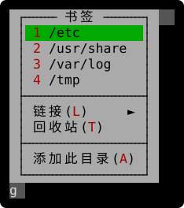

# 书签

书签是你经常去的目录。`Alt+F1` 打开左面板的书签列表，`Alt+F2` 打开右面板的，`Alt+C` 打开活动面板的；它们也是 *管理* 菜单中的 *左侧书签* 和 *右侧书签*。

## 书签列表

每个书签有一个键，依次是 `1` 到 `9`、`0`，然后是字母：按下这个键，或者移到该书签上按 `Enter`，面板就会转到那里。目录当前不存在的书签显示为灰色。

| 键 | 作用 |
|---|---|
| `Enter`，或书签的键 | 转到该目录 |
| `F2` | 给书签起一个标签，代替路径显示。标签留空则去掉标签 |
| `Ctrl+Up`、`Ctrl+Down` | 在列表中上移或下移书签 |
| `Del` | 删除书签 |
| `Esc` | 关闭列表 |

最后一项是 *添加此目录*，它把面板的目录加为书签；如果该目录已是书签，这一项就变成 *移除此目录*。

分隔线下面列出当前已挂载、但不是书签的磁盘，例如 U 盘。它们只是可去的地方，不会被保存。列表中还有一个 *链接* 部分，列出你[保存的连接](connections.md)。

删除前会先询问。在询问框中勾选 *不再询问*，或者在[确认](settings.md#确认)页上取消 *删除书签*，即可关闭这个询问。

## 不打开列表

`Alt+1` 到 `Alt+9` 让活动面板直接转到前九个书签。`Alt+Shift+1` 到 `Alt+Shift+9` 把面板的目录存为该位置的书签。

## 最初的书签

Navigator 第一次启动时，会把你的主目录、桌面已有的文件夹（如“文档”和“下载”）以及挂载磁盘的目录加为书签。此后列表就归你管理：你删除的书签不会再回来。
