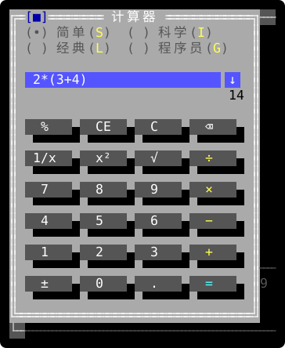
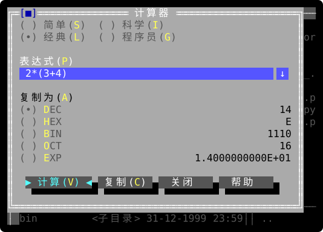
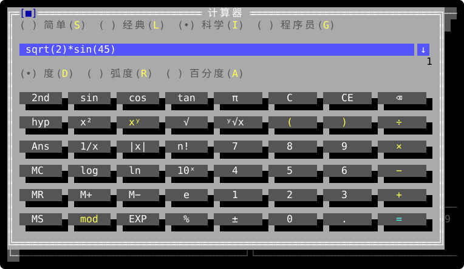
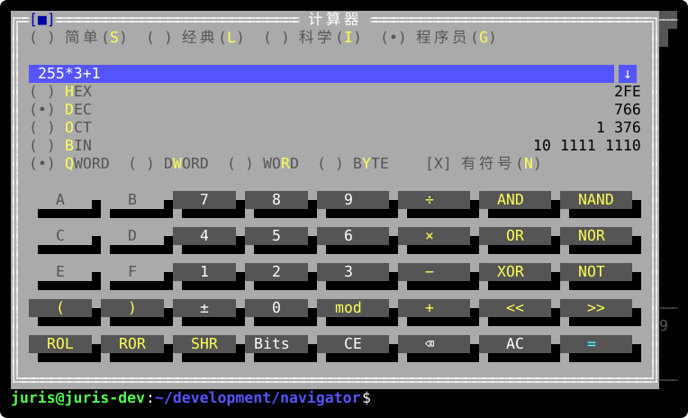

# 计算器

`Ctrl+F6`，即 *工具 > 计算器*，打开计算器。在输入行中输入表达式，边输入边计算出它的值。`Enter` 求值：表达式进入输入行的历史，值保持选中状态，因此输入数字会开始新的计算，输入运算符则在该值的基础上继续。

## 四种界面

计算器有四种界面，可以从顶部的标签条、*计算器* 菜单中选择，或再按一次 `Ctrl+F6` 切换到下一个。它会记住上次使用的界面。

- *简单* 是一个袖珍计算器：数字和四则运算。
- *经典* 同时以五种形式显示值：十进制、十六进制、二进制、八进制和科学计数法。
- *科学* 增加了函数、角度单位选择、存储器和上次的结果。
- *程序员* 以选定位宽的整数运算，使用四种进制。

在 *简单*、*科学* 和 *程序员* 界面中，输入行下方的键盘区可以像键盘一样向其中输入。函数键会把光标前的数字括起来：先按 `9` 再按 `√` 得到 `SQRT(9)`。

## 表达式

| 写法 | 含义 |
|---|---|
| `12`、`1.5`、`.5`、`1E+3` | 数字 |
| `$FF`、`0FFh`、`0x1F` | 十六进制数 |
| `101b`、`0b101` | 二进制数 |
| `17o` | 八进制数 |
| `+`、`-`、`*`、`/` | 四则运算 |
| `^` | 乘方：`2^10` |
| `%` | 两个整数相除的余数 |
| `&`、`\|`、`\`、`~` | 按位与、或、异或、非 |
| `<<`、`>>` | 移位 |
| `=`、`<>`、`<`、`>`、`<=`、`>=` | 比较，结果为 1 或 0 |
| `&&`、`\|\|` | 两个真值的与、或 |
| `(`、`)` | 括号 |
| `PI` | 圆周率 π |

不区分大小写。乘除先于加减，乘方先于所有运算。

函数有 `SIN`、`COS`、`TAN`、`CTAN`、`ARCTAN`、`SQR`（平方）、`SQRT`（平方根）、`LN`、`LG`（以十为底的对数）、`EXP`、`SIGN`，以及 `IF(condition, a, b)`：条件为真时为 `a`，否则为 `b`。

## 经典

五行分别以各种形式显示值；不是整数的值在十六进制、二进制和八进制中只显示其整数部分。

- *计算* 求出表达式的值，与 `Enter` 相同。
- *复制为* 选择形式，*复制* 以该形式把值放到剪贴板。
- *关闭* 关闭计算器。

## 科学

- *度*、*弧度* 和 *百分度* 选择三角函数接受和返回的单位。
- 更多函数：`ASIN`、`ACOS`、`ATAN`、`SINH`、`COSH`、`TANH`、`ABS`、`CBRT`、`ROOT(x, n)`、`LOG`、`LOG2`、`FACT`，以及数字后的 `!` 表示阶乘。`E` 是自然常数 e。
- `ANS` 或 *Ans* 键是上次求出的值。
- 存储器键：*MS* 存入值，*MR* 调出值，*M+* 和 *M−* 加到存储值上和从中减去，*MC* 清除存储器。
- *2nd* 和 *hyp* 改变函数键输入的内容：分别为反函数和双曲函数。

## 程序员

- *HEX*、*DEC*、*OCT* 和 *BIN* 选择输入数字所用的进制。值同时以四种进制显示。
- *QWORD*、*DWORD*、*WORD* 和 *BYTE* 选择数字的位宽：64、32、16 或 8 位。放不下的结果会截断为该位宽。
- *有符号* 把数字当作有符号数。不勾选时，数字永远不会为负。
- 除法得到整数。
- 运算也可以写成单词：`AND`、`OR`、`XOR`、`NAND`、`NOR`、`NOT`、`MOD`、`SHL`、`SHR`、`SAR`、`ROL` 和 `ROR`。
- *计算器* 菜单中的 *位键盘* 以 64 个位代替按键显示。单击或按 `Space` 翻转一个位。

## 按键

| 按键 | 作用 |
|---|---|
| `Enter` | 求值 |
| `Ctrl+F6` | 下一个界面 |
| `Ctrl+1` 到 `Ctrl+4` | 简单、经典、科学、程序员界面（终端能发送这些键时） |
| 在输入行上按 `Down` | 表达式历史 |
| `Esc` | 关闭计算器 |
