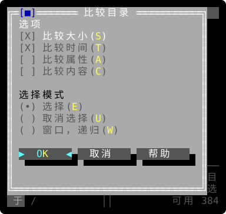
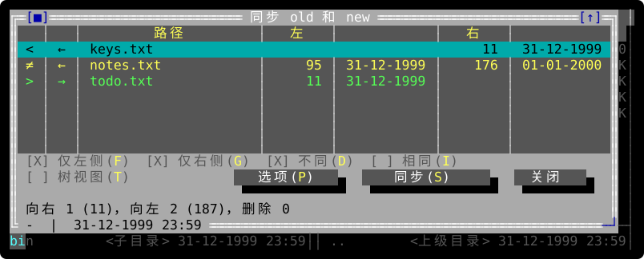
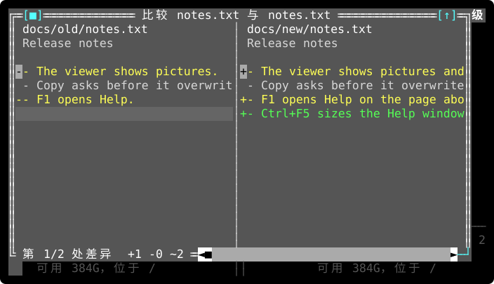

# 比较

## 比较目录

*面板 > 比较目录* 按名称比较两个面板中的文件。

- *比较大小*、*比较时间*、*比较属性* 和 *比较内容* 选择同名的两个文件在什么条件下算作相同。只有 *比较内容* 会读取文件，耗时更长。
- *选择* 在每个面板中标记在另一个面板中没有对应项的文件。把标记的文件复制过去，就能让另一个目录保持最新。
- *取消选择* 则改为取消这些文件的标记。
- *窗口，递归* 比较目录及其中的所有内容，并打开同步窗口。

## 同步

同步窗口列出只在一侧存在或有差异的每个文件，左面板的目录在左边。每一行都有一个操作：复制到右侧、复制到左侧、删除或跳过。窗口会给出建议的操作，*同步* 菜单可以为光标下的行或一次为所有行更改操作。

- *同步*（`F5`）在询问后执行这些操作。
- *比较文件*（`Enter` 或 `F3`）并排显示该行的两个文件。
- *重新比较*（`Ctrl+R`）重新读取两个目录。
- *显示仅左侧*、*显示仅右侧*、*显示不同* 和 *显示相同项* 选择列出哪些行。
- *树视图*（`Ctrl+T`）以目录树的形式列出各行。
- *选项* 设置如何比较文件，以及用于选择要查看哪些文件的[文件掩码](panels.md#文件掩码)。

### 选项

同步窗口中的 *选项* 设置比较什么以及如何比较。*OK* 重新比较两个目录。

- *文件掩码* 选择要查看的文件；留空则比较全部。模式之间用 `;` 分隔。模式前的 `-` 排除其文件，模式后的 `/` 表示目录：`*.py;-.git/`。
- *视为相同的时间* 规定两个时间必须多接近：*精确到秒*、*2 秒以内 (FAT)* 或 *1 分钟以内 (FTP)*。
- *或恰好相差一小时* 把相差一小时的时间也视为相同，夏令时切换会在 FAT 磁盘上造成这种情况。
- *非对称：右侧成为左侧的副本* 建议删除只在右侧存在的内容，并把每个不同的文件复制到右侧，无论哪一侧更新。

## 比较文件

*文件 > 比较文件* 并排显示两个文件，并标出它们的差异。它使用活动面板中已标记的两个文件。没有标记时，它使用光标下的文件和另一个面板中的同名文件；如果没有同名文件，则使用另一个面板光标下的文件。

