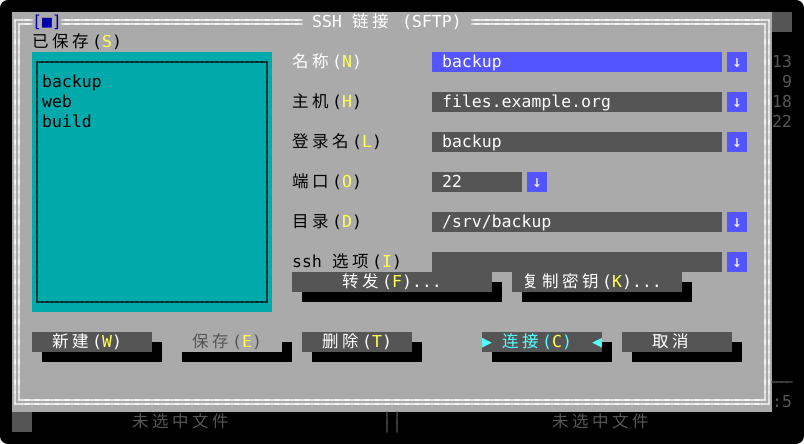
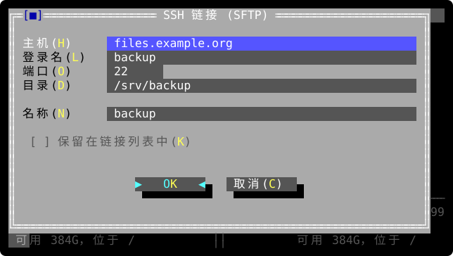
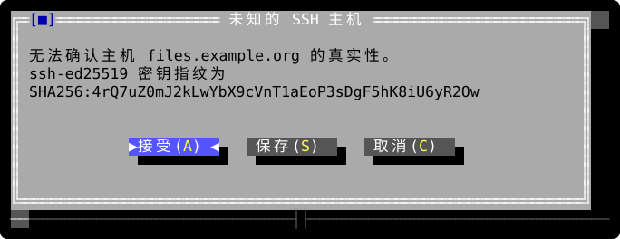
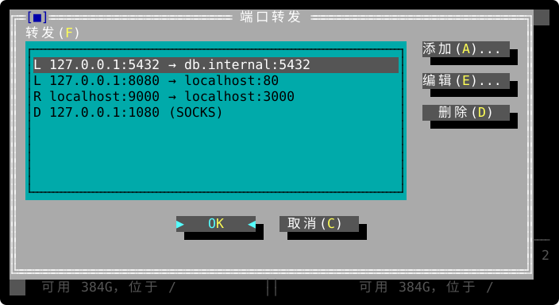
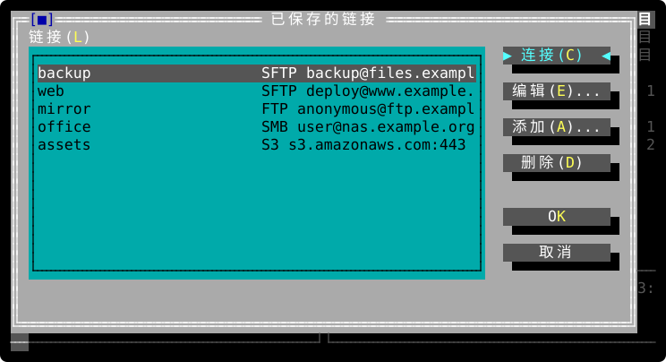

# 连接

本页介绍如何让面板显示服务器上的内容，以及如何保存常用的连接。各种位置是什么，以及到达它们的其他途径，参见[磁盘以外的位置](drives.md)。

## 链接管理器

*工具 > 链接* 中的每一项，例如 *SSH (SFTP)*（`Alt+F11`），会在左侧显示为该协议保存的连接，在右侧显示一个连接的各项输入行。

- 对话框打开时输入行是空的。填写后按 *连接*，即可建立一个不保存的连接。
- 在 *已保存* 下选择一个连接，把它填入输入行。双击则直接连接。
- *新建* 创建一个保存的连接，其名称可以改写。*保存* 保留所做的更改；已更改的连接标有 `*`，离开它时会询问是否保存。*删除* 删除该连接。
- *连接* 让活动面板转到那里。从 *工具 > 远程 Shell* 打开时，则改为在窗口中打开一个 shell。

各输入行即[一个连接](#一个连接)的各项。每行都记得以前填过的内容；在输入行上按 `Down` 打开其历史。

SSH 管理器还多三项：

- *ssh 选项* 在打开远程 shell 时传给 `ssh`。
- *转发* 设置该连接的[端口转发](#端口转发)。
- *复制密钥* 把你的一个公钥放到服务器上，以后连接就不再需要密码。

rclone 管理器的 *配置* 运行 `rclone config` 来设置远程。

## 一个连接

| 输入行 | 含义 |
|---|---|
| *主机* | 服务器的名称或地址。对于 SSH，可以使用 `~/.ssh/config` 中的 `Host` 名称，留空的登录名和端口会按该文件的内容填写 |
| *登录名* | 连接所用的用户 |
| *端口* | 端口，在不是该协议的常用端口时填写 |
| *目录* | 面板在服务器上的起始位置 |
| *名称* | 保存该连接所用的名称 |

不同协议的输入行略有不同：FTP 连接有 *使用 TLS 加密*，勾选后即为 FTPS；GVfs/KIO 位置只有 *名称* 和 *URI*。

*保留在链接列表中* 以其名称保存该连接，以后一步即可再次连接。

## 密码和口令

连接需要时，会询问服务器的密码或私钥的口令。*保存到密钥环* 把它记在桌面的密钥环中，以后不再询问。只有存在可供保存的密钥环时才显示此项。

## 未知的主机密钥

第一次连接某个 SSH 服务器时，它的主机密钥不在 `~/.ssh/known_hosts` 中，因此会像 `ssh` 那样询问是否继续。

- *接受* 只在本次连接中信任该密钥。
- *保存* 还会把它写入 `~/.ssh/known_hosts`，以后不再询问。
- *取消* 不进行连接。

接受之前，请把显示的指纹与从服务器管理员处获得的指纹进行比对。

## 端口转发

SSH 管理器中的 *转发* 列出一个连接的端口转发。*添加*、*编辑* 和 *删除* 修改该列表，保存连接时列表随之保存。

| 类型 | 作用 |
|---|---|
| *本地 (-L)* | 本机上的一个端口通向目标，目标从服务器访问 |
| *远程 (-R)* | 服务器上的一个端口通向目标，目标从本机访问 |
| *动态 SOCKS (-D)* | 本机上的一个端口成为经由服务器的 SOCKS 代理 |

*监听地址* 和 *监听端口* 是等待连接的一端，*目标主机* 和 *目标端口* 是连接被发送到的地方。动态转发没有目标。

## 已保存的链接

*工具 > 已保存的链接* 在一个对话框中列出所有协议的已保存连接。*连接* 打开光标下的连接，*编辑* 修改它，*添加* 新建一个，*删除* 删除它。用 *OK* 离开时保留这些更改。

*工具 > 断开*（`Alt+H`）关闭一个连接；原先显示该连接的面板会回到磁盘。
