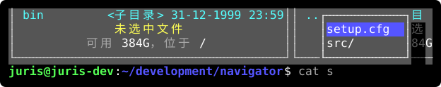
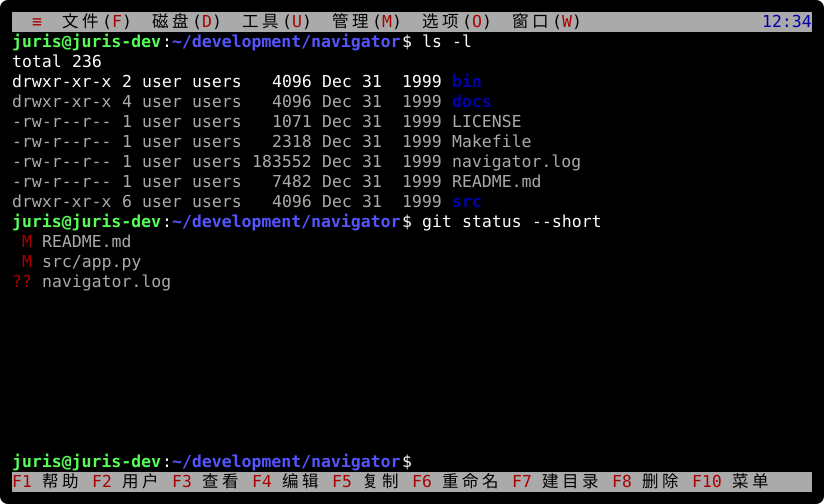
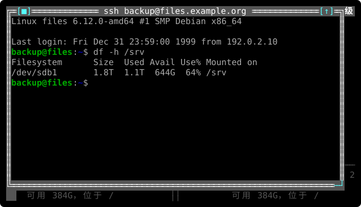
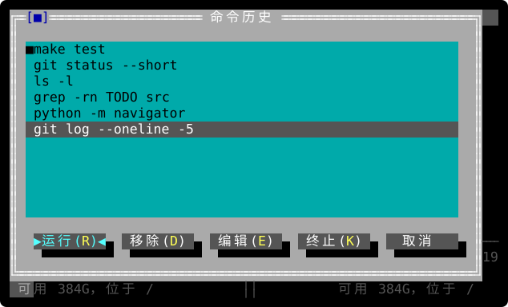

# 命令行和控制台

面板下方是命令行，窗口后面是控制台：一个运行着你的 shell 的终端。

## 命令行

面板拥有键盘焦点时，输入的任何内容都会进入命令行。`Enter` 在 shell 中、在活动面板的目录下运行它，输出显示在控制台中。

| 按键 | 作用 |
|---|---|
| `Enter` | 运行命令 |
| `Ctrl+Enter` | 把光标下文件的名称放到命令行上 |
| `Ctrl+E`、`Ctrl+X` | 调出上一条、下一条命令 |
| `Tab` | 命令行中有文本时，补全正在输入的单词 |
| `Esc` | 清空命令行 |

命令行中有文本时，`Left`、`Right`、`Home` 和 `End` 用于编辑它。在面板中的程序上按 `Enter` 会运行该程序。

命令执行后，面板会重新读取各自的目录；如果命令改变了目录，活动面板会跟随 shell 转到新目录。

## 控制台

`Ctrl+O` 隐藏窗口并显示控制台；再按 `Ctrl+O` 恢复窗口。窗口隐藏时，按键会发送给 shell，或其中正在运行的程序。

`Shift+PgUp` 和 `Shift+PgDn` 向回滚动浏览控制台显示过的内容，`Shift+Up` 和 `Shift+Down` 按行滚动。

控制台中有程序运行时，它会接收所有按键，包括 `F1` 和 `F10`；请先按该程序自己的方式退出它。

## 在窗口中运行命令

命令可以在面板旁的单独窗口中运行，而不是在控制台上。在命令行开头加上 `&`，或用 `Shift+Enter` 代替 `Enter`。

窗口中的程序接收除了把其他窗口调到前面的按键以外的所有按键。程序结束后，窗口保留其输出，标题显示程序如何结束；`Esc` 或 `Enter` 关闭窗口。在程序运行时关闭窗口会结束该程序。

*工具 > 远程 Shell* 在这样的窗口中打开服务器、容器或设备上的 shell。

## 执行命令

*文件 > 执行系统命令* 在一个输入行中询问命令，该输入行与命令行共用历史。

- *在窗口中* 在单独的窗口中运行命令，而不是在控制台上。
- *最大化* 让该窗口覆盖整个桌面。
- *模态* 在该窗口关闭之前，键盘焦点一直留在其中。

## 命令历史

`Alt+F8`，即 *工具 > 命令历史*，列出你输入过的命令，最新的在最后。

- *运行* 或 `Enter` 运行光标下的命令。
- *移除* 把它放到命令行上但不运行。
- *编辑* 在对话框中修改它；修改后的命令成为最新的一条。
- *终止* 或 `Del` 把它从历史中删除。

*工具 > 模糊搜索历史*（`Alt+Shift+F8`）用 `fzf` 搜索在这里和在 shell 中输入过的命令。

## 文件历史

`Alt+PgDn` 列出以前查看过的文件，`Alt+PgUp` 列出以前编辑过的文件；它们就是 *工具* 菜单中的 *文件查看历史* 和 *文件编辑历史*。*打开* 再次打开光标下的文件，*删除记录* 把它从列表中删除。
