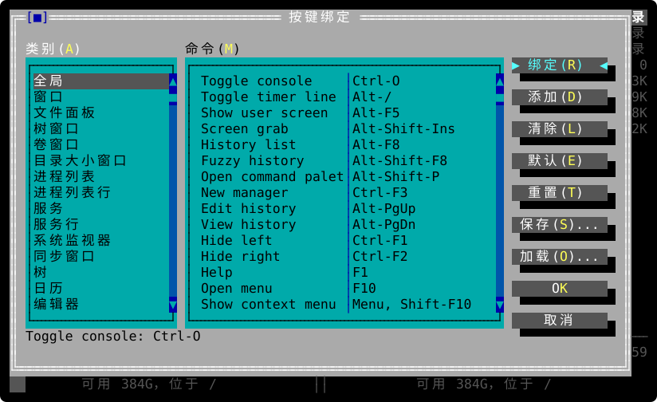
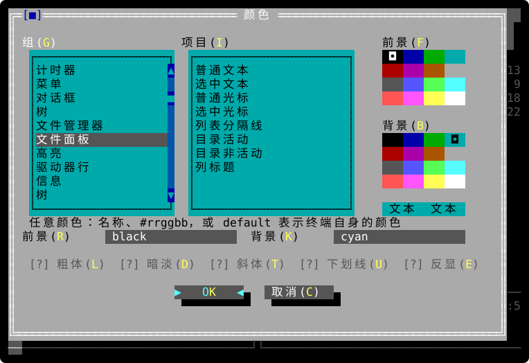

# 按键与颜色

## 按键绑定

*选项 > 配置 > 按键绑定* 用来更改各个键的作用。按键按其生效的位置分成若干节：全局、文件管理器、编辑器、查看器、对话框等等。

选中一个命令，然后按下想给它的键。

*保存* 把整套绑定写入一个文件，*加载* 则读入一个文件。Navigator 自带四套：它的默认设置，以及仿照 WordStar、DOS Navigator 1.51 和 Emacs 的几套。

绑定保存在配置目录中的 `keybindings.ini` 里。在列表和文本中移动光标的键是固定的，不能更改。

## 颜色

*选项 > 颜色* 用来更改当前主题的颜色。

- *组* 和 *项目* 选择要着色的对象。
- *前景* 和 *背景* 从十六种颜色中选择；旁边的输入行可接受任意颜色，可以写颜色名，也可以写成 `#rrggbb`。
- 五个复选框分别设置粗体、暗淡、斜体、下划线和反显。显示 `?` 的复选框表示该属性沿用项目继承来的值。

更改时屏幕会随之变化。*确定* 为此主题保留更改；*取消* 则全部还原。

*存储调色板* 把这些颜色保存为你自己的主题，之后 `--theme` 和 *加载调色板* 都能找到它。*加载调色板* 则套用另一个主题的颜色。

要使用其他主题，请用 `--theme NAME` 启动 Navigator；`--list-themes` 会列出所有主题。
