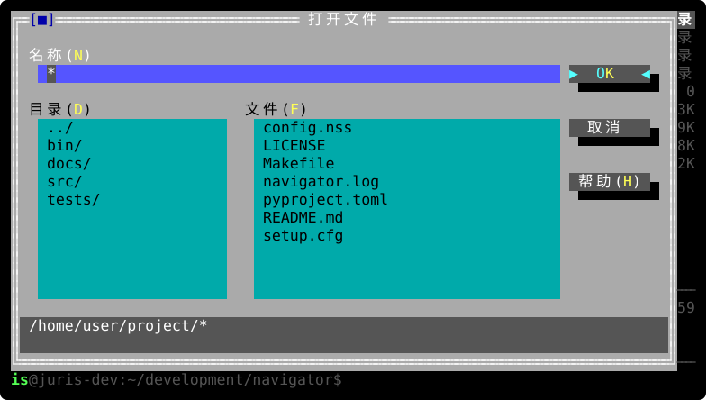

# 对话框

对话框在关闭之前独占键盘。

## 对话框中的按键

| 键 | 作用 |
|---|---|
| `Tab`、`Shift+Tab` | 转到下一个或上一个控件 |
| `Alt` 加高亮字母 | 转到带有该字母的控件 |
| `Enter` | 按下默认按钮，即带箭头标记的那个 |
| `Esc` | 关闭对话框，不做任何操作 |
| `Space` | 勾选复选框，或选中单选按钮 |
| 在旁边有 `↓` 的输入行上按 `Down` | 打开该行的历史 |
| `F1` | 显示此对话框的帮助 |

在历史列表中，`Enter` 选用一条记录，`Del` 删除它。

## 选择文件

有些命令用同一个对话框来要求选择文件：上面一行是名称，下面是所查看位置中的文件和目录。

- *名称* 是文件名。可以输入完整路径。含有 `*` 或 `?` 的名称，或者目录名，会列出相应的文件，而不是选中某个文件。
- *文件* 列出匹配的文件。在其中键入字母会找到以这些字母开头的名称。
- *目录* 列出各个目录；在目录上按 `Enter` 进入该目录。
- 底部的窗格显示路径，以及光标所在文件的大小和日期。
- *确定*，或在文件上按 `Enter`，选中该文件。

`Left` 和 `Right` 在各列表和按钮之间移动。
