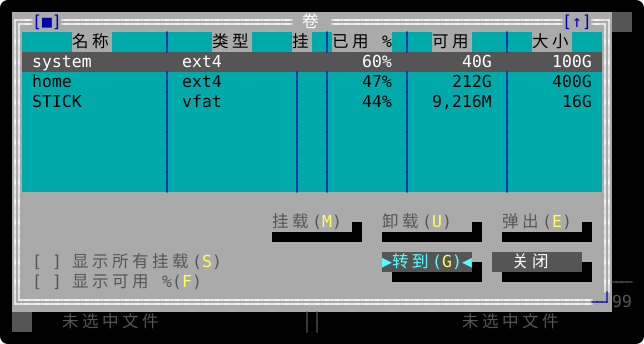
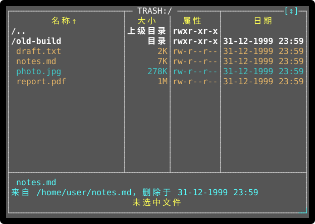

# 磁盘以外的位置

面板显示的不只是磁盘上的目录。无论面板位于何处，文件的查看、编辑、复制和删除方式都相同。

## 压缩包

在压缩包（例如 zip 或 tar 文件）上按 `Enter`，就像进入目录一样进入其中。用 `F5` 把文件复制出来或复制进去。创建和解压参见[压缩包](archives.md)。

## 服务器、容器和设备

*工具 > 链接* 在另一台机器或服务上打开面板。每一项都保存着你建立过的连接列表，以便再次连接；其对话框参见[连接](connections.md)。

| 菜单项 | 可到达的位置 |
|---|---|
| *SSH (SFTP)*、`Alt+F11` | 通过 SSH 访问的服务器 |
| *FTP* | FTP 或 FTPS 服务器 |
| *SMB* | Windows 共享 |
| *S3* | S3 或兼容服务中的存储桶 |
| *Docker 容器*、*Podman 容器* | 正在运行的容器内的文件 |
| *Android 设备* | 通过 `adb` 访问的手机或平板电脑 |
| *rclone 远程* | 在 `rclone` 中设置的任何远程，例如 Google Drive 或 Dropbox |
| *GVfs/KIO 链接* | 桌面能访问的任何位置，例如通过 MTP 访问的手机或 WebDAV 服务器 |

所需程序未安装时，菜单项显示为灰色；其工具提示会说明需要哪个程序。

在要求输入目录的地方，也可以输入地址，例如 `sftp://user@host/dir` 或 `smb://host/share`。

*工具 > 远程 Shell* 在服务器、容器或设备上打开一个 shell。*工具 > 断开*（`Alt+H`）关闭一个连接；原先显示该连接的面板会回到磁盘。

## 卷

*磁盘 > 卷* 列出磁盘和可移动介质，并可挂载、卸载和弹出它们。

### 磁盘映像

在磁盘映像（`.iso` 或 `.img` 文件）上按 `Enter`，或在光标位于其上时选择 *磁盘 > 挂载映像*，会以只读方式挂载它并在面板中打开。在映像内部或在映像上选择 *磁盘 > 卸载映像*，会再次卸载它，并让原先位于其中的面板回到映像文件。这需要 udisks2，大多数桌面环境都在运行它；设置的[文件面板](settings.md#文件面板)页中的 *ENTER 挂载磁盘映像* 可关闭 `Enter` 的这一功能。

## 回收站

在设置的[文件面板](settings.md#文件面板)页勾选 *F8 移到回收站* 后，`F8` 会把磁盘上的文件移到回收站，而不是删除它们。此时[删除](file-operations.md#删除)对话框中会勾选 *移到回收站*；取消勾选即可永久删除文件。[撤消](file-operations.md#撤销)（`Ctrl+Z`）可撤回最近一次移到回收站的操作。

*磁盘 > 回收站*，或双击回收站图标，会在活动面板中显示回收站中的文件。面板下方的信息行显示光标下文件的原位置和删除时间。

- *文件 > 从回收站还原* 把所选文件放回原位置。
- 在那里按 `F8` 会永久删除它们。
- `F5` 像从任何目录一样把它们复制出来。

*磁盘 > 清空回收站* 在询问后永久删除回收站中的所有内容。

## 书签

`Alt+F1` 和 `Alt+F2` 为左面板和右面板打开书签目录列表，`Alt+C` 为活动面板打开。列表的按键参见[书签](bookmarks.md)。
