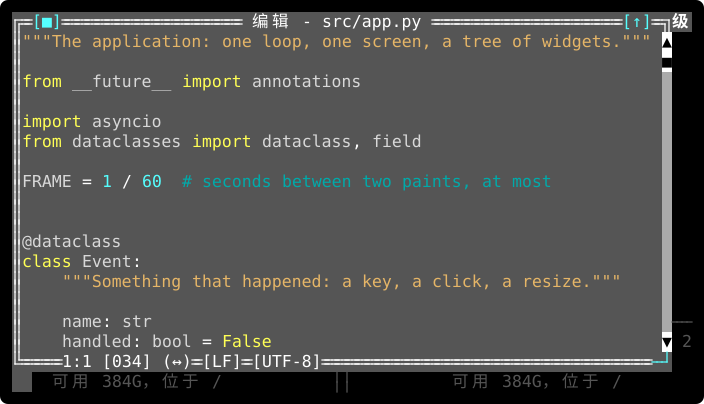
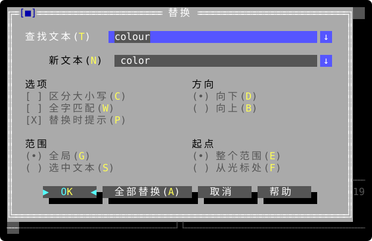
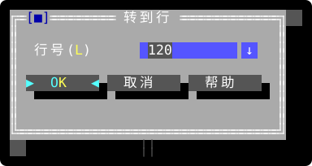
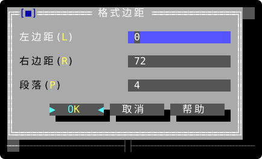

# 编辑器

`F4` 在编辑器中打开光标下的文件。所有命令也都在 *编辑器* 菜单中，编辑器打开时该菜单出现在菜单栏上。



## 按键

| 按键 | 作用 |
|---|---|
| `F2` | 保存 |
| `Shift+F2` | 另存为 |
| `Ctrl+F4` | 关闭编辑器；文本有改动时先询问 |
| `Alt+Backspace` | 撤消 |
| `Alt+Shift+Backspace` | 重做 |
| `Ctrl+Y` | 删除当前行 |
| `Ctrl+Backspace` | 删除左边的单词 |
| `Ctrl+N` | 插入一行 |
| `F7`、`Ctrl+F7` | [查找和替换](#查找和替换) |
| `Alt+G` | [转到行](#转到行) |
| `Alt+PgUp` | 列出以前编辑过的文件 |

## 打开文件

| 按键或菜单项 | 打开的内容 |
|---|---|
| `F4` | 光标下的文件 |
| `Alt+F4`、`Ctrl+K`、*文件 > 编辑 > 备用编辑* | 用另一个编辑器打开光标下的文件：见下文 |
| `Shift+F4`、*文件 > 编辑 > 编辑新文件* | 在[文件对话框](dialogs.md#选择文件)中指定名称的文件。尚不存在的名称在保存时创建 |
| *文件 > 编辑 > 打开...* | 在文件对话框中选择的文件，不需要文件管理器。尚不存在的名称在保存时创建 |
| `Alt+PgUp` | 以前编辑过的文件列表中的一个文件 |

`F4` 使用 Navigator 的编辑器，*备用编辑* 则使用另一个程序：`editors.ini` 为该文件指定的程序（[文件关联](user-menu.md#文件关联)），否则列出终端中已安装的编辑器，例如 `vim` 或 `nano`，所选的编辑器在单独的窗口中运行。在设置的[系统](settings.md#系统)页取消勾选 *内部编辑器* 后，这两个键互换：`F4` 运行 `editors.ini` 的程序，否则运行 `$EDITOR`，而 *备用编辑* 使用 Navigator 的编辑器。之所以有 `Ctrl+K`，是因为许多窗口管理器会在按 `Alt+F4` 时关闭终端。

在目录上按 `F4` 会打开它的[文件属性](file-operations.md#文件属性)。

以前编辑过的文件会在上次离开的位置打开。

## 块和剪贴板

移动光标时按住 `Shift`，或用鼠标拖动，即可标记一个块。

| 按键 | 作用 |
|---|---|
| `Ctrl+Ins`、`Ctrl+C` | 复制块 |
| `Shift+Del`、`Ctrl+X` | 剪切块 |
| `Shift+Ins`、`Ctrl+V` | 粘贴 |
| `Ctrl+Del` | 删除块 |
| `Alt+Shift+I`、`Alt+Shift+O` | 增加、减少块的缩进 |
| `Alt+Shift+U`、`Alt+Shift+L` | 把块改为大写、小写 |
| `Alt+T` | 对块中的行排序 |
| `Alt+H` | 隐藏或显示块 |

[复制和粘贴](clipboard.md)说明了哪些复制和粘贴键在哪种终端中可用。

*选项* 子菜单切换本窗口的行为，例如自动缩进、行号和语法高亮。新编辑器的初始设置在设置的[编辑器/查看器](settings.md#编辑器查看器)页中设定。

## 查找和替换

`F7` 查找文本，`Ctrl+F7` 替换文本。`Shift+F7` 重复上一次搜索，包括替换。

对话框打开时会猜测你要找的内容：如果标记的文本在一行之内就用它，否则用光标下的单词。



- *查找文本* 是要查找的文本。在该行上按 `Down` 打开以前搜索的历史。
- *新文本* 在替换时是要放到原处的文本。

### 选项

- *区分大小写* 区分大写字母和小写字母。
- *全字匹配* 跳过属于更长单词一部分的匹配。
- *替换时提示* 在每次替换前询问：*是*、*否*、*全部*（本处及之后的所有匹配）或 *取消*。

### 查找位置

- *方向*：*向下* 朝文本末尾查找，*向上* 朝文本开头查找。
- *范围*：*全局* 搜索整个文本，*选中文本* 只搜索标记的块。
- *起点*：*整个范围* 从范围的开头开始，*从光标处* 从光标开始。

### 替换

*OK* 替换第一个匹配。*全部替换* 替换所有匹配，并报告替换了多少处。每次替换都可以单独撤消。

### 查找栏

`Ctrl+F` 和 `Ctrl+R` 在编辑器窗口内打开一个查找栏，而不是对话框。它边输入边查找，在屏幕上突出显示所有匹配，并可按正则表达式搜索。

## 转到行



`Alt+G` 询问行号，并把光标放到该行。行从 1 开始计数。对话框打开时填有上次输入的数字。

## 边距



*编辑器 > 段落 > 边距* 设置段落排版所依据的三个数字。它们只对本编辑器窗口有效；初始值来自编辑器设置。

- *左边距* 是每行开始的列。
- *右边距* 是一行最多能到达的列。
- *段落* 是段落首行开始的列。

要排版一个段落，先把它标记为块，然后按 `Alt+J` 两端对齐，`Alt+L` 左对齐，`Alt+R` 右对齐，或 `Alt+C` 居中。整个块被视为一个段落。

## 语法高亮

编辑器和查看器会按各部分的含义为程序、网页、配置文件等多种文件的文本着色。文件使用哪种着色由 `highlight.ini` 中的文件名决定；对于没有已知扩展名的脚本，则由其第一行决定，例如 `#!/bin/sh`：*选项 > 编辑高亮文件* 在编辑器中打开该文件。

```ini
[*.conf]
lexer = ini

[*.txt]
lexer = none
autowrap = on
right_margin = 72
```

- 每个节是一个[文件掩码](panels.md#文件掩码)。第一个与文件匹配并指定了 `lexer` 的节决定语言；没有任何节匹配的文件由 Pygments 猜测。
- `lexer` 指定语言，使用 Pygments 中的名称（`python3 -m pygments -L lexers` 可列出全部）。`none` 不着色；`auto` 让 Pygments 根据名称和内容猜测。
- 一个节还可以为这些文件设置编辑器选项，名称与 `navigator.ini` 的 `[editor]` 节中相同：`auto_indent`、`insert_tabs`、`line_numbers`、`soft_wrap`、`autowrap`、`right_margin`、`line_ending` 等。每个选项取自第一个设置了它的匹配节。该文件自身的注释列出了全部选项。以前编辑过的文件保留上次离开时的选项。

对于单个窗口，*编辑器 > 文件类型*（`Ctrl+Shift+H`）选择另一种语言，*编辑器 > 选项 > 语法高亮* 关闭或打开着色。颜色取自主题。
