# 文件操作

复制、移动、链接、分割和编码都作用于选择：活动面板中已标记的文件，或者在没有标记时作用于光标所在的文件。其中大多数操作默认把结果放到另一个面板的目录中。

## 复制和移动

`F5` 复制所选内容，`F6` 重命名或移动它。两者打开同一个对话框：一行指定目标位置，然后是复制模式和四个选项。

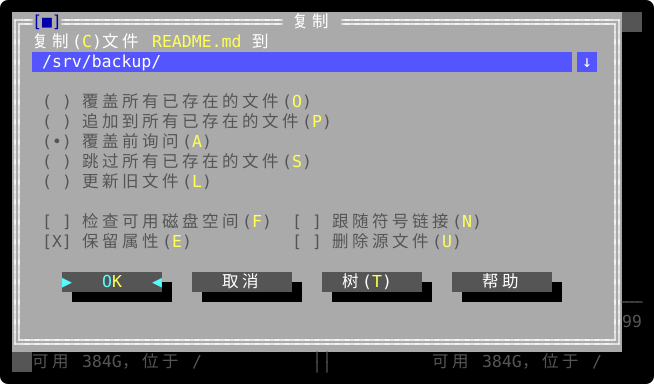

### 目标位置

在这一行中输入的内容决定了会发生什么：

| 输入 | 含义 |
|---|---|
| 一个已存在的目录，或以 `/` 结尾的名称 | 文件放进该目录 |
| 含有 `*` 或 `?` 的名称 | 每个文件按这个掩码在目标处重命名 |
| 其他任何名称，且只选了一个文件 | 该文件的新名称 |
| 其他任何名称，且选了多个文件 | 要创建并复制进去的目录 |

掩码分别作用于文件名和扩展名：`*.bak` 把每个文件的扩展名都改为 `bak`。不含点的掩码作用于整个名称，所以 `*` 让每个名称保持原样。

`F10` 或 *树* 按钮从目录树中选取目录。在这一行上按 `Down` 会打开以前复制目标的历史。

### 已存在的文件如何处理

| 模式 | 作用 |
|---|---|
| *覆盖所有已存在的文件* | 直接替换，不询问 |
| *追加到所有已存在的文件* | 把每个文件追加到已有文件的末尾 |
| *覆盖前询问* | 对每个文件都询问。回答可以设为对其余所有文件生效 |
| *跳过所有已存在的文件* | 不动这些文件，只复制其他文件 |
| *更新旧文件* | 只有当要复制的文件更新时才替换 |

询问时，*重命名* 可以给副本另起一个名称。

### 选项

- *检查可用磁盘空间*：目标空间不足时，在复制之前就停止。
- *保留属性*：在副本上保留权限、所有者和时间。未能保留的内容会报告出来，但复制本身仍然成功。
- *跟随符号链接*：复制链接所指向的内容，而不是链接本身。
- *删除源文件*：复制完成后删除原文件，这样复制就成了移动。

模式和选项会一直记住，直到你退出 Navigator。

### 运行过程中

进度框显示速度和剩余时间。*后台* 把复制转到后台，让你继续工作：菜单栏上会出现一个百分比，点击它可以重新打开进度框。如果复制在后台时有问题要问，百分比会显示 `?` 并等待你处理。*停止* 会先询问，再放弃复制。

已复制的文件会取消标记；被跳过的文件保持标记。

`Ctrl+Z` 撤销这次复制；参见[撤销](#撤销)。

## 创建目录

`F7` 在活动面板中创建目录。输入 `a/b/c` 这样的路径可以一并创建路径上的每个目录，输入用 `;` 分隔的多个名称可以创建多个目录。

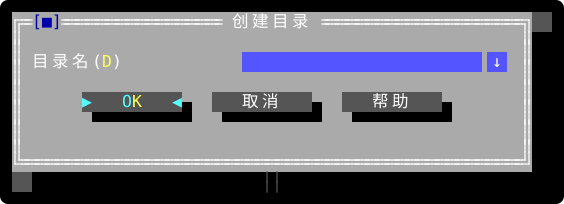

## 快速重命名

`Shift+F6` 或 *文件 > 重命名工具 > 快速重命名* 在一个小框中要求输入光标所在文件的新名称。它只在原处重命名一个文件；要移动文件，或按掩码重命名多个文件，请使用 `F6`。

## 批量重命名

`Alt+A` 或 *文件 > 重命名工具 > 批量重命名* 按同一个模式重命名已标记的文件。下半部分的列表在执行任何操作之前就显示每个新名称；当某个名称无法使用时，列表下方的一行会说明问题所在：名称为空、名称中含有 `/`、两个文件得到同一个名称，或者名称已被占用。

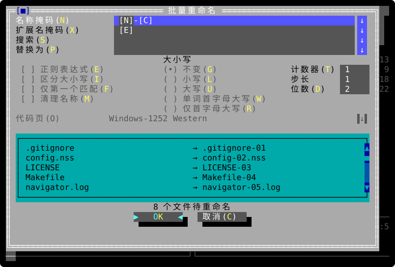

新名称分三步生成。

**掩码。** *名称掩码* 生成文件名，*扩展名掩码* 生成扩展名。普通文字照原样使用，方括号中的占位符会被替换：

| 占位符 | 代表 |
|---|---|
| `[N]` | 不含扩展名的旧名称 |
| `[N3]` | 旧名称的第三个字符 |
| `[N2-5]` | 第二到第五个字符 |
| `[N2-]` | 从第二个字符起的部分 |
| `[N2,4]` | 从第二个字符起的四个字符 |
| `[N-3-]` | 最后三个字符 |
| `[E]` | 旧扩展名，截取方式同上 |
| `[P]` | 文件所在目录的名称，截取方式同上 |
| `[C]` | 计数器，取自 *计数器*、*步长* 和 *位数* |
| `[C10+5:3]` | 从 10 开始、步长为 5、三位数的计数器：010、015、020 |
| `[Y]` `[M]` `[D]` `[h]` `[m]` `[s]` | 文件的修改日期和时间 |
| `[[]` `[]]` | 一个 `[` 和一个 `]` |

扩展名掩码为空时，名称不带点。

**搜索和替换。** *搜索* 和 *替换为* 作用于掩码生成的完整名称。

- *正则表达式* 把搜索内容当作正则表达式；这时替换内容可以用 `\1` 引用分组。
- *区分大小写* 区分大写和小写字母。
- *仅第一个匹配* 在每个名称中只替换一处匹配，而不是全部。

**大小写。** *不变*、*小写*、*大写*、*单词首字母大写* 或 *仅首字母大写*。

*清理名称* 在这三步之前修复名称：不是 UTF-8 的字节按所选的 *代码页* 读取，控制字符变为 `_`，同一目录中仅大小写不同的名称会被编号。

名称不变的文件保持原样。在多个文件之间互换的名称（`a` 改为 `b`、`b` 改为 `a`）也能正确重命名。

### 需要清理的名称

*文件 > 重命名工具 > 选择不良名称* 标记面板中所有会被 *清理名称* 改动的文件：不是有效 UTF-8 的名称、以 Unicode 分解形式书写的名称、含有控制字符的名称，以及与另一个名称仅大小写不同的名称。之后勾选 *清理名称* 再按 `Alt+A`，即可重命名它们。

## 删除

`F8`，或在命令行为空时按 `Del`，会在询问后删除所选内容。`Shift+F8`、`Shift+Del` 或 *文件 > 删除单个文件* 删除光标所在的文件，不管标记了什么。

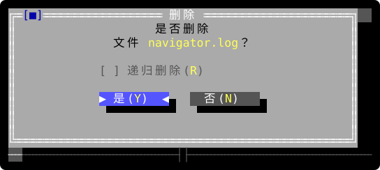

- *递归删除* 删除目录及其中的所有内容，不再逐个询问。
- *移到回收站* 在使用[回收站](drives.md#回收站)时显示。不勾选时，文件会被永久删除。

不勾选 *递归删除* 时，遇到非空目录和你无权写入的文件会询问你；每个问题都可以设为对其余所有文件生效。到底询问哪些问题，在设置的[确认](settings.md#确认)页上设定。

耗时较长的删除也可以像复制一样转到后台。

## 撤销

`Ctrl+Z` 或 *文件 > 撤销操作* 撤销最近一次文件操作，再按一次则撤销再前一次，最多五十次。它会先说明将要做什么，并询问确认。

| 操作 | 撤销的作用 |
|---|---|
| 复制：`F5` 或粘贴 | 删除复制产生的内容，但仅限此后未被改动的文件：在磁盘上移到回收站，在其他位置则永久删除 |
| 移动：`F6` 或剪切后粘贴 | 把文件移回去 |
| 重命名：`F6`、`Alt+F6`、`Shift+F6` 或 `Alt+A` | 恢复旧名称 |
| 删除到[回收站](drives.md#回收站) | 从回收站恢复文件 |
| `F7` 新建的目录 | 如果它仍为空，就删除它 |

被复制或移动替换掉的文件已永久丢失，询问时会说明有多少个。永久删除、属性和链接都不能撤销，复制或移动进出压缩包也不能撤销。操作列表一直保留到 Navigator 退出，并由所有文件管理器窗口共享。命令行中有文字时，`Ctrl+Z` 留给命令行使用。

## 文件属性

`Alt+E` 更改所选内容的属性。只应用你更改的部分，因此在其他方面不同的文件会保留各自的差异。*递归* 把更改同时应用到目录内的所有内容。

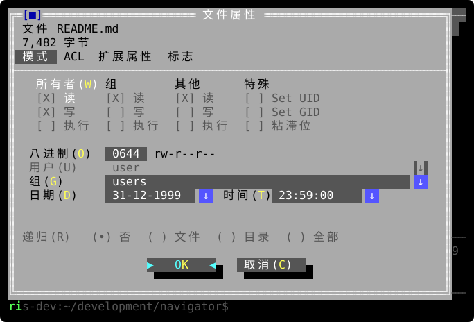

- *模式* 包含权限：一个由所有者、组和其他人的读、写、执行组成的网格，等价的八进制数，所有者和组，以及日期和时间。在网格中，`R`、`W` 和 `X` 勾选一整行。
- *ACL* 列出模式之外的访问控制条目，并可添加、编辑和删除它们。
- *扩展属性* 列出扩展属性。
- *标志* 包含文件系统的标志，如不可变和仅追加。

显示 `?` 的复选框表示各文件在此处不同；不去动它，每个文件就保持原样。

### ACL 条目

在 *ACL* 页上按 *添加* 或 *编辑* 会打开一个条目。*类型* 表示它指的是用户还是组，*名称* 选择具体是哪一个，*权限* 有 *读*、*写* 和 *执行*。*默认，由新文件继承* 使它成为目录的默认条目：在该目录中新建的内容会继承它。

### 扩展属性

在 *扩展属性* 页上按 *添加* 或 *编辑* 会打开一个属性，包括其 *名称* 和 *值*。值可以是文本，也可以是 `0x` 后跟十六进制数字，或 `0s` 后跟 base64。用引号括起的值保持为文本。

## 链接

`Shift+F5` 在你指定的目录中为所选内容创建链接。

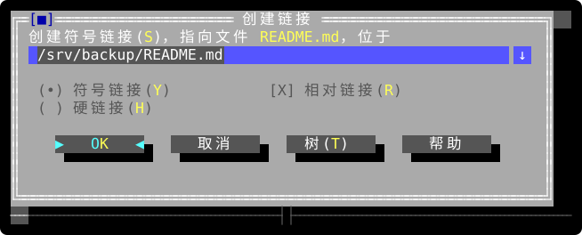

- *符号链接* 创建一个保存原文件路径的小文件。它可以指向目录，也可以指向另一个磁盘。
- *硬链接* 给文件再起一个名称。它只适用于文件，并且只能在同一个文件系统内使用。
- *相对链接* 写入相对于链接的路径，这样链接和原文件可以一起移动。它只适用于符号链接。

*文件 > 链接* 中还有更多功能：编辑链接的指向、把链接改为相对或绝对路径、标记损坏的链接，以及显示硬链接文件的所有名称。

### 更改链接的指向

*文件 > 链接 > 编辑链接目标* 更改所选的符号链接。

- 只选了一个链接时，一行中显示它的目标供你编辑。*相对链接* 以相对于链接的方式写入新目标。
- 选了多个链接时，*搜索* 和 *替换为* 更改每个目标中的同一部分，这正是一棵被移走的目录树所需要的。

*改为相对路径* 和 *改为绝对路径* 把每个所选链接的目标改写为另一种形式，仍指向同一个文件。*选择损坏的链接* 标记面板中所有指向不存在目标的链接：即列表不显示图标时标有 `!` 的那些。

### 文件的所有名称

有硬链接的文件有多个名称，可能分布在不同的目录中。*文件 > 链接 > 显示硬链接* 在文件系统中找出光标所在文件的每个名称，并像[查找文件](panels.md#查找文件)列出结果那样在面板中列出它们；在 `..` 上按 `Enter` 返回。你无权读取的目录会被跳过，所以找到的名称可能比文件实际拥有的少。详细视图中的 *链接数* 列显示文件有多少个名称。

## 分割和合并

*文件 > 分割/合并* 作用于光标所在的文件，执行哪一种由文件名决定。

### 分割

任何普通文件都可以在你指定的目录中分割成名为 `NAME.001`、`NAME.002` 等的分卷。

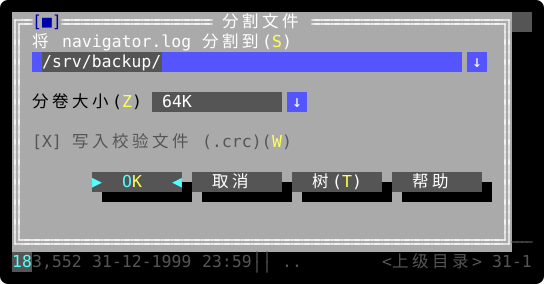

- *分卷大小* 是每个分卷的大小：一个字节数，或数字后跟 `K`、`M` 或 `G`，如 `100M` 或 `1.44M`。
- *写入校验文件 (.crc)* 还会写入 `NAME.crc`，其中保存文件的名称、大小和校验和。有了它，就可以校验合并后的文件。

不大于一个分卷的文件不会被分割。Total Commander、Double Commander 和 7-Zip 都能合并这些分卷。

### 合并

在一个分卷（`NAME.001`）或一组分卷的 `NAME.crc` 上执行该命令，会在你指定的目录中把文件重新拼合。它按顺序读取各分卷，直到缺少某一卷为止。有 `.crc` 文件时还会校验结果；如果校验和不符，文件仍会保留，并告诉你。

## UU 编码和解码

UU 编码把任何文件转换成纯文本，可以在只允许文本的地方发送。

### 编码

`Ctrl+F7` 把光标所在的文件编码为 `NAME.uue`。大文件会分段写入，每段一个文件。

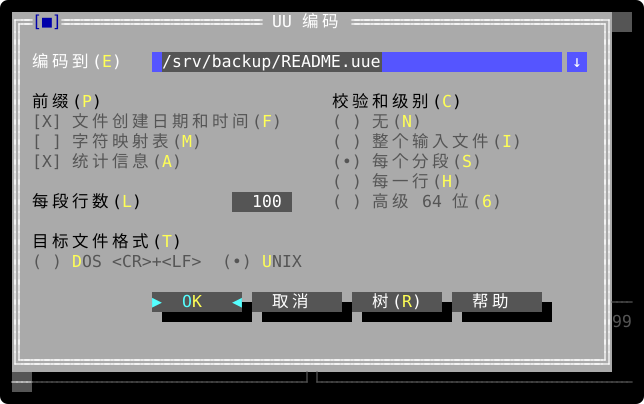

- *前缀* 在数据前面添加几行：文件的日期和时间、所用的字符表，以及统计信息。
- *校验和级别* 添加校验和，以便解码时发现损坏：无、整个文件的、每段的、每行的，或 64 位的。
- *每段行数* 是一段中放多少行数据。
- *目标文件格式* 选择行尾格式：DOS 式或 UNIX 式。

### 解码

`Ctrl+F8` 把光标所在的文件解码到你指定的目录中。一个文件可以包含多个编码文件，其各段的顺序也可以任意。

- *检查已存在的文件* 在替换已有文件之前询问。
- *显示错误信息* 显示在数据中发现的每个错误。
- *保存损坏的文件* 即使数据有损坏，也把文件写出来。

## 校验和

校验和列表保存每个文件的摘要，以便日后检查文件是否损坏或被改动。

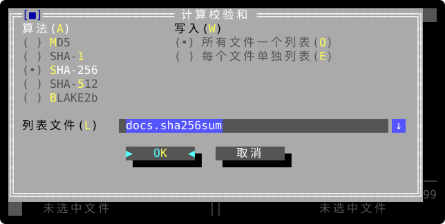

*文件 > 编码与加密 > 校验和 > 计算* 对已标记的文件以及已标记目录中的所有内容计算散列。

- *算法* 为 *MD5*、*SHA-1*、*SHA-256*、*SHA-512* 或 *BLAKE2b*。
- *所有文件一个列表* 写出一个列表，名称在 *列表文件* 一行中指定。*每个文件单独列表* 在每个文件旁边写一个列表。

*验证* 读取已标记的列表或光标所在的列表，重新计算其中列出的文件的散列，并报告有多少个匹配。不匹配或缺失的文件列在 *问题* 下。

这些列表就是 `md5sum`、`sha256sum` 及同类工具写出和检查的那种，因此双方可以互相验证。列表的算法由其名称判断，如 `.sha256sum`、`.sha256` 或 `SHA256SUMS`，否则由摘要的长度判断。

## 加密

*文件 > 编码与加密 > 加密* 用 GnuPG（`gpg`）或 `age` 加密和解密文件。未安装的程序显示为灰色。

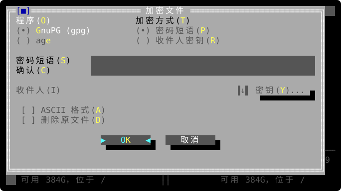

*加密* 作用于已标记的文件以及已标记目录中的所有内容。每个文件都在其旁边写成 `NAME.gpg` 或 `NAME.age`。

- *程序* 为 *GnuPG (gpg)* 或 *age*。
- *加密方式*：*密码短语*（输入两次），或 *收件人密钥*。多个收件人用空格分隔：对 gpg 是密钥 ID 或指纹，对 age 是密钥或密钥文件。*密钥...* 从 gpg 的密钥中选取。
- *ASCII 格式* 把加密后的文件写成文本；gpg 将其命名为 `NAME.asc`。
- *删除原文件* 在每个文件的加密副本写好后删除该文件。

*解密* 作用于已标记的加密文件，或光标所在的那个，把每个文件解密后写在其旁边，名称去掉结尾的扩展名。只有当某个文件需要密码短语时才会询问，并且对所有文件只问一次。

## 转换文本

*文件 > 编码与加密 > 转换文本* 以另一种编码或另一种行尾格式改写已标记的文本文件，或光标所在的那个。每个文件都在原处修改。

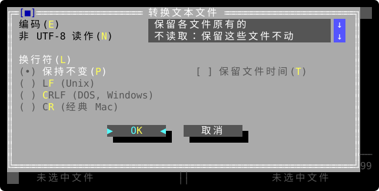

- *编码* 是写入文件所用的编码。
- *非 UTF-8 读作* 是对不是 UTF-8 且没有字节顺序标记的文件所假定的编码。未选择时，这样的文件保持不动。
- *换行符*：*保持不变*、*LF (Unix)*、*CRLF (DOS, Windows)* 或 *CR (经典 Mac)*。
- *保留文件时间* 让每个改写后的文件保持原来的时间。

看起来是二进制的文件、其文本无法用所选编码写出的文件，以及非常大的文件都保持不动，并会告诉你原因。结果不会有变化的文件不会被写入。

## 打开方式

*文件 > 打开方式* 用桌面的某个应用程序打开光标所在的文件，从能处理该类型的应用程序列表中选择，常用的排在最前。

- *其他应用程序* 列出已安装的其他所有应用程序。
- *设为默认* 选定该类型今后用哪个应用程序打开，本身不打开任何东西。
- *命令...* 要求输入你自己的命令行。其中的 `!.!` 代表该文件；没有它时，文件名放在末尾。命令在控制台中运行，每种扩展名都保留所用命令的历史。

它需要桌面的 `gio` 或 KDE 的工具；参见设置[通信](settings.md#通信)页上的 *桌面集成*。服务器上的文件会先下载下来。应用程序所做的更改不会传回；*命令...* 所做的更改会在命令结束后传回。

当[文件面板](settings.md#文件面板)页上勾选了 *其他文件交给桌面* 时，在 `extensions.ini` 中没有任何条目处理的文件上按 `Enter`，也会用桌面的应用程序打开它。

## 打印

`Ctrl+F9` 或 *文件 > 打印* 在询问后打印所选的文件。文件通过 `lp`（没有 `lp` 时用 `lpr`）送往系统的打印机，打印到 `$PRINTER` 或默认打印机上。目录会被跳过，每个文件送往打印机后即取消标记。编辑器用 `F8` 打印其文本。
