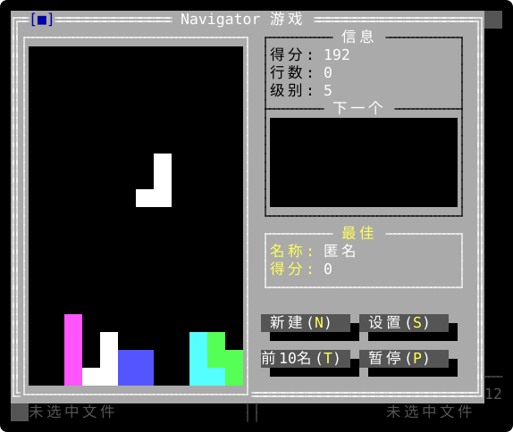

# 游戏

`Alt+F9`，或 `≡` 菜单中的 *游戏*，会打开游戏：方块落进一个容器，填满的一行会消失。游戏有两种风格：七种方块的俄罗斯方块，以及二十七种方块的 Pentix。

## 按键

| 键 | 作用 |
|---|---|
| `Left` 或 `Home` | 方块左移 |
| `Right` 或 `PgUp` | 方块右移 |
| `Up` | 旋转方块 |
| `Down` 或 `Space` | 方块落下 |
| `F2` | 开始新游戏 |
| `F3` | 暂停，再按继续 |
| `F4` | 显示前十名 |
| `F5` | 设置游戏：起始级别、风格和预览 |
| `Gray +` | 提高级别 |
| `Gray *` | 显示或隐藏下一个方块 |
| `Esc` | 关闭游戏 |

切换到其他窗口时，游戏会自动暂停。

## 前十名

一局结束时，如果得分足以进入前十名，会要求你输入一个名字来登记。不输入名字或按 *取消*，就登记为 *匿名*。每种风格各有一份榜单。

## 设置

`F5` 或 *设置* 按钮用来设置游戏。

- *级别* 是一局开始时的级别，从 *1 - 婴儿* 到 *10 - 疯人院*。级别越高，方块落得越快。
- *游戏风格* 为 *经典俄罗斯方块* 或 *Pentix*。
- *方块预览* 在容器旁边显示下一个方块。
