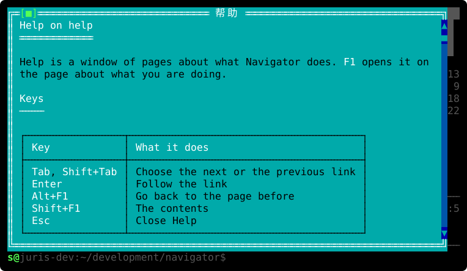

# 帮助说明

`F1` 在介绍当前操作的页面上打开本手册。各页面相互链接：链接以其专用颜色显示，并且总有一个链接处于选中状态。

## 当前位置的帮助

`F1` 在任何地方都可用，它会打开介绍当前拥有键盘焦点之物的页面：

- 在对话框中，打开介绍该对话框的章节。许多对话框还有一个作用相同的 *帮助* 按钮；
- 在打开的菜单中，打开介绍高亮菜单项或其所在菜单的页面；
- 在窗口中，例如查看器、编辑器或计算器，打开该窗口的页面；
- 在面板中，打开介绍面板的页面。

如果没有页面介绍当前的操作，则打开[目录](README.md)。`Esc` 关闭帮助并回到原来的位置；如果原来打开着菜单，菜单仍保持打开。控制台中有程序运行时，`F1` 归该程序使用。

## 按键

| 按键 | 作用 |
|---|---|
| `Tab` | 选择下一个链接 |
| `Shift+Tab` | 选择上一个链接 |
| `Enter` | 转到选中的链接 |
| `Alt+F1` | 返回到来的位置 |
| `Shift+F1` | 打开[目录](README.md) |
| `F1` | 打开本页 |
| `Up`、`Down`、`PgUp`、`PgDn`、`Home`、`End` | 滚动页面 |
| `Left`、`Right` | 代码行比窗口宽时，左右滚动 |
| `Alt+Z` | 把窗口最大化到整个屏幕，再按一次还原 |
| `Ctrl+F5` | 移动窗口和调整大小：方向键移动，`Shift` 加方向键调整大小，`Enter` 保留，`Esc` 还原 |
| `Esc` | 关闭帮助 |

这些按键可以更改：在 选项 > 配置 > 按键绑定 中的 *帮助窗口* 下。

## 鼠标

单击链接即可转到该处。滚轮滚动页面；页面比窗口长时，窗口右边缘的滚动条也可以滚动页面。如果页面中有比窗口宽的代码行，窗口底边也有一个滚动条；`Shift` 加滚轮可左右滚动。

## 指向其他网站的链接

指向本手册以外（即某个网站）的链接，Navigator 不会跟随。你的终端可能会打开它：在大多数终端中，按住 `Ctrl` 并单击即可。
