# 面板

文件管理器并排显示两个面板，各列出一个目录中的文件。其中一个是活动面板：光标条在它上面，命令作用于它的文件，并且通常把另一个面板的目录作为存放结果的位置。

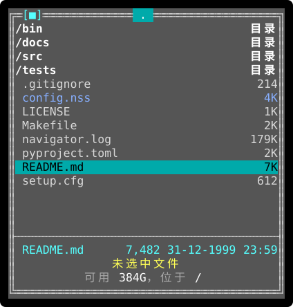

## 移动

| 按键 | 作用 |
|---|---|
| `Tab` | 切换到另一个面板 |
| `Up`、`Down`、`PgUp`、`PgDn`、`Home`、`End` | 移动光标 |
| `Enter` | 进入目录或压缩包、运行程序或打开文件 |
| `Backspace`、`Ctrl+PgUp` | 转到上级目录 |
| `Ctrl+\` | 转到根目录 |
| `Ctrl+R` | 重新读取目录 |
| `Alt+Backspace` | 列出去过的目录 |
| `Alt+=` | 在另一个面板中显示同一目录 |
| `Ctrl+U` | 交换两个面板 |

直接输入字母会写到面板下方的命令行上；参见[命令行](console.md)。

目录中有变化时，面板会自动重新读取该目录。

## 视图

`Ctrl+Y` 在面板的三种视图之间轮换：

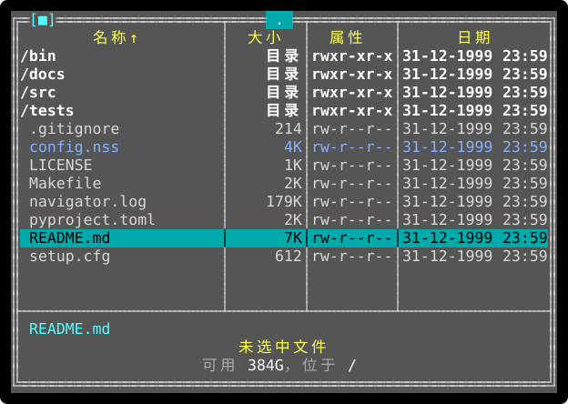

- *简单*：名称和大小。
- *详细*：名称，以及分列显示的大小、属性、所有者和日期。`Alt+K` 选择显示哪些列。
- *列表*：只有名称，分多列显示。

在简单和详细视图中，`Left` 和 `Right` 可滚动显示过长的名称。在详细视图中，单击列标题按该列排序，再次单击则反转顺序。

`Ctrl+H` 显示或隐藏隐藏文件，`Alt+I` 显示或隐藏列表下方的信息行。

## 排序

`Alt+B` 选择面板的排序方式：按名称、扩展名、大小、时间、属性、所有者或类型，每种都可升序或降序，也可以不排序。目录总是列在文件之前。

## 标记文件

命令作用于已标记的文件；没有标记任何文件时，作用于光标下的文件。

| 按键 | 作用 |
|---|---|
| `Ins`，或命令行为空时的 `Space` | 标记或取消标记文件，并下移一行 |
| `Gray +` | 标记与掩码匹配的文件 |
| `Gray -` | 取消标记与掩码匹配的文件 |
| `Gray *` | 反转标记 |
| `Ctrl+A` | 标记全部 |

使用鼠标时，中键标记一个文件，按住中键拖动则标记经过的每个文件。按住 `Shift` 或 `Ctrl` 单击左键，会标记从光标到所点文件之间的所有文件。

列表下方的信息行显示已标记文件的数量及其总大小。

## 快速搜索

`Ctrl+S` 开始按名称搜索：输入开头几个字母，光标便跳到第一个以它们开头的名称。再按 `Ctrl+S` 跳到下一个。`Esc` 结束搜索；其他任何键也会结束搜索并执行其原本的功能，因此 `Enter` 会直接进入找到的目录。

## 通过剪贴板复制

`Ctrl+C` 复制所选内容，`Ctrl+X` 剪切；在另一个目录中按 `Ctrl+V` 把文件粘贴到那里，并像[复制和移动](file-operations.md#复制和移动)那样询问。`Esc` 放弃这些文件。这些键在命令行为空时作用于面板。

## 另一侧

非活动的一侧可以在面板的位置显示别的内容：

| 按键 | 显示内容 |
|---|---|
| `Ctrl+T` | 目录树 |
| `Ctrl+Q` | 光标下文件的快速查看 |
| `Ctrl+L` | 关于目录、磁盘和光标下文件的[信息](#信息面板) |

再按同一个键即恢复面板。`Ctrl+F1` 和 `Ctrl+F2` 隐藏左侧和右侧，`Ctrl+P` 隐藏非活动的一侧，`Alt+Left` 和 `Alt+Right` 移动两侧之间的分隔线。

`Alt+F12` 切换到 Miller 列视图：一排窄列，路径上的每个目录一列，并预览光标下的内容。

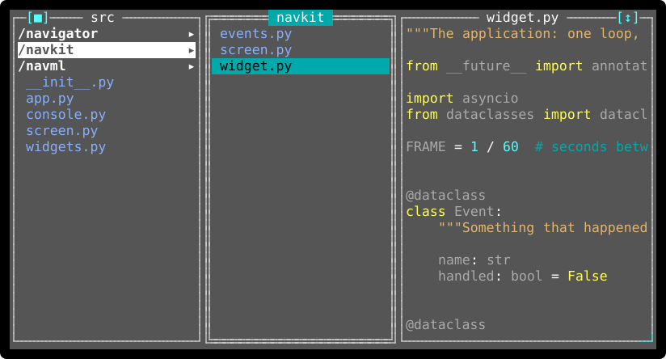

## 信息面板

`Ctrl+L` 在另一个面板的位置显示活动面板的信息，再按 `Ctrl+L` 恢复面板。它会随着你在活动面板中的移动而更新：

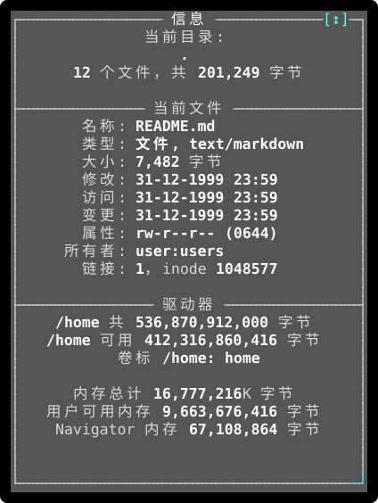

- 目录的名称，其中有多少文件及其大小；
- 光标下的文件：类型、大小、时间、属性、所有者、链接数和 inode。图片、音频、视频、PDF 和程序会显示更多内容：像素尺寸、时长、流、页数，或程序所需的库。音频和视频的信息需要 FFmpeg 的 `ffprobe`；
- 目录所在的文件系统：大小、可用空间，以及设备或卷标。在服务器上则显示服务器及连接方式；在压缩包中则显示压缩包；
- 计算机的内存、程序还可使用的内存，以及 Navigator 自身占用的内存；
- 目录的说明文件 `DirInfo` 或 `File_ID.DIZ`（如果有）。

内容超出显示范围时，`Tab` 把键盘焦点移入其中，可用方向键、`PgUp` 和 `PgDn` 滚动；鼠标滚轮也能滚动。设置中的[信息面板](settings.md#信息面板)页选择显示哪些行。

## 多个文件管理器

`Ctrl+F3` 打开另一个文件管理器窗口。在窗口之间切换参见[窗口](windows.md)。

## 文件掩码

有些对话框需要填写文件掩码。掩码是用 `;` 分隔的一个或多个模式，其中 `*` 代表任意文本，`?` 代表任意一个字符。以 `-` 开头的模式排除它匹配的内容，并且由最后一个与名称匹配的模式决定结果：`*;-*.bak` 表示除备份以外的所有文件。

## 面板选项

`Alt+S`，即 *面板 > 面板设置*，设置活动面板如何列出文件。对所有新面板生效的相同选项位于[设置](settings.md#面板默认值)的 *面板默认值* 页。

- *排序方式* 选择顺序：按名称、扩展名、大小、时间、属性、所有者或类型，或不排序。*倒序* 将顺序反过来。
- *目录大小* 计算并显示每个目录的大小。
- *当前文件*、*已选文件*、*合计* 和 *可用空间* 选择列表下方显示哪些行。
- *文件高亮* 按类型为文件着色。
- *可执行文件在前* 和 *压缩包在前* 把这些文件排在其他文件之前。
- *文件掩码* 让面板只显示与[掩码](#文件掩码)匹配的文件。

## 过滤

`Alt+Del`，即 *面板 > 选择 > 高级过滤*，按扩展名选择面板显示哪些文件。对话框列出 `*`，以及目录中出现的每种扩展名各一个掩码。

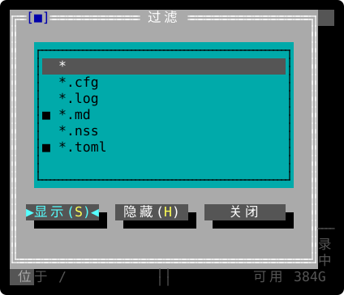

- `Space` 或 `Ins` 标记一个掩码并移到下一个。`+` 标记全部，`-` 全不标记，`*` 反转标记。
- *显示* 让面板显示已标记的掩码；没有标记时显示光标下的那个。
- *隐藏* 让面板不显示它们。
- *关闭* 关闭对话框。执行 *显示* 和 *隐藏* 后对话框保持打开，以便继续选择。

选择 `*` 即重新显示全部文件。

## 查找文件

`Alt+F7`，即 *文件 > 查找*，按名称和内容搜索文件。

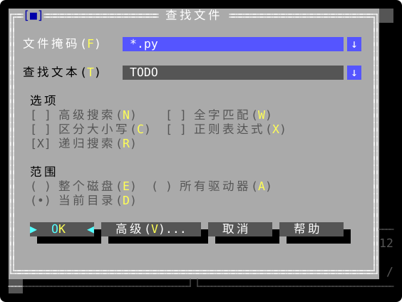

- *文件掩码* 指定要查找的名称。不含 `*` 也不含点的普通单词会找到所有以它开头的名称。
- *查找文本* 把搜索限制在包含该文本的文件中。留空则只按名称搜索。

### 选项

- *高级搜索* 同时应用用 *高级* 按钮设置的限制条件。
- *区分大小写* 在文本中区分大写字母和小写字母。
- *递归搜索* 也搜索子目录。
- *全字匹配* 跳过属于更长单词一部分的文本。
- *正则表达式* 把文本当作正则表达式，可跨行匹配。

### 范围

- *整个磁盘* 搜索面板所在的整个磁盘。
- *当前目录* 搜索面板的目录。
- *所有驱动器* 搜索所有磁盘。

### 搜索结果

找到的文件列在面板中，标题为 *查找:* 加上掩码。可以像其他文件一样在那里查看、编辑、复制和删除它们；面板下方的信息行显示每个文件所在的目录。在 `..` 上按 `Enter` 返回开始搜索时的目录。

### 高级搜索

*高级* 按钮设置在勾选 *高级搜索* 时生效的限制条件：

- *日期晚于* 和 *日期早于* 按修改时间限制文件。日期按年-月-日书写，例如 `2026-01-31`。
- *大小大于* 和 *大小小于* 按大小限制文件。
- *种类* 把文件限制为可执行文件、符号链接、隐藏文件、只读文件或失效链接。

*全部清除* 清除所有限制。

### 在文件中替换

`Alt+Shift+F7` 打开同一个对话框，多出一行 *替换为*。它以同样的方式查找文件，并替换其中每个文件里的文本。

## 创建列表文件

`Alt+L`，即 *面板 > 创建列表文件*，把已标记文件的名称写入一个文本文件。

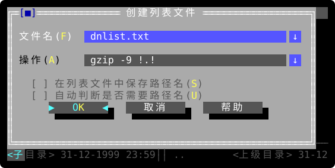

- *文件名* 是要写入的文件。如果它已存在，会询问是替换还是追加到末尾。
- *操作* 填写后，列表就变成脚本：每个文件一行，文件名嵌入你给出的文本中。每个文件需要多行时用 `;` 分隔。
- *在列表文件中保存路径名* 写入每个文件的完整路径，而不只是名称。
- *自动判断是否需要路径名* 只为不在列表文件所在目录中的文件写入路径。

在操作中，以下符号代表每个文件名称的各个部分：

| 写法 | 替换为 |
|---|---|
| `!` | 不含扩展名的名称 |
| `.!` | 扩展名，带点 |
| `!\` | 文件所在目录，以 `/` 结尾 |
| `!/` | 文件所在目录，不带末尾的 `/` |
| `!!` | 一个 `!` |

操作中不含以上任何符号时，文件名会加在末尾：`cp` 变成 `cp name`。

## 选择组

`Gray +` 标记面板中与[文件掩码](#文件掩码)匹配的文件，`Gray -` 取消标记它们。它们也是 *面板* 菜单中的 *选择组* 和 *取消选择组*。

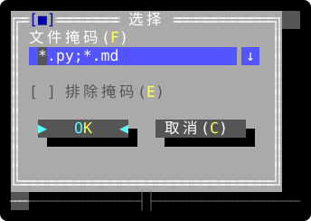

*排除掩码* 把掩码反过来：标记或取消标记的是不匹配的文件。

## 列设置

`Alt+K`，即 *面板 > 列设置*，选择详细视图在每个名称旁显示什么：*大小*、*属性*、*链接*、*所有者* 和 *日期*。

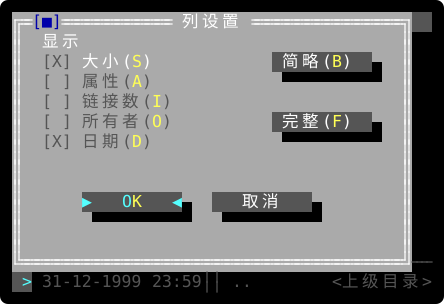

- *OK* 显示勾选的列。
- *简略* 只显示名称。
- *完整* 显示除 *链接* 以外的所有列。

新面板初始显示的列位于设置的[列](settings.md#列)页。

## 查找重复文件

*面板 > 查找重复文件* 在面板目录下查找内容相同的文件，并像搜索那样把它们列在面板中。

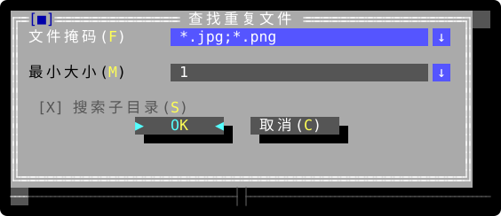

- *文件掩码* 选择要比较哪些文件。
- *最小大小* 排除较小的文件。
- *搜索子目录* 也搜索下级目录。

浪费空间最多的组排在最前面，并且无论面板按什么排序，同一组的文件都排在一起。不会标记任何文件：请标记不需要的副本，然后用 `F8` 删除。符号链接会被跳过，同一文件的两个硬链接名称不算重复。

## 命令输出到面板

`Alt+Y`，即 *面板 > 命令输出到面板*，在面板的目录中运行一条 shell 命令，并把它输出的文件（每行一个文件名）作为面板的列表。它适用于回答“哪些文件？”的命令：

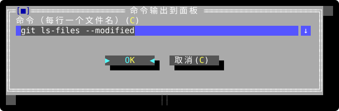

```sh
git ls-files -m
grep -l TODO *.py
```

以 `|` 开头的命令行效果相同，但不弹出对话框。

## 目录历史

`Alt+BkSp`，即 *面板 > 目录历史*，列出面板去过的目录，最近的在前。*转到* 在活动面板中打开光标下的目录，*删除记录* 把它从列表中删除。

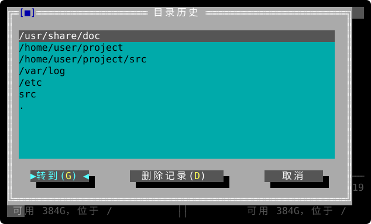

## 记住目录设置

*面板 > 为此目录记住* 保存面板当前的排序方式、视图和文件掩码，此后面板进入该目录时都使用它们。*也用于其子目录* 让下面的每个目录都以同样方式显示，除非某个目录单独记住了设置。

*已记住的目录列表* 显示已记住的目录。`Enter` 转到其中一个，`Del` 忘记它。
