# 设置

*选项 > 设置* 把所有设置分成十五页。`Ctrl+PgUp` 和 `Ctrl+PgDn` 切换页面；*选项 > 配置* 和 *选项 > 文件管理器* 下的菜单项会直接在各自的页面上打开这个对话框。鼠标停在某个选项上会显示它的作用。

*确定* 立即应用更改，并把它们写入 `navigator.ini`。*取消* 放弃更改。

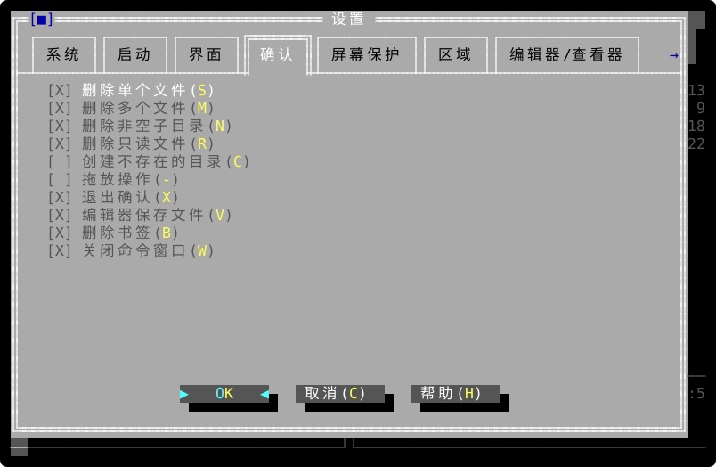

## 系统

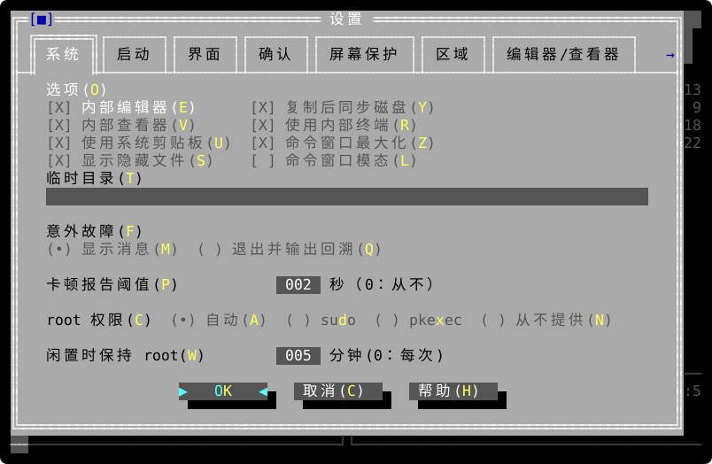

- *内部编辑器* 和 *内部查看器*：`F4` 和 `F3` 使用 Navigator 自己的编辑器和查看器。关闭时，它们运行 `$EDITOR` 和 `$PAGER` 中指定的程序。
- *使用系统剪贴板*：复制到桌面的剪贴板，并从中粘贴。关闭时，Navigator 使用自己的剪贴板。
- *显示隐藏文件*：新面板显示隐藏文件。`Ctrl+H` 切换单个面板。
- *复制后同步磁盘*：每个复制的文件都要真正写入磁盘后才算完成。
- *使用内部终端*：`Ctrl+O` 在 Navigator 内部显示控制台。关闭时，它把整个终端交给 shell。
- *命令窗口最大化* 和 *命令窗口模态*：在单独窗口中运行的命令以何种方式打开。
- *临时目录*：临时文件存放的位置。留空表示使用 `$TMPDIR`。
- *意外故障*：发生意外错误时，要么显示带有详细信息的消息，要么退出 Navigator 并打印这些信息。
- *卡顿报告阈值*：Navigator 停止响应多少秒后，把原因写入 `errors.log`。
- *root 权限*：因权限被拒绝的步骤如何以 root 身份重做：通过 `sudo`、通过 `pkexec`，或者从不。
- *闲置时保持 root*：root 权限在最后一次使用后保持打开多少分钟。参见[以 root 身份工作](as-root.md)。

## 启动

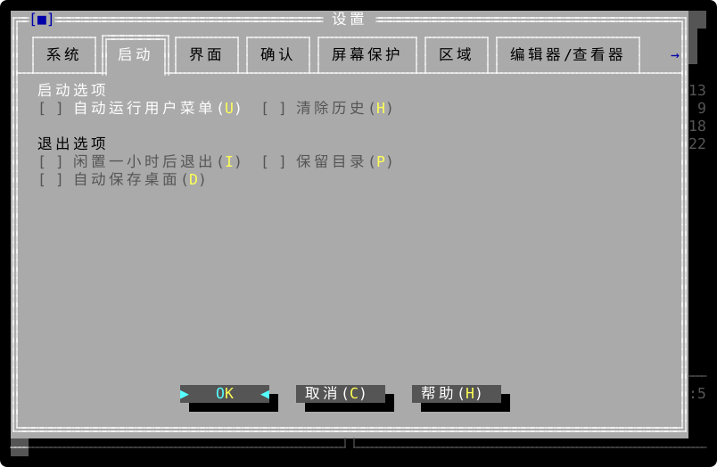

- *自动运行用户菜单*：Navigator 启动时打开用户菜单（`F2`）。
- *清除历史*：每次启动时删除未固定的历史记录。
- *闲置一小时后退出*：一小时内没有任何按键或点击时，Navigator 退出。
- *自动保存桌面*：退出时保存各个窗口，下次启动时恢复。
- *保留目录*：执行命令后以及在恢复的桌面中，活动面板保持其目录。

## 界面

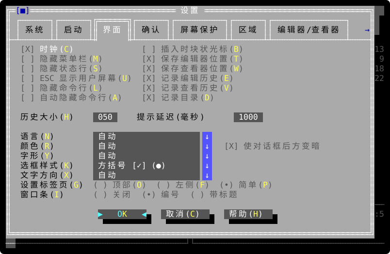

- *时钟*、*隐藏菜单栏*、*隐藏状态行*：菜单栏上的时钟、菜单栏本身（按 `F10` 前隐藏），以及最底行的按键栏。
- *ESC 显示用户屏幕*：在空命令行上按 `Esc` 显示控制台，直到按下一个键。
- *隐藏命令行* 和 *自动隐藏命令行*：总是隐藏命令行，或在其为空时隐藏。
- *插入时块状光标*：命令行上使用块状光标。
- *保存编辑器位置* 和 *保存查看器位置*：文件重新打开时，回到上次离开时的窗口和位置。
- *记录编辑历史*、*记录查看历史*、*记录目录*：保留 `Alt+PgUp`、`Alt+PgDn` 和 `Alt+Backspace` 显示的列表。
- *历史大小*：每个历史列表保留多少条记录。
- *提示延迟(毫秒)*：鼠标停留多久后显示提示；0 表示不显示。
- *语言*：标题和消息使用的语言。
- *颜色*：向终端发送多少种颜色。
- *字形*：假定终端字体具有哪些字符：纯 ASCII、Unicode，或 Nerd Font 的图标。
- *使对话框后方变暗*：对话框后面的内容画得暗淡一些。
- *选框样式*：复选框和单选按钮的画法。
- *文字方向*：从左到右、从右到左，或按语言的书写方向。
- *设置标签页*：这个对话框把标签页显示在哪里。
- *窗口条*：是否在菜单栏上列出打开的窗口，以编号还是以标题列出。

## 确认

每个复选框都让 Navigator 在相应操作前先询问：删除一个文件、删除多个文件、删除非空目录、删除只读文件、创建复制目标中指定的目录、拖放、退出、在编辑器中保存、删除书签，以及关闭命令仍在运行的命令窗口。

## 屏幕保护

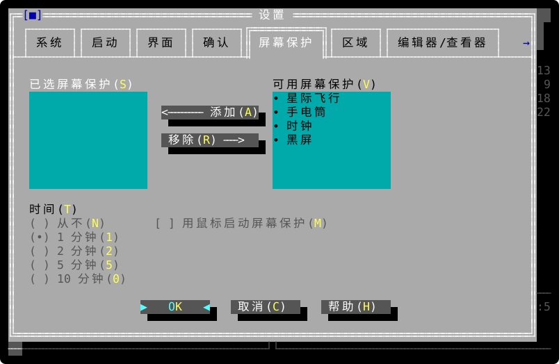

一段时间内没有任何按键或点击后，屏幕保护会接管屏幕。

- *已选屏幕保护* 轮流出现。*添加* 从 *可用屏幕保护* 中移入一个，*移除* 把它移出。
- *时间* 是等待多久，或者 *从不*。
- *用鼠标启动屏幕保护*：把指针移到右上角会立即启动屏幕保护；指针停在右下角时则不会启动。

## 区域

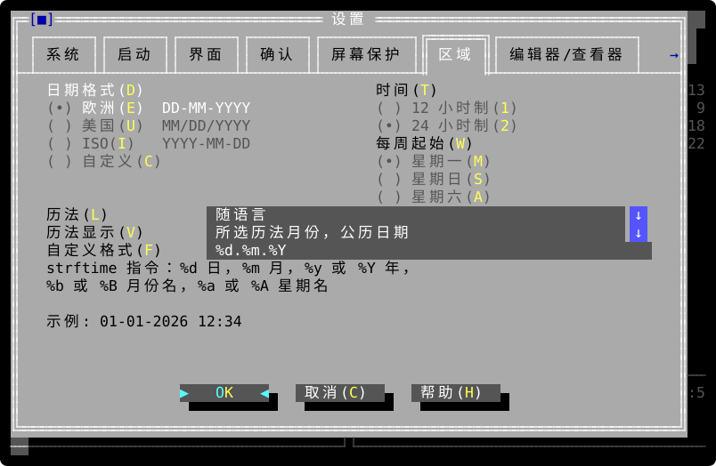

- *日期格式*：日期的书写顺序，或选 *自定义* 并在 *自定义格式* 一行中写出格式。
- *时间*：12 小时制或 24 小时制。
- *每周起始*：日历中每周的第一天。
- *历法* 和 *历法显示*：日历窗口显示哪种历法，以及是否与公历并列显示。

*示例* 按所选方式显示一个日期和时间。

## 编辑器/查看器

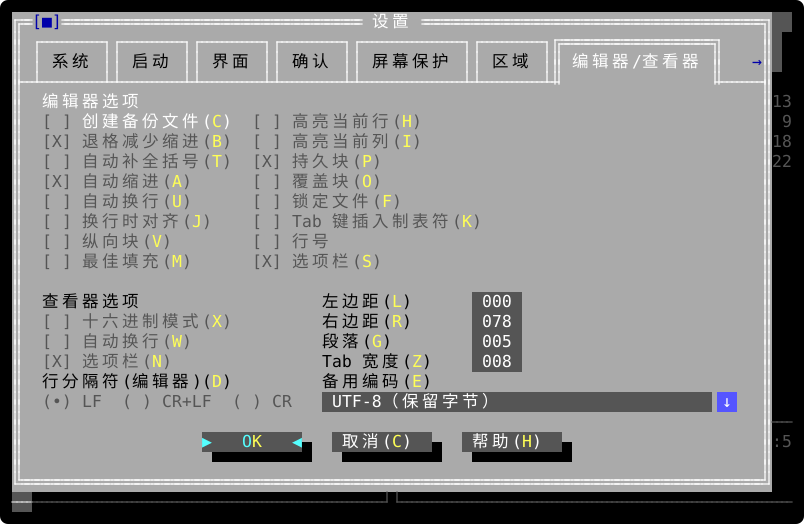

这里是新的编辑器或查看器窗口开始时的设置。编辑器的大多数选项可以在其 *选项* 菜单中针对单个窗口切换。

编辑器选项：

- *创建备份文件*：用 `F2` 保存时，旧文件保留为 `NAME.bak`。
- *退格减少缩进*：在行首空白中按 `Backspace` 会退回到上面某一行的缩进。
- *自动括号*：键入 `(`、`{` 或 `[` 时，同时键入与之配对的括号。
- *自动缩进*：`Enter` 让新行与上一行缩进相同。
- *自动换行* 和 *换行时对齐*：键入超过右边距的行会自动换行，留下的那一行会被拉宽到边距。
- *纵向块*：按列标记块。
- *最佳填充*：到达制表位的空白写成制表符。
- *高亮当前行* 和 *高亮当前列*：高亮显示光标所在的行和列。
- *持久块*：光标移动时块保持标记。*覆盖块*（在前者关闭时）：键入和粘贴会替换块。
- *锁定文件*：编辑器对其文件持有一个其他程序可见的锁。
- *Tab 键插入制表符*：`Tab` 插入制表符，而不是空格。
- *行号*：在左侧为各行编号。
- *选项栏*：底部边框显示窗口的选项，点击可切换某个选项。

查看器选项：*十六进制模式* 以十六进制打开文件，*自动换行* 折行显示长行，*选项栏* 与编辑器的相同。

- *左边距*、*右边距*、*段落*：[段落格式化](editor.md#边距)使用的边距。
- *Tab 宽度*：制表符的宽度。
- *行分隔符(编辑器)*：新文件使用的行尾符。
- *备用编码*：文件不是 UTF-8 时，编辑器按什么编码读取它。

## 查看器类型

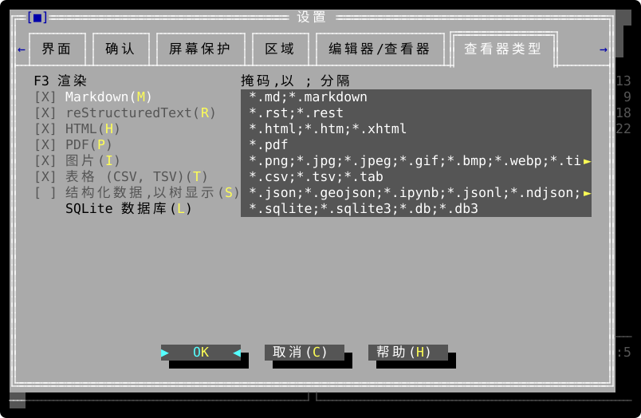

规定 `F3` 把哪些文件显示为文本以外的形式：Markdown、reStructuredText 和 HTML 显示为页面，PDF 显示为其文本，图片显示为图片，CSV 和 TSV 显示为表格，结构化文件（JSON、YAML、TOML、XML）显示为树。每种都有一个开关复选框，以及一行[文件掩码](panels.md#文件掩码)，说明适用于哪些文件。*SQLite 数据库* 是作为数据库打开的文件的掩码。

## 文件面板

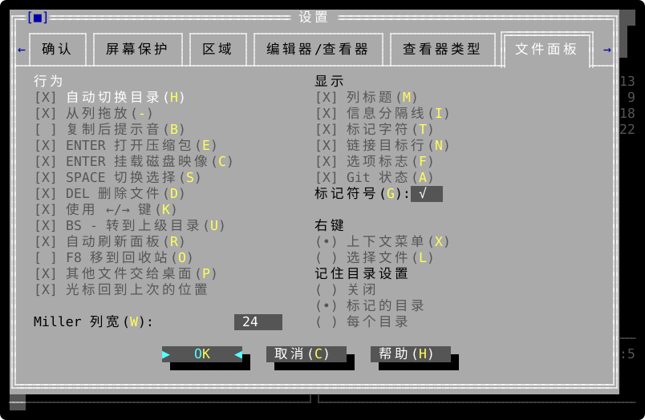

行为：

- *自动切换目录*：面板跟随旁边树中的光标。
- *从列拖放*：可以用鼠标把文件拖出面板。
- *复制后提示音*：复制结束时终端响铃。
- *ENTER 打开压缩包*：在压缩包上按 `Enter` 会像进入目录一样进入它。
- *ENTER 挂载磁盘映像*：在 `.iso` 或 `.img` 文件上按 `Enter` 会挂载并打开它。
- *SPACE 切换选择*、*DEL 删除文件*、*BS - 转到上级目录*：命令行为空时，这些键作用于面板。
- *使用 ←/→ 键*：命令行中有文字时，方向键、`Home` 和 `End` 编辑命令行。关闭时，需配合 `Shift` 才能编辑。
- *自动刷新面板*：目录在磁盘上发生变化时，面板重新读取它。
- *F8 移到回收站*：`F8` 把文件移到回收站，而不是删除。
- *其他文件交给桌面*：在没有设定程序的文件上按 `Enter`，用桌面的应用程序打开它。
- *光标回到上次的位置*：回到某个目录时，光标回到上次离开时的位置。
- *Miller 列宽*：Miller 视图中一列的宽度。

显示：

- *列标题*：各列上方的标题行。
- *信息分隔线*：列表下方合计信息上面的一条线。
- *标记字符* 和 *标记符号*：被标记的文件是否用符号标出，以及用哪个符号。
- *链接目标行*：面板下方的一行显示符号链接指向何处。
- *选项标志*：底部边框显示面板的选项，点击可切换某个选项。
- *Git 状态*：在 git 工作树中显示每个文件的状态，并在标题中显示分支。

*右键* 选择鼠标右键在面板中的作用：打开上下文菜单，或标记文件。*记住目录设置* 选择哪些目录保留各自的排序方式、视图、列和文件掩码。

## 信息面板

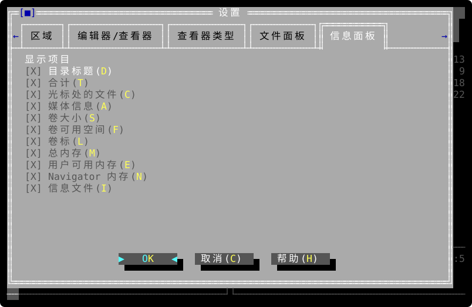

规定信息面板（`Ctrl+L`）显示哪些行：目录名、目录的合计、光标所在的文件、媒体详情、卷的大小、可用空间和卷标、机器的内存，以及目录的说明文件。

## 面板默认值

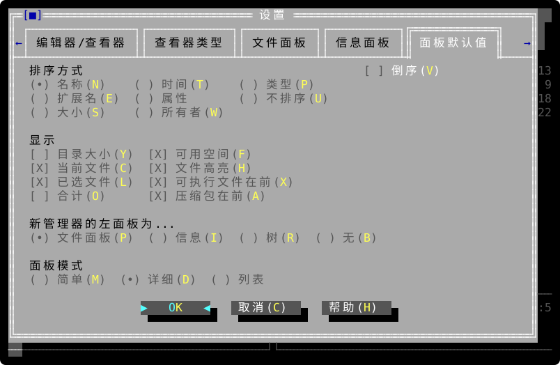

新文件管理器的面板以什么设置开始。

- *排序方式* 和 *倒序*：文件列出的顺序。
- *目录大小*：统计并显示每个目录的大小。
- *当前文件*、*已选文件*、*合计*、*可用空间*：列表下方的各行。
- *文件高亮*：按类型为文件着色。
- *可执行文件在前* 和 *压缩包在前*：这些文件排在其他文件前面。
- *新管理器的左面板为...*：文件面板、信息面板、树，或者什么都没有。
- *面板模式*：简要、详细或列表视图。

## 列

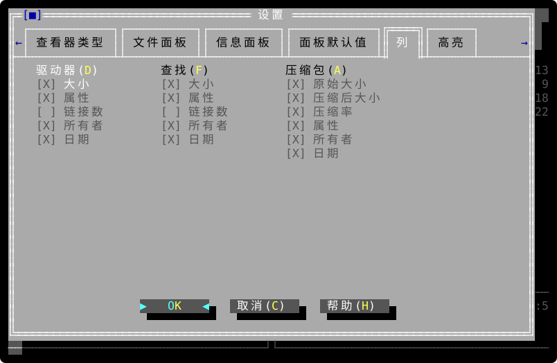

规定面板在详细视图中显示哪些列，按三种列表分别设置。`Alt+K` 为单个面板更改它们；参见[列设置](panels.md#列设置)。

- *驱动器*：磁盘或服务器上的目录。列有 *大小*、*属性*、*链接数*（文件有多少个名称）、*所有者* 和 *日期*。
- *查找*：[查找文件](panels.md#查找文件)填入面板的列表。列与上面相同。
- *压缩包*：压缩包内部。*原始大小*、*压缩后大小*、*压缩率*（压缩了多少）、*属性*、*所有者* 和 *日期*。

## 高亮

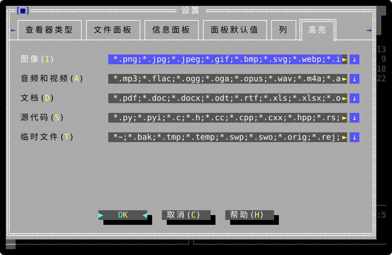

面板着色的五个组的[文件掩码](panels.md#文件掩码)：*图像*、*音频和视频*、*文档*、*源代码* 和 *临时文件*。面板勾选了 *文件高亮* 时，与某组掩码匹配的文件以该组的颜色列出。颜色本身属于主题，在 *选项 > 颜色* 中更改（[颜色](customizing.md#颜色)）。

这些组为面板中的文件名着色；查看器和编辑器中文件内文字的颜色在 `highlight.ini` 中设置（[语法高亮](editor.md#语法高亮)）。

## 通信

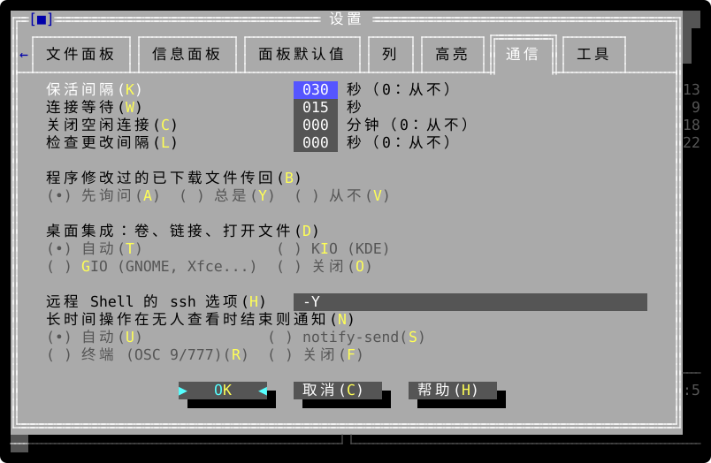

- *保活间隔*：多久发送一次消息，使与服务器的连接保持打开。
- *连接等待*：等待服务器应答多长时间。
- *关闭空闲连接*：未使用的连接保持打开多长时间。
- *检查更改间隔*：多久检查一次服务器目录的变化。
- *程序修改过的已下载文件传回*：是否把这样的文件重新上传：询问后上传、总是上传或从不上传。
- *桌面集成*：卷、链接和打开文件使用哪个桌面的服务。
- *远程 Shell 的 ssh 选项*：添加到每个远程 shell 的 `ssh` 命令中的参数。
- *长时间操作在无人查看时结束则通知*：终端处于后台时，长时间操作结束后以什么方式通知桌面。

## 工具

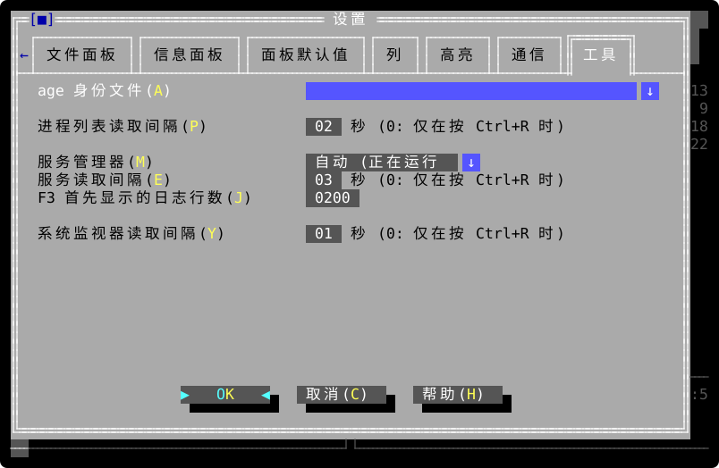

- *age 身份文件*：`age` 用来解密的密钥文件。
- *进程列表读取间隔*、*服务读取间隔*、*系统监视器读取间隔*：这些窗口多久刷新一次。
- *服务管理器*：服务窗口与哪个服务管理器通信。
- *F3 首先显示的日志行数*：`F3` 打开服务日志时显示多少内容。
