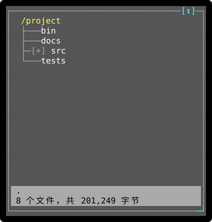
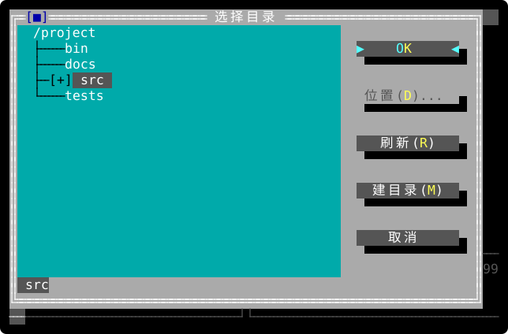
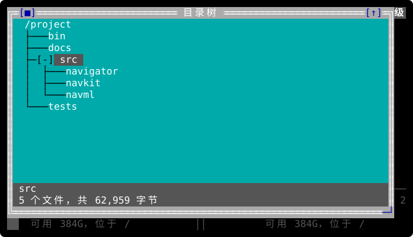
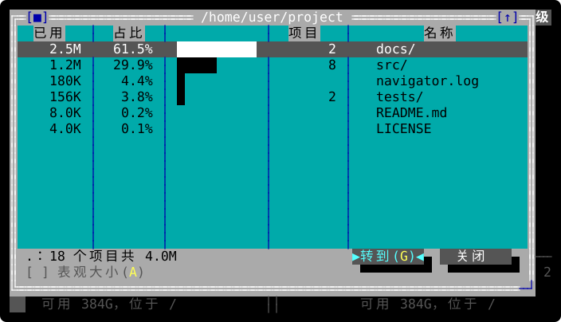

# 目录树

目录树显示目录，其中包含的目录缩进列在下方。

| 按键 | 作用 |
|---|---|
| `Up`、`Down` | 移动光标 |
| `Right` | 展开目录并进入其中 |
| `Left` | 转到其所在的目录 |
| `+`、`-` 或 `Space` | 展开或折叠目录 |
| `*` | 展开所有目录 |
| `Enter` | 选择该目录 |
| `Ctrl+S` | 搜索：输入名称的开头；`/` 继续在找到的目录内搜索 |

面板显示隐藏目录时（`Ctrl+H`），目录树也显示它们。

## 面板旁的目录树

`Ctrl+T` 在非活动面板的位置显示目录树。它跟随活动面板，活动面板也跟随它：光标停在目录树中的某个目录上时，面板就显示该目录。在设置的[文件面板](settings.md#文件面板)页取消勾选 *自动切换目录* 后，只有按 `Enter` 才会这样。

## 切换目录

`Alt+T` 在对话框中打开目录树，从中选择活动面板的目录。*建目录* 在光标下创建一个目录，*刷新* 重新读取目录树。

## 目录树窗口

*磁盘 > 目录树* 在桌面上的单独窗口中打开目录树，在别处工作时它保持打开。在目录上按 `Enter` 会让活动文件管理器的活动面板转到那里。该窗口有自己的 *树* 菜单，其中有 *刷新*（`Ctrl+R`）、*快速搜索*（`Ctrl+S`）和 *关闭*；`Esc` 也会关闭它。

## 目录大小

*磁盘 > 目录大小* 测量活动面板的目录，并按大小列出其中的内容，让你看清是什么占用了空间。

| 按键 | 作用 |
|---|---|
| `Enter`、`Right` | 进入目录 |
| `Backspace`、`Left` | 返回上级 |
| `Ctrl+N`、`Ctrl+S`、`Ctrl+E` | 按名称、大小、项数排序；再按一次反转顺序 |
| `Ctrl+A` | 在内容大小和磁盘占用空间之间切换 |
| `F8`、`Del` | 删除，与在面板中相同 |
| `Ctrl+R` | 重新测量 |
