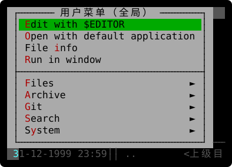

# 用户菜单和文件关联

## 用户菜单

`F2` 打开一个由你自己的命令组成的菜单。Navigator 会在面板的目录及其上级的每个目录中查找名为 `.navigator-menu.ini` 的文件；这就是 *本地* 菜单。如果没有，则使用 *全局* 菜单，即 Navigator 配置目录中的 `menu.ini`。



在菜单中，`F2` 在本地菜单和全局菜单之间切换，`F4` 在编辑器中打开当前显示的菜单。*选项 > 全局菜单定义* 和 *本地菜单定义* 也可以编辑它们。

### 编写菜单

```ini
# A comment
~S~how the file = less !.!

[Archive]
~P~ack this file = tar czf !.tar.gz !.!
-
~L~ist = tar tf !.!
```

- `Caption = command` 是一个菜单项。其下缩进的行是同一菜单项的更多命令。
- `[Name]` 开始一个子菜单，`[Name/Inner]` 开始其中的子菜单。
- 只有 `-` 的行是分隔线。
- 字母前的 `~` 使该字母成为菜单项的热键。以 `F1` 到 `F12` 加空格开头的标题可以用该键选择。

以下符号代表活动面板中光标下的文件：

| 写法 | 替换为 |
|---|---|
| `!` | 不含扩展名的名称 |
| `.!` | 扩展名，带点 |
| `!.!` | 完整名称 |
| `!\` | 所在目录，以 `/` 结尾 |
| `!/` | 所在目录，不带末尾的 `/` |
| `!!` | 一个 `!` |

把 `!` 换成 `$` 的相同写法代表另一个面板中的文件，因此要写一个普通的 `$` 时请写成 `$$`。`%1` 是一个列出活动面板中已标记名称的文件，`%2` 则列出另一个面板中的已标记名称。

`%3` 到 `%9` 是菜单项运行时询问你的词语。`<Title` 行为该问题指定标题，`<=text` 填入一个初始答案。

需要时，名称会为 shell 加上引号，因此不要自己给它们加引号。命令在控制台的 shell 中运行，就像你亲自输入一样。

## 文件关联

配置目录中还有五个文件，决定各类文件如何处理。每个文件为每个文件掩码设一个节。

| 文件 | 决定什么 | 编辑入口 |
|---|---|---|
| `extensions.ini` | 对文件按 `Enter` 时运行什么 | *选项 > 编辑扩展名文件* |
| `viewers.ini` | 用什么代替查看器来响应 `F3` | *选项 > 查看器* |
| `editors.ini` | 用什么代替编辑器来响应 `F4` | *选项 > 编辑器* |
| `quickrun.ini` | `Ctrl+Shift+F1` 到 `Ctrl+Shift+F10` 运行什么 | *选项 > 编辑快速运行文件* |
| `highlight.ini` | 编辑器和查看器如何为文件着色，以及编辑器对该文件的选项 | *选项 > 编辑高亮文件* |

`Alt+F3` 总是使用 Navigator 自己的查看器。`F4` 使用 Navigator 的编辑器时，`Alt+F4` 使用 `editors.ini` 的程序，反之亦然；参见[编辑器](editor.md#打开文件)。Navigator 第一次启动时会写入每个文件，并附带示例。`highlight.ini` 的说明见[语法高亮](editor.md#语法高亮)。
