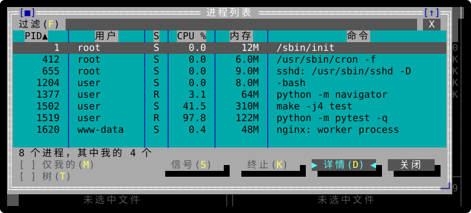
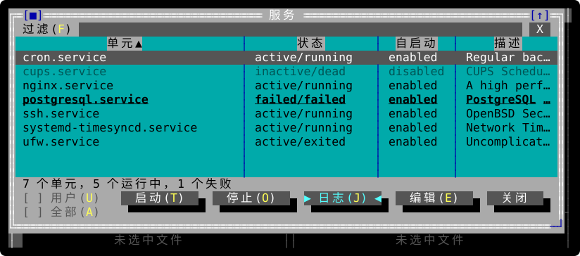
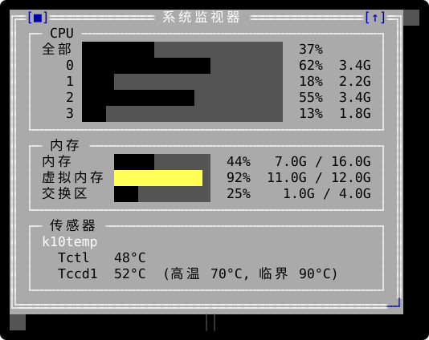
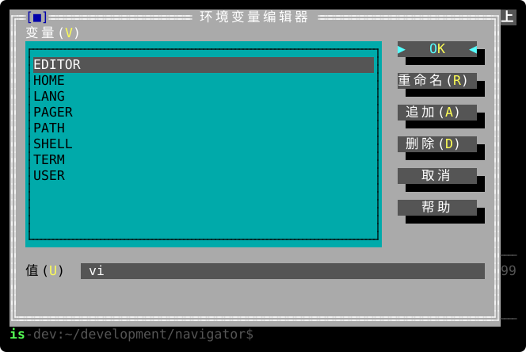
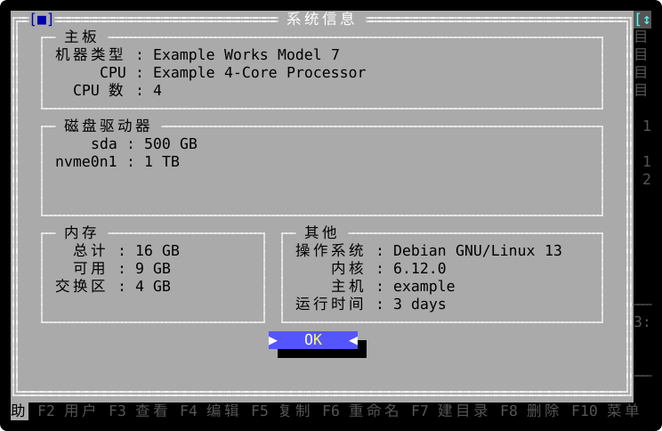
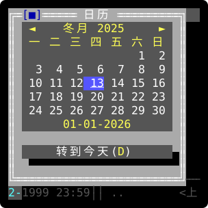
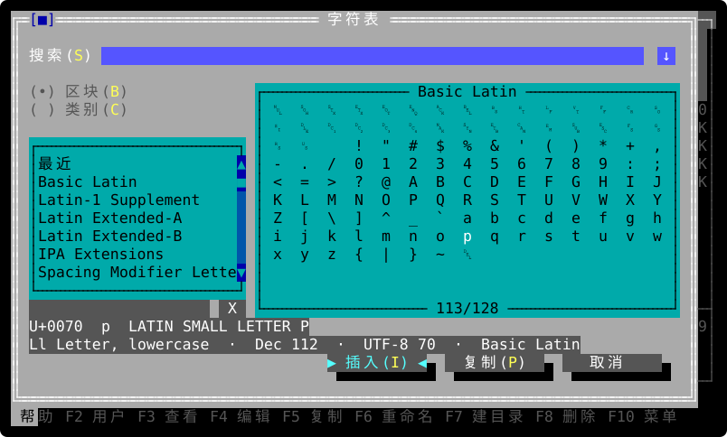

# 工具

## 进程列表

*工具 > 进程列表* 显示正在运行的进程。

| 按键 | 作用 |
|---|---|
| 直接输入、`F4` | 过滤列表，只显示命令、名称、用户或编号中包含该文本的进程；`Esc` 清除过滤 |
| `Ctrl+T` | 以父子进程树的形式显示进程 |
| `Ctrl+H` | 只显示你自己的进程 |
| `Ctrl+P`、`Ctrl+U`、`Ctrl+E`、`Ctrl+L`、`Ctrl+Z`、`Ctrl+N` | 按编号、用户、状态、CPU 负载、内存、命令排序 |
| `Left`、`Right` | 滚动显示过长的命令 |
| `F3` | 显示进程的详细信息 |
| `F7` | 发送所选的信号 |
| `F8`、`Del` | 询问后结束进程 |
| `Ctrl+R` | 重新读取列表 |

单击列标题按该列排序。信号因权限不足被拒绝时，会提示以 root 身份发送。

## 服务

*工具 > 服务* 通过 systemd、OpenRC、runit 或 SysVinit 列出并控制系统的服务。

| 按键 | 作用 |
|---|---|
| `Enter` | 显示服务的详细信息 |
| `F3` | 显示其日志并持续跟踪 |
| `F4` | 编辑其配置 |
| `F5`、`F6`、`F7` | 启动、重启、重新加载 |
| `F8`、`Del` | 询问后停止 |
| `Ctrl+E`、`Ctrl+D` | 启用、禁用开机启动 |
| `Ctrl+U` | 显示你自己的服务 |
| `Ctrl+A` | 显示所有类型的单元 |
| `Ctrl+S` | 过滤列表 |
| `Ctrl+R` | 重新读取列表 |

更改系统服务通常需要 root 权限，届时会提示你获取。

## 系统监视器

*工具 > 系统监视器* 显示每个处理器的负载、内存和交换空间的使用情况，以及机器报告的温度和风扇转速。

## 编辑环境变量

*工具 > 编辑环境变量* 显示从 Navigator 启动的程序所获得的环境变量，并允许修改它们。

- *变量* 列出名称。光标下变量的值显示在 *值* 行中，可以在那里编辑。
- *重命名* 给变量换一个名称。
- *追加* 添加一个新变量。
- *删除* 删除光标下的变量。
- *OK* 保留更改；*取消* 放弃所有更改。

更改会作用于此后 Navigator 启动的程序：外部查看器和编辑器、用户菜单的命令，以及控制台中的 shell。更改一直有效，直到退出 Navigator。

## 系统信息

*工具 > 系统信息* 显示机器的配置：*主板* 和处理器、*磁盘驱动器*、*内存*，以及 *其他* 下的系统、内核、主机名和已运行时间。

## 日历

*工具 > 日历* 显示一个月，并标出今天。在各周下方，光标所在的日期按[国家/地区](settings.md#区域)设置中的日期格式完整写出。

| 按键 | 作用 |
|---|---|
| 方向键 | 逐日移动 |
| `PgUp`、`PgDn` | 上一个月、下一个月 |
| `Ctrl+PgUp`、`Ctrl+PgDn` | 上一年、下一年 |
| `M`、`Y` | 从列表中选择月份或年份 |
| `T` | 转到今天；也就是 *转到今天* 按钮 |
| `C` | 在另一种历法和公历之间切换 |
| `Esc` | 关闭日历 |

*日历* 菜单有相同的命令，另外还有两个。*历法* 以另一种历法显示该月，例如希伯来历、伊斯兰历或波斯历。*历法显示* 决定在公历月份旁显示它的哪些内容：只显示它的月份；在公历月份下写出按它表示的日期；显示它的月份并在下面写出公历日期；或者两个月份并排显示。

## 字符表

`Ctrl+B`，即 *工具 > 字符表*，查找一个字符并在光标处输入它。

- *搜索* 按名称查找字符，例如 `arrow` 或 `euro`。
- 左侧列表选择一组字符，其下方的输入行按名称筛选这些组。
- 右侧网格显示该组。光标下的字符在底部给出说明。
- *插入* 输入该字符，*复制* 把它放到剪贴板。

在设置为纯 ASCII 字符的终端上，该表就是 DOS Navigator 的 *ASCII 表*：256 个字符，并以十进制和十六进制显示光标下字符的编码。

## SmartPad

`Alt+Q`，即 `≡` 菜单中的 *SmartPad*，打开一个跨会话保留的记事本。每次打开时，它会在末尾添加一行日期和时间，并把光标放在其下方，因此记事本读起来就像一份日志。它是一个[编辑器](editor.md)窗口，关闭时自动保存。

## 系统菜单

菜单栏左端的 `≡` 菜单包含属于整个 Navigator 的功能。

| 菜单项 | 作用 |
|---|---|
| *关于* | 显示版本、许可证和作者 |
| *命令面板* | 通过几个字母查找任意[命令](windows.md#命令面板) |
| *刷新显示* | 重绘整个屏幕，覆盖其他程序留下的内容 |
| *屏幕休息* | 立即启动屏幕保护程序 |
| *屏幕抓取*、`Shift+Alt+Ins` | 把屏幕上的一个矩形区域复制到剪贴板 |
| *用户屏幕*、`Alt+F5` | 显示[控制台](console.md#控制台)，直到按下任意键 |
| *输出窗口*、`Ctrl+O` | 收起窗口以便在控制台中输入，再按一次恢复窗口 |
| *SmartPad*、`Alt+Q` | 打开[记事本](#smartpad) |
| *回收站 开/关* | 显示或隐藏回收站图标，把文件拖放到上面即可删除 |
| *游戏*、`Alt+F9` | 打开[游戏](game.md) |

`Alt+X` 退出 Navigator。它会先询问；在询问框中勾选 *不再询问*，或在[确认](settings.md#确认)页取消 *退出确认*，即可关闭此询问。
