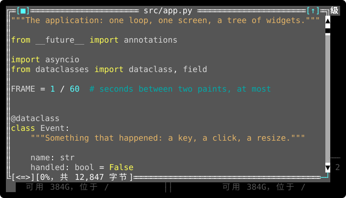
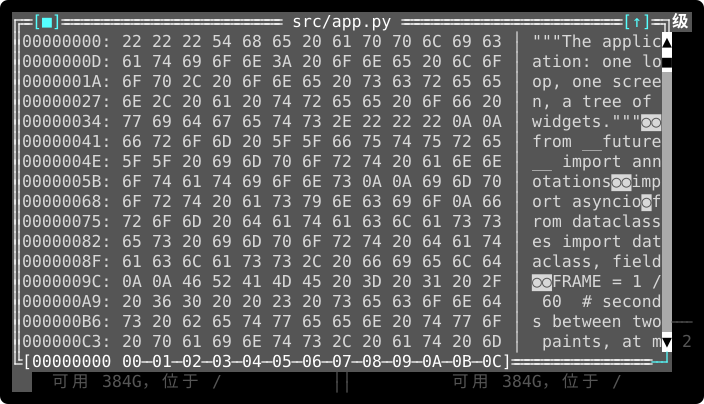
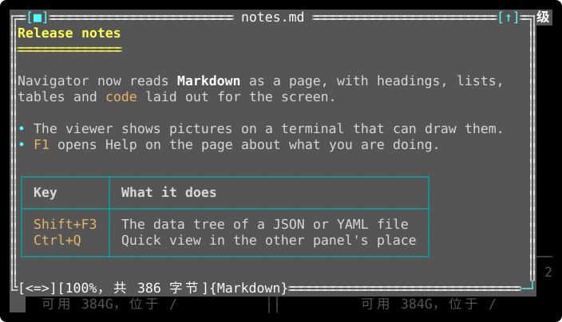
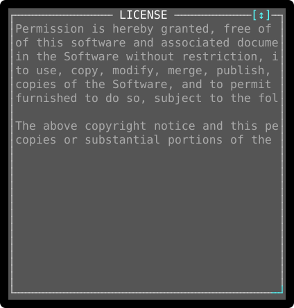
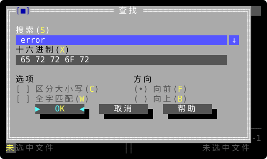
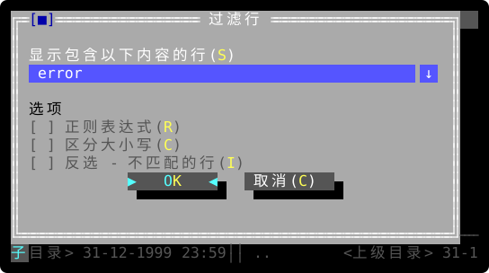
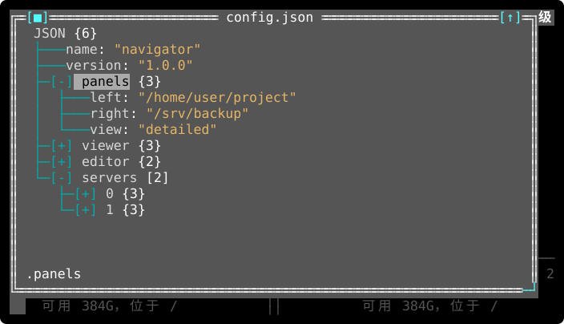
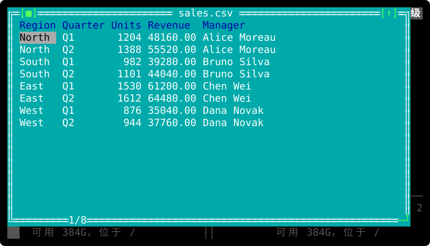

# 查看器

`F3` 显示光标所在的文件，但不修改它。无论文件多大，都会立即打开。

## 按键

| 键 | 作用 |
|---|---|
| `Up`、`Down`、`PgUp`、`PgDn` | 滚动 |
| `F2` | 折行显示长行，或取消折行 |
| `F4` | 在文本、十六进制和转储之间切换 |
| `F5` | 转到某个地址 |
| `F6` | 更改字符过滤 |
| `F7` | 搜索；`Shift+F7` 再次搜索，`Ctrl+F7` 向后搜索 |
| `Shift+F3` | 把 Markdown、HTML 等文件显示为渲染后的样子，或显示其源码 |
| `Shift+F4` | 编辑该文件 |
| `Shift+F5` | 以另一个名称保存该文件 |
| `Shift+F6` | 选择读取文本所用的编码 |
| `Ctrl+T` | 跟随正在增长的文件末尾 |
| `Ctrl+G` | 只显示与某段文字匹配的行 |
| `Alt+PgDn` | 列出以前查看过的文件 |
| `Esc`、`F3` | 关闭查看器 |

同样的命令也在 *查看* 菜单中；查看器打开时，这个菜单位于菜单栏上。

在十六进制模式下可以修改字节：在字节上直接键入十六进制数字，或按 `Tab` 后键入字符。`Shift+F2` 把修改写入文件。

## 打开文件

| 键或菜单项 | 作用 |
|---|---|
| `F3`、*文件 > 查看 > 原样* | 按文件类型以最合适的方式查看光标所在的文件，见下文 |
| `Alt+F3`、*文件 > 查看 > 备用查看* | 在 Navigator 的查看器中查看，从不显示为表格、压缩包，也不使用 `viewers.ini` 中的程序 |
| *文件 > 查看 > 作为文本*、*作为十六进制* | 以文本模式或十六进制模式打开查看器 |
| *文件 > 查看 > 作为数据库* | 把 dBase 或 SQLite 文件作为[表格](#表格)打开，不论文件名如何 |
| *文件 > 查看 > 作为电子表格* | 把 CSV 或 TSV 文件作为表格打开 |
| *文件 > 查看 > 打开...* | 在[文件对话框](dialogs.md#选择文件)中选择一个文件来查看，不需要文件管理器 |
| `Alt+PgDn` | 从以前查看过的文件列表中选一个来查看 |

`F3` 会把 dBase、SQLite 或 CSV 文件作为表格打开，并像 `Enter` 一样进入压缩包内部。否则，如果 `viewers.ini` 为该文件指定了程序，就由那个程序显示（[文件关联](user-menu.md#文件关联)）；不然由 Navigator 的查看器显示。如果在设置的[系统](settings.md#系统)页上取消勾选 *内部查看器*，`F3` 会运行 `viewers.ini` 中的程序，没有则运行 `$PAGER`。

在目录上按 `F3` 会统计其中所有内容的大小。

## 特殊显示

有些文件不按其文本显示，而以其他形式显示。`Shift+F3` 或 *查看 > 标记语言视图* 在这种形式和文件本身的文本之间切换；底部边框上的标记（如 `{Markdown}`）在你查看文本时会带删除线，点击它也能切换。

- **Markdown、reStructuredText 和 HTML** 显示为页面：标题、列表、表格、引用和代码块都会排好版，段落按窗口宽度重排。你的终端也许能打开页面上的链接。用 `F7` 搜索时，搜索的是文件本身的文本，并在页面上显示找到的位置。
- **PDF** 逐页显示为文本。其中的图片会略去；由于 PDF 的文本在文件内部是压缩存放的，`F7` 找不到 PDF 中的文字。
- **图片** 在能够绘图的终端上通过 kitty 的图形协议或 sixel 画成图片。大多数图片格式需要 Python 包 Pillow（`pip install navigator-fm[images]`）；没有它，只有 kitty 上的 PNG 能画出来。其他情况下显示图片的字节。当询问终端出错时，可用[命令行](command-line.md#颜色和字符)上的 `--graphics` 指明终端的能力。
- **JSON、YAML、TOML、XML 和属性列表** 以文本打开，`Shift+F3` 把它们显示为[数据树](#数据树)。
- **dBase、SQLite 和 CSV 文件** 在单独的窗口中作为记录[表格](#表格)打开。

大于 4 MB 的文件，或大于 64 MB 的 PDF 或图片，按文本显示。[查看器类型](settings.md#查看器类型)设置规定哪些类型特殊显示，以及按哪些文件掩码识别。

## 快速查看

`Ctrl+Q` 在另一个面板的位置上显示光标所在的文件，并随光标移动而更新。`Tab` 把键盘焦点移到查看区域中，在那里可以使用查看器的按键。

## 搜索

`F7` 在文件中搜索。`Shift+F7` 再次搜索，`Ctrl+F7` 向后搜索。

- *搜索* 是要查找的文本。*十六进制* 是用十六进制数字写成字节的同一搜索内容；按要找的内容，在哪一行输入都可以。
- *区分大小写* 区分大写和小写字母。
- *全字匹配* 跳过作为更长单词一部分出现的文本。
- *方向*：*向前* 朝文件末尾，*向上* 朝文件开头。

搜索大文件时会显示进度，*停止*、`Esc` 或 `Enter` 可以结束搜索。

## 转到地址

在十六进制模式下按 `F5` 会要求输入 *地址*，即用十六进制写的文件位置，然后从那里开始显示文件。

## 过滤行

`Ctrl+G` 或 *查看 > 过滤行* 只显示包含某段文字的行。

- *正则表达式* 把文本当作正则表达式。
- *区分大小写* 区分大写和小写字母。
- *反选 - 不匹配的行* 显示不包含该文字的行。

## 数据树

在 JSON、YAML、TOML、XML 或属性列表文件上按 `Shift+F3`，会把其数据显示为树，再按一次 `Shift+F3` 回到文本。底部一行是光标所在节点的路径。

| 键 | 作用 |
|---|---|
| `F7` | 搜索键和值；`Shift+F7` 再次搜索 |
| `Ctrl+S` | 边键入边查找键 |
| `Ctrl+Ins` | 把节点的路径复制到剪贴板 |
| `Ctrl+Shift+C` | 把节点的值复制到剪贴板 |
| `Shift+F4` | 编辑该文件 |
| `Esc` | 关闭窗口 |

*数据* 菜单中有同样的命令，还有 *全部展开*。

## 在表格中搜索

在表格中按 `F7` 会在记录中搜索一段文字。`Shift+F7` 重复搜索。

- *搜索文本* 是要查找的文字。
- *区分大小写* 区分大写和小写字母。
- *范围*：*在光标字段中* 只在光标所在的列中查找，*所有字段* 在每一列中查找。
- *方向*：*向前* 从光标朝最后一条记录，*向上* 朝第一条记录，*整个范围* 从第一条记录开始。

## 表格

dBase、SQLite 或 CSV 文件作为记录表格打开。

- `F2` 显示表格的结构：它的字段及其类型。
- 在备注字段上按 `F3` 会在一个框中显示备注的文本，其中可以使用查看器的按键。
- 在 SQLite 文件上按 `F6` 会要求输入查询。只运行读取数据的查询；文件永远不会被修改。
- 在 CSV 或 TSV 文件上按 `Shift+F6` 设置如何把它切分成单元格：*分隔符*（*逗号*、*分号*、*制表符*、*竖线*，或 *其他* 并在旁边键入字符）、*首行为标题*，以及 *编码*。
