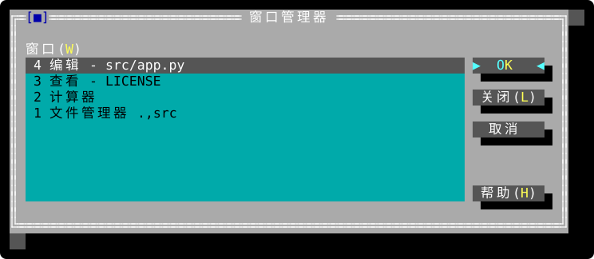
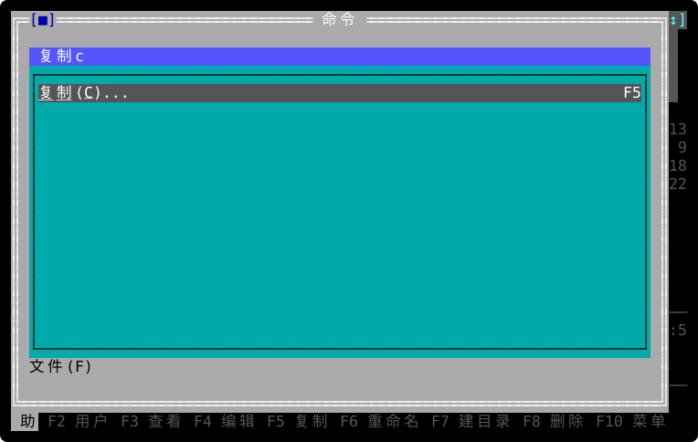

# 窗口

文件管理器、查看器、编辑器和各种工具都在桌面上各自的窗口中打开。*窗口* 菜单用于排列它们。

## 使用窗口

| 按键 | 作用 |
|---|---|
| `F9` | 转到下一个窗口 |
| `Shift+F9` | 转到上一个窗口 |
| `Alt+0` | 列出窗口 |
| `Alt+Z` | 把窗口最大化到整个桌面，再按一次还原 |
| `Ctrl+F5` | 用方向键移动窗口，或用 `Shift` 加方向键调整大小；`Enter` 保留，`Esc` 还原 |
| `Ctrl+F4` | 关闭窗口 |

*窗口 > 平铺* 和 *层叠* 一次排列所有窗口，*全部关闭* 关闭所有窗口。使用鼠标时，拖动窗口的上边框可移动它，拖动右下角可调整大小，单击窗口可把它调到前面。

每个窗口都有一个编号，显示在窗口列表中。

## 同一文本的两个视图

*窗口 > 新视图*，或 *编辑器 > 文件 > 新视图*，为最前面的编辑器中的文本打开第二个窗口。两个窗口显示同一文本：在一个窗口中输入的内容会出现在另一个窗口中，它们共用一个撤消历史和一次保存。每个窗口都有自己的光标、滚动位置和块，因此可以同时在长文件的两处工作。

## 后台操作

复制、移动或删除可以通过其进度框中的 *后台* 转入后台。此后菜单栏上的百分比显示其进度，`?` 表示它在等待回答。*窗口 > 后台操作*，或单击该百分比，会重新调出进度框；有多个操作正在运行时，会先列出它们，最早的在前，光标位于正在等待回答的那个上。

## 保存桌面

*选项 > 保存桌面* 保存当前打开的窗口：每个文件管理器及其面板的目录、视图和排序，每个编辑器所编辑的文件和位置，每个查看器所查看的文件和位置，每个表格所在的记录，目录树窗口、卷窗口、计算器、日历，以及每个窗口的位置。*选项 > 加载桌面* 关闭当前打开的窗口并恢复保存的窗口；活动面板保持在其当前目录，除非在设置的[启动](settings.md#启动)页勾选了 *保留目录*。在该页勾选 *自动保存桌面* 后，退出时会保存桌面，下次启动时恢复；在[命令行](command-line.md)上给出的目录优先于保存的目录。

## 窗口列表

`Alt+0`，即 *窗口 > 列表*，列出打开的窗口，最前面的窗口排在第一。

- *OK* 或 `Enter` 转到光标下的窗口。
- 按数字直接转到具有该编号的窗口。
- *关闭* 关闭光标下的窗口。列表保持打开，因此可以关闭多个窗口。
- *取消* 保持一切不变。

## 命令面板

`Alt+Shift+P`，即 `≡` 菜单中的 *命令面板*，列出在当前位置适用的所有命令：各菜单中的项目（包括活动窗口自己的菜单），以及只能用按键运行的命令。每条命令都显示其按键，当前无法运行的命令显示为灰色。

按顺序输入命令中的几个字母即可缩小列表范围。`Enter` 运行光标下的命令，`Esc` 关闭列表。
